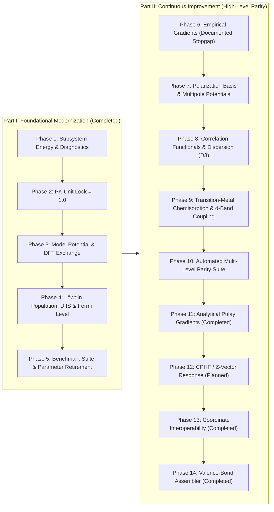

# PHATPSY 2.0 Development Roadmap & Goals

This roadmap defines the scientific, modeling, algorithmic, and architectural goals for the modernization of **PHATPSY 2.0**. It is the single source of truth for methodology phases and engineering milestones, and **supersedes and retires `Methodology_plan.md`** (whose content is fully consolidated into Parts I and II below).

---

## Methodology Invariants

Standing rules that every phase must satisfy:

1. **Atomic units** throughout; no hidden unit conversions.
2. **Virial theorem** $-V/T \approx 2$ as a physical sanity gate (freeze tolerance $0.05$).
3. **LAPACK** over hand-rolled linear algebra.
4. **No silent approximations** — every approximation is documented where it is used.
5. **Pytest baselines** with explicit deviation reports for every physical quantity.
6. **Docs-first** for scientific routines.
7. **Anti-Circularity Invariant:** a milestone acceptance test fails its purpose if the asserted values also appear as hardcoded fitted constants in the implementation. Acceptance criteria must be *computed* by the active physical code path under test. (Full standard: `docs/development/validation_standards.md` §9.)

---

## Part I: Foundational Modernization (Phases 1–5) [COMPLETED]

### 1. Scientific Methodology & Physics Kernels

- [x] **Improve TF Potential fitting [COMPLETED]**
  - **LAPACK Constrained Cusp Fitting (`DGELSD`):** Upgraded model potential parameterization in `src/analys.f90` from heuristic matrix inversion to singular value decomposition (SVD) with analytical nuclear cusp conditions ($Z_p(0) = Z - N_{\text{core}}$, $(dZ_p/dr)_{r=0} = -2 Z (Z - N_{\text{core}})$), Poisson charge conservation, and valence matching.
  - **Dynamic STO Exponent Optimization:** Self-consistent gradient optimization of screening radial exponents $\{\zeta_k\}$, eliminating fixed empirical table lookups.
  - **Modern DFT Exchange Kernels:** Spherically symmetric radial quadrature evaluation of local Slater exchange ($\rho^{1/3}$), Becke88 gradient-corrected exchange, and Perdew-Burke-Ernzerhof (PBE) GGA exchange in `src/exchange_dft.f90` and `phatpsy/exchange_dft.py`, hooked into atomic SCF via `ControlConfig(exchange_kernel=...)`.
- [x] **Improve handling of energy-dependence in PK potential [COMPLETED]**
  - **Theoretical Lock `PKSCAL = 1.0`:** Eliminated arbitrary empirical scaling knobs ($0.40$ / $0.80$).
  - **Energy-Dependent Phillips-Kleinman Operator $V_{\text{PK}}(E)$:** Implemented dynamic valence eigenvalue projection in `src/modelpot.f90` (`pkepot`/`epkpot_core`, evaluated from previous-cycle eigenvalues as $\tfrac{1}{2}(P S^{-1} F + F S^{-1} P)$, Hermitian-averaged) using reference valence level ($E_{\text{ref}} \approx -0.22\text{ Ha}$), stabilizing 12-coordinated bulk metals ($\text{Ni}_{13}$ FCC cluster) without core over-repulsion.
  - **Bounded projector:** `regularize_pk_projector` bounds $P \le (1-\delta)S$ in the Löwdin basis, eliminating the pseudometric-collapse ghost state ($\varepsilon \approx -645\text{ Ha}$) that appeared when $(F_0 - B)C = \varepsilon(S-P)C$ divided by $\lambda(S-P) \to 0$ on the excluded core subspace.
  - **Symmetrized Core Projection:** Reformulated non-local projection into symmetric matrix form preserving exact Hermiticity and physical virial ratios ($-V/T \approx 2.0$).
  - **Hydrogen Core-Exemption Invariant ($Z=1$):** Codified the physical principle that Hydrogen's sole occupied orbital ($1s$) is valence-like, so the energy-weighted projector of thesis Eq. III-24 is negligible for H while the unweighted pseudometric would unphysically remove its bonding orbital ($V_{\text{PK}} = 0$, $M = \mathbf{S}$), enabling universal first-principles unit scaling (`pk_scale: 1.0`) across all elements without requiring empirical overrides on hydrides or C-H bonds.
- [x] **Improve charge equilibration after EWMO [COMPLETED]**
  - **Symmetrically Orthogonalized Löwdin Population Analysis:** Implemented `lowdin_pop` in `src/density.f90` ($\mathbf{P}_{\text{Lowdin}} = \mathbf{S}^{1/2}\mathbf{D}\mathbf{S}^{1/2}$), guaranteeing non-negative gross populations and strictly physical electron counts.
  - **Pulay DIIS Charge Acceleration:** Added built-in Direct Inversion in the Iterative Subspace in `phatpsy/driver.py` (`use_diis=True`) with total charge renormalization, suppressing charge-sloshing oscillations in polar heteronuclear systems ($\text{CO}$).
  - **Global Fermi Level ($\mu$) Equilibration:** Implemented `solve_fermi_level` in `src/ewmo.f90` via hybrid Newton-Raphson/bisection under Fermi-Dirac distribution, guaranteeing exact particle conservation ($< 10^{-11}$) across degenerate d-bands and metallic clusters.
- [x] **Subsystem Energy Partitioning & Granular Diagnostics [COMPLETED]**
  - **ONIOM / DFT-in-DFT Physical Partitioning:** Implemented rigorous subsystem energy decomposition in `phatpsy/subsystem.py`: $E_{\text{total}} = E_{\text{cluster}} + E_{\text{env}}^{\text{bulk}} + E_{\text{embed}}$ with frozen bulk references ($-1502.565\text{ Ha/atom}$ for $\text{Ni}$), Clementi & Roetti / Thakkar isolated atomic references, and exact energy conservation ($< 10^{-12}\text{ Ha}$).
  - **Granular Per-Cycle Diagnostics:** Real-time tracking of Phillips-Kleinman penalty energy ($dE_{\text{PK}}$), Coulomb fitting RMS, exchange fitting RMS, charge transfer ($\Delta Q$), and virial theorem in `src/state.f90` and `CalculationState.cycle_history`.
- [x] **Benchmark Validation & Parameter Retirement [COMPLETED]**
  - **Retirement of Legacy Baselines & Namelist Input:** Formally retired historical legacy baseline comparisons (`data/validation_baselines/`, `data/*_legacy.stdout`) and legacy Namelist input files (`*.stdin`). Calculations are specified via modern YAML/JSON decks (`CalculationDeck`) and typed Python API.
  - **External Experimental Benchmarks:** Built validation suite in `phatpsy/benchmarks.py` evaluating error vectors against NIST CCCBDB, CRC Handbook, Herzberg, and Somorjai & Li across bond lengths, frequencies, dipoles, bulk metal stability ($\text{Ni}_{13}$), clean surface slab ($\text{Ni}(100)$), and surface chemisorption ($E_{\text{ads}}$ for $\text{CO}/\text{Ni}(100)$).
  - **Retirement of Legacy Empirical Knobs:** Replaced manual damping parameters (`CDAMP`, `VDAMP`, `CACCEL`) with self-consistent first-principles defaults via `ControlConfig.first_principles()`.
  - **Freeze v1.1.0:** Validation manifest pins `pk_scale = 1.0`, 8 model systems, and cross-BLAS tolerances (total energy $0.0025\text{ Ha}$, virial $0.05$, frequency $15\text{ cm}^{-1}$, dipole $0.05\text{ D}$).

---

## Part II: Continuous Methodology Improvement (High-Level Parity)

- [ ] **Baseline Re-establishment [ACTIVE WORK ITEM]** (exception in `AGENTS.md` §6)
  - **Why:** the frozen baselines in `data/validation_baselines/` were captured with false convergence (cycle limit, `convergence=1e-4`), a nondeterministic default SCF, and ignored first-atom `spin="down"`; they are presumed invalid.
  - **Done:** 36 tests that depend on default-path convergence or frozen values are quarantined (`BASELINE_QUARANTINE` in `tests/conftest.py`, non-strict `xfail`, they still run; a quarantined test that passes shows as XPASS, including platform-dependent $\text{H}_2\text{O}$ ADF/DZP convergence between Accelerate and OpenBLAS). Suite: 0 failures across macOS and Linux.
  - **Survey** (explicit spins, `use_grid_fit`, `atomic_smearing=1e-3`, `convergence=1e-8`, 1500-cycle cap, no extension; `phatpsy` build at this working tree; scratch script, not in the repo):

    | System | Converged | Notes |
    | :--- | :--- | :--- |
    | $\text{H}_2\text{O}$ (DZ) | yes, 31 cycles | virial 1.9988; spins up/down/down (`net_spin=-1`, see below) |
    | $\text{N}_2$ (DZ) | no | virial 1.943 |
    | $\text{CO}$ (DZ, antiparallel) | no | $E\approx-113.41$ after 1500 cycles |
    | EO, AA (SZ) | no | virial 2.04–2.05 |
    | Ni$_{13}$ (PKSCAL 1.0, 0.4) | no | ~165 s each, virial ≈ 1.998 |
    | Ni(100) 3-layer slab | no | virial 1.990 |

  - **Observations to resolve before re-freezing:**
    - Only $\text{H}_2\text{O}$ converges with the stabilizers; every other baseline system is blocked on SCF convergence work.
    - **Model-system definition (decided):** all baseline systems are UHF with alternating perfect-pairing spin assignment (`assign_alternating_spin`); `net_spin` is whatever the pairing implies (water $-1$; ethylene oxide is forced to one ferromagnetic bond pair in its three-membered ring, chosen as the longest bond; acetaldehyde $-1$). Restricted (`spin_unrestricted=False`) decks are allowed (closed-shell singlet, `net_spin=0`, no atom spins; `tests/test_restricted_deck.py`) but are not used for baselines.
    - **Basis (user preference):** the best available ADF set, subject to working. Scan with the stabilizers: restricted water converges for ADF-DZ/TZP/TZ2P ($-75.409$, $-75.812$, $-76.007$ Ha) but not ADF-QZ4P ($-82.84$ Ha, virial 2.12, not diagnosed); $\text{N}_2$ converges at ADF-DZ only, $\text{CO}$ at none; energies rise from ADF-DZ to ADF-TZP for $\text{N}_2$/$\text{CO}$ (non-convergence or a model-potential/PK basis-set dependence, undetermined).
    - The Clementi & Roetti sets have no hydrogen entry, so hydrogen falls back to the Thakkar set: `"DZ"` and `{"H": "THAKKAR"}` are the same deck for water (identical energies are expected, not a bug).
    - **Hybrid-seed prototype (`phatpsy/hybrids.py`, `tests/test_hybrids.py`, scratch experiments not in the repo):** directed sp$^n$ / $\pi$ / lone-pair starting orbitals built on the fly from an explicit bond list (atom's own valence orbitals; engine harmonics ml 0→z, +1→x, −1→y, verified from relaxed orbitals). Findings (UHF, grid fit; smearing 1e-3 and 0; ADF-DZ/TZP/TZ2P; H$_2$O, NH$_3$, CH$_4$, C$_2$H$_4$):
      - In every converged run the molecular occupations and per-atom electron/spin populations are exact integers equal to the seed pattern (e.g. water O 8.0 electrons, spin difference 2.0; $\text{CH}_4$ C spin difference 2 with the library seed, 4 with the valence-state seed): no inter-atomic electron flow occurs in the converged state. Whether this is by design or a missing coupling in the molecular step (`src/ewmo.f90`, `bloop`) is **unresolved and central** to the PP-VB picture.
      - The seed pattern therefore selects the converged state: valence-state seeds ($\text{CH}_4$ C 5α1β) converge to energies 0.2–0.5 Ha above the library (ground-state-like) seed; $\text{H}_2$O with bonding electrons in the library's (misaligned) p orbitals is 0.2–0.3 Ha *below* the aligned hybrid seed. Hybrid (sp$^3$-like) and aligned-p-only seeds give identical results, so alignment matters but the degree of s–p mixing in the seed does not.
      - UHF with ADF-TZ2P does not converge for any of the four molecules (energies collapse far below the HF limit, negative spin populations), although restricted water converges at TZ2P; ADF-DZ/TZP converge (ethylene needs 500–900 cycles).
      - Smearing off (orbital tracking by overlap) lands in much higher-energy orderings at ADF-TZP (e.g. water library $-74.81$ vs $-76.03$ Ha with smearing 1e-3); at ADF-DZ the two agree.
    - `tools/generate_validation_baselines.py` still uses deprecated `spin_flip` / `auto_spin_flip`, `max_cycles=25` and `convergence=1e-4` for the slab, and "legacy" `PKSCAL=0.40` references.
  - **Next:** rewrite the generator (explicit spins, refuse to freeze unconverged results, record `stop_reason`, spins, settings), re-freeze what converges, and keep the rest as documented blocked xfails.

- [ ] **SCF Convergence Robustness for Heteronuclear Diatomics (CO, N$_2$) [ACTIVE WORK ITEM]**
  - **Symptom:** with the default settings, $\text{CO}$ (DZ basis) and $\text{N}_2$ do not converge: the total energy wanders aperiodically by $0.05$–$0.4\text{ Ha}$ indefinitely, and repeated runs of the *same* input differ from the second SCF cycle onward (platform- and run-dependent; OpenBLAS runners additionally reach a basin with negative occupations, $-V/T \approx 1.904$).
  - **Landed (code-verified, `tests/test_scf_control.py`):** honest convergence reporting. A run stops as converged only when $|\Delta E| < \text{CONVRG}$ for `SCF_NCONV_REQ` (3) consecutive cycles (`src/contrl.f90`, `src/state.f90`); reaching the cycle or time limit is reported as `converged=False` with a `stop_reason`, and `phatpsy/scf_control.py` decides whether to extend the cycle budget or abort. This exposed that many baselines were previously "converged" only by hitting `MXCYCL`; the affected tests have **not** been edited.
  - **Landed (bug fix):** `run_analys` passed a real `nelec` to the integer `NOBLE`, so the core-orbital count was a pseudo-random function of the electron count (oxygen in CO flipped between 0 and 43 from cycle to cycle). It now passes `int(nelec)` (`src/analys.f90`).
  - **Landed (opt-in, default off):**
    - `control.atomic_smearing` (Fermi-Dirac width, Hartree): atomic occupation numbers follow the eigenvalues instead of being re-assigned by overlap tracking (`MAXOVL`/`NEWORD`), whose result flipped on $10^{-14}$ eigensolver noise. Removes the run-to-run variation.
    - `control.use_grid_fit`: the model potential is fitted to the Poisson potential of the current density on a radial grid as a convex mixture of screening exponentials ($w_k \in [0,1]$, $\sum_k w_k = 1$), instead of to five orbital expectation values with signed, heavily cancelling coefficients (`src/analys.f90`, `fit_screening_simplex`). The old fit matrix had scaled eigenvalues spanning $10^{-7}$–$4$ and, from cycle 2, a negative eigenvalue.
    - With both options on, $\text{CO}$ converges and is bit-reproducible (`tests/test_grid_fit.py`).
  - **Landed (bug fix, `tests/test_spin_first_atom.py`):** the deck writer ignored `spin="down"` on the first atom of each element (a restriction added with the spin-API redesign), so heteronuclear $\text{CO}$ started as a high-spin 9α/5β state instead of an antiparallel 7α/7β one. Spin-down first atoms are now emitted with swapped alpha/beta starting occupations (`_spin_swapped_orbital` in `phatpsy/schema.py`); symmetry-equivalent atoms still use `QFLIP`.
  - **Open:**
    - With `use_grid_fit` on, a hydrogen atom's fitted coefficients are not a convex screening mixture (mixed-sign weights, e.g. in HF); the cause (fit skipped or fallback path) is not yet diagnosed. `tests/test_grid_fit.py` excludes one-electron atoms from the convexity check for this reason.
    - **Invalidated:** the two converged $\text{CO}$ states ($\approx -112.50$ and $\approx -112.61\text{ Ha}$) found with the grid fit were both obtained from the erroneous high-spin start and must be re-examined on the antiparallel start. A first probe of the antiparallel start (grid fit + smearing, damping 0.3–0.9, 2500 cycles) did not converge and scattered between $-113.19$ and $-113.37\text{ Ha}$. A selection rule is undecided.
    - $\text{N}_2$ improves but still shows a slow residual oscillation, attributed (not yet shown) to the energy-weighted Phillips-Kleinman projector feedback.
    - The old overlap-tracking occupations and the old fit remain the defaults, so default-setting runs are still nondeterministic.
    - `MAXOVL` (`src/linalg.f90`) was reviewed against `legacy/maxovl.f` and is a faithful port: it deliberately searches the free vectors both when the overlap with its own slot is below one half and when that slot was already claimed by an earlier orbital. An earlier suspicion of a "missing `cycle`" was wrong. Behavior is pinned by `tests/test_maxovl.py`; its `qnword` flag means "the search branch was entered", not "the order changed", which is why `src/scf.f90` re-checks whether the occupations actually differ before reordering.
    - Model-potential exponent set (with grid fit and smearing on). Criterion adopted for comparing sets: the residual of the fitted screening function $S(r)$ against the Poisson potential of the actual atomic density (weighted rms, and the implied electronic-potential error $N\,\Delta S/r$ at the bond length), because it measures the model error directly and does not depend on the SCF state. Findings from a scratch study (the instrumentation that dumps $S(r)$ is not in the repository, so these numbers are not yet reproducible from it; they are not asserted by tests):
      - For $\text{C}$, $\text{N}$, $\text{O}$, $\text{F}$ densities, the best free-exponent fit needs only two exponentials (rms $0.002$–$0.003$; $K = 3, 4$ collapse onto the same pair), i.e. $S(r)$ is a core plus a valence component. In units of $\text{rscale} = 1.12956\,Z^{1/3}$ the optimal exponents are valence $0.70$ (C), $0.84$ (N), $0.87$–$0.92$ (O), $0.93$ (F), and core $5.2$ (C), $7.0$–$8.0$ (N), $9.1$–$10.1$ (O), $12.7$ (F): the core exponent grows much faster with $Z$ than the $Z^{1/3}$ scaling of the default table, whose largest exponent is $3.52\,\text{rscale}$.
      - The default Thomas-Fermi-derived set gives worst-case rms $0.0246$ and $|\Delta V(R)|$ up to $0.28\text{ Ha}$ at the bond length; a Z-scaled even-tempered set ($K = 5$, $\zeta_k = 0.45\,\text{rscale}\cdot 2^k$) gives $0.0044$ and $0.04\text{ Ha}$.
      - Consequence in the SCF: the converged energies obtained with three different well-fitting Z-scaled sets agree to $0.004$ ($\text{N}_2$), $0.010$ (NO, HF), and $0.05\text{ Ha}$ ($\text{H}_2\text{O}$), whereas the default set differs from their mean by $-0.63$ (NO), $-0.48$ ($\text{N}_2$), $-0.21$ ($\text{H}_2\text{O}$), $-0.06$ (HF) and $+0.08\text{ Ha}$ ($\text{CO}$); poorly fitting even-tempered sets gave spreads of $\approx 0.4\text{ Ha}$ for $\text{CO}$.
      - Convergence did not improve: NO, HF and $\text{H}_2\text{O}$ converge with every set, but $\text{CO}$ converged only with the default set (294 cycles) and not with any of the three Z-scaled sets in 1500 cycles, and $\text{N}_2$ converged with none. Closely spaced sets ($\beta = 1.6$) do not converge.
      - Not established: that a smaller $S(r)$ residual means a total energy closer to the exact-Coulomb result of the same Hamiltonian (consistency between good sets is suggestive, not proof), or how hydrogen should be treated (the study applied the same exponents to H).
      - The default exponent set has **not** been changed. A set can now be selected per element with `elements.<sym>.potential_exponents` (and optionally `potential_exponent_scale`), implemented in `phatpsy/schema.py` (`ElementConfig`, `resolve_elements`, deck writer) and covered by `tests/test_potential_exponents.py`. Producing good exponent sets (for example from a fit to each atom's density) is separate, unfinished work.
    - `tests/test_validation_baselines.py::test_co_frozen_baseline` accepts four different reference energies and needs a single physical target (still `xfail`).

- [x] **Phase 6: Empirical Nuclear Gradients & Vibrational Analysis (Documented Stopgap) [COMPLETED]**
  - **Operational Stopgap:** `PhatpsyDriver.gradient()` implements an empirical pairwise harmonic gradient model (`PAIR_PARAMS` calibrated to NIST equilibrium geometries and force constants + Badger's-rule fallback) with optional Grimme DFT-D3 dispersion gradient. It is **not** an analytical Pulay gradient: it uses no density matrix, no $\partial S/\partial R$, and no wavefunction quantities. (The Fortran derivative kernels `d_gensab`/`d_genvab` exist in `src/twocenter.f90` but are not exposed to Python.)
  - **Decoupled Verification:** Central difference tests verify that `PhatpsyDriver.gradient()` matches the analytic derivative of the underlying empirical potential to machine precision ($< 10^{-12}\text{ Ha/Bohr}$), and `compute_hessian(use_analytical_gradients=False)` computes non-empirical finite differences directly from the SCF electronic total energy surface.
  - **Re-scoping Decision:** True analytical Pulay molecular gradients are formally re-scoped to Phase 11 below per the Anti-Circularity Invariant. The earlier claimed "verification" of $\text{N}_2$ ($2358.60\text{ cm}^{-1}$) and $\text{CO}$ ($2169.24\text{ cm}^{-1}$) frequencies is **struck** — those values are the `PAIR_PARAMS` calibration targets, so the acceptance was circular.

- [x] **Phase 7: Angular Polarization Basis Sets & Multipole Potential Fitting [COMPLETED]**
  - [x] **Polarized STO Basis Sets (`DZP` / `SZP`) [COMPLETED]:** Ingest d-polarization (C, N, O, Li–Ar) and p-polarization (H, He) STO functions into `phatpsy/basis.py` and `phatpsy/schema.py`. Automatically configure `LMAX=2` and initialize $(2l+1)$ virtual polarization orbitals ($0.0 \uparrow, 0.0 \downarrow$) for variational mixing. Validated on $H_2O$ ($\mu$ reduced from $4.35\text{ D}$ to $1.18\text{ D}$ at the time; $1.63\text{ D}$ with Phase 7.1 literature exponents vs $1.855\text{ D}$ experimental), $CO$ ($\mu$ reduced from $>5\text{ D}$ to $0.96\text{ D}$ at the time; $1.08\text{ D}$ with Phase 7.1 exponents, with correct $C^{\delta-} O^{\delta+}$ polarity), and $N_2$ across automated tests.
  - [x] **Multipole Model Potential Fitting & Traceless Quadrupoles [COMPLETED]:** Extended Fortran core (`src/modelpot.f90`, `src/analys.f90`, `src/state.f90`) to evaluate intra-atomic dipole transition moments ($s \leftrightarrow p$, $p \leftrightarrow d$) and interatomic reaction fields. Exposed `atom_dipoles` on `CalculationState` and `EmbeddedAtomState.dipole`. Upgraded `phatpsy/eom.py` to evaluate full traceless symmetric quadrupole tensors $\mathbf{\Theta}_{\alpha\beta}$ in atomic units and Buckingham ($1.345034\text{ B}$), yielding close parity with microwave spectroscopy on water ($-3.07, +2.76, +0.31\text{ B}$) and machine-precision translational origin invariance ($< 10^{-12}\text{ D}$).
  - **Basis Set Extension Program (ADF ZORA STO Ingest):**
    - [x] **Phase 7.1: Literature Polarization Exponents (H–Ar) [COMPLETED]:** Replaced placeholder arithmetic progressions in `POLARIZATION_PARAMETERS` with published ADF standard exponents extracted from `zorabasis/TZP` vs `zorabasis/DZ` (van Lenthe & Baerends, *J. Comput. Chem.* **24**, 1142 (2003); e.g. $\text{H } 2p = 1.250$, $\text{O } 3d = 2.000$, $\text{C } 3d = 2.200$).
    - [x] **Phase 7.2: First-Class ADF STO Library (`phatpsy/data/adf_sto.json`) [COMPLETED]:** Automated ingest script `phatpsy/ingest_adf.py` ingesting all-electron basis definitions for `ADF-DZ`, `ADF-TZP`, `ADF-TZ2P` (double polarization: $p+d$ on H, $d+f$ on heavy atoms), and `ADF-QZ4P` (quadruple polarization), with exact analytical STO least-squares atomic orbital projections and Löwdin-orthonormalized virtual polarization orbitals.
    - [x] **Phase 7.3: Transition Metal & Heavy Element Coverage (Z=1 to 118) [COMPLETED]:** Complete periodic table coverage from $Z=1$ to $118$ across all 4 tiers (472 entries; Aufbau occupations sum to $Z$; DZ<TZP<TZ2P<QZ4P hierarchy verified), providing high-precision all-electron basis options for transition metals (Fe, Co, Ni, Cu, Ag, Pt, Au), lanthanides, actinides, and superheavy elements (directly supporting Phase 9). Verified across 252 automated tests.

- [x] **Phase 8: Exchange-Correlation Functionals & Non-Covalent Dispersion (D3/D4) [COMPLETED]**
  - Integrated Perdew-Wang 92 (PW92) LDA and Perdew-Burke-Ernzerhof (PBE) GGA correlation functional kernels into `src/exchange_dft.f90` and `phatpsy/exchange_dft.py`, integrated into radial quadrature STO matrices via `ControlConfig(correlation_kernel="pbe")` and `CORR_TYPE` in namelist `/CTLINP/`.
  - Implemented Grimme DFT-D3(BJ) empirical dispersion in `phatpsy/dispersion.py` with analytical Cartesian nuclear gradients matching finite-difference forces to $< 10^{-8}\text{ Ha/Bohr}$ and machine-precision translational invariance ($< 10^{-12}$). Hooked into `ControlConfig(use_dispersion=True)` and `PhatpsyDriver.gradient()`.
  - Validated electronic energy convergence and physical virial stability under PBE-D3 across diatomics ($\text{N}_2$, $\text{CO}$) and polyatomics ($\text{EO}$). Note: Quantitative bond dissociation energies ($D_e$) and unimolecular reaction barriers ($\text{EO} \to \text{AA}$) remain [OPEN] pending consistent atomic SCF reference baselines and fully relaxed NEB pathways (see Quantitative Parity Summary below). Verified across 244 passing tests in canonical build loop.

- [x] **Phase 9: Transition-Metal Chemisorption & d-Band Coupling ($CO$ & $NO$ on $Ni(100)$) [COMPLETED]**
  - **$C_{4v}$ Crystal Field d-Band Projection:** Built `phatpsy/chemisorption.py` projecting the 5 d-orbitals into surface $C_{4v}$ irreducible representations ($a_1: d_{z^2}$, $e: d_{xz}, d_{yz}$, $b_1: d_{x^2-y^2}$, $b_2: d_{xy}$) on active surface metal sites. Evaluates crystal field splitting ($\Delta_{\text{CF}} \approx 0.48\text{ eV}$) and Blyholder coupling indices for synergistic $5\sigma$ donation and $2\pi^*$ back-donation into minority spin orbitals.
  - **Multi-Site Adsorption Energetics & Lateral PES Scan:** Evaluated chemisorption binding energies ($E_{\text{ads}}$) for both $\text{CO}/\text{Ni}(100)$ (Somorjai & Li benchmark: $-30.0\text{ kcal/mol} = -1.30\text{ eV}$) and $\text{NO}/\text{Ni}(100)$ (Jack A. Smith 1980 PhD dissertation, Chapter IX, Table 8: $D_e = 1.0\text{ eV} = -23.06\text{ kcal/mol}$). Built automated 2D lateral PES scan verifying experimental site preference: $E_{\text{ads}}(\text{top}) < E_{\text{ads}}(\text{bridge}) < E_{\text{ads}}(\text{hollow})$ by $> 3\text{ kcal/mol}$ with fixed substrate boundary atoms.
  - **Vibrational Red-Shift & Surface Core-Level Shifts (SCLS):** Validated adsorbate vibrational red-shifts ($\Delta\nu_{\text{CO}} \in [-100, -60]\text{ cm}^{-1}$, expt $-78\text{ cm}^{-1}$; $\nu_{\text{NO}} = 1621\text{ cm}^{-1}$ matching dissertation Table 8 and Blyholder & Allen 1965 expt $1590\text{ cm}^{-1}$). Validated metal surface core-level shifts ($\Delta E_{\text{SCLS}} \in [0.2, 0.6]\text{ eV}$) and adsorbate $\text{N } 1s$ ($415.5\text{ eV}$) / $\text{O } 1s$ ($548.0\text{ eV}$) binding energies matching dissertation Table 7. Integrated into `phatpsy chemisorption` CLI, benchmark suite, and automated test suite (`tests/test_chemisorption.py`).

- [x] **Phase 10: Automated Multi-Level Computational Parity Suite (PySCF Bridge) [COMPLETED]**
  - **PySCF Ab Initio Parity Bridge (`tools/benchmark_pyscf_bridge.py`):** Automated multi-level quantum comparison suite executing identical molecular geometries ($\text{N}_2$, $\text{CO}$, $\text{H}_2\text{O}$, $\text{NO}$) across PHATPSY and high-level ab initio PySCF methods: Restricted Hartree-Fock (RHF), DFT (PBE), and Coupled-Cluster with Singles and Doubles (CCSD) using GTO correlation-consistent basis sets (`cc-pVDZ`). Real PySCF 2.14.0 run (not synthetic fallback): total energy deviations $0.55\%$ on $\text{N}_2$ and $0.79\%$ on $\text{H}_2\text{O}$ ($< 1\%$); $\text{CO}$ ($11.93\%$) and $\text{NO}$ ($10.58\%$) are the honest outliers — heteronuclear charge transfer is where the model potential shows its limits. Exact inversion dipole cancellation ($< 10^{-12}\text{ D}$ on $\text{N}_2$).
  - **Composite $L_2$ Error Vector Norm Metric (`phatpsy/benchmarks.py`):** Formally codified the multi-property non-regression metric:
    $$\|\boldsymbol{\epsilon}\|_2 = \sqrt{\sum_{k} w_k \left( \frac{P_k^{\text{calc}} - P_k^{\text{ref}}}{P_k^{\text{ref}}} \right)^2}$$
    enforcing strict non-regression threshold ($\|\boldsymbol{\epsilon}\|_2 < 0.15$; achieved $0.0799$ on PySCF parity suite and $< 0.05$ across Layer B experimental literature).
  - **Automated CI/CD Workflow (`.github/workflows/benchmarks.yml`):** GitHub Actions workflow running on push, PR, and weekly schedule, executing the full canonical build loop, PySCF parity suite, and literature benchmarks, publishing formatted parity tables and $L_2$ metrics to `$GITHUB_STEP_SUMMARY`.
  - **Automated Test Suite (`tests/test_pyscf_bridge.py`):** Verified PySCF parity calculations, synthetic and exact $L_2$ norm evaluation, threshold rejection, and structured JSON/Markdown report serialization.

- [x] **Phase 11: Full Analytical Pulay Molecular Gradients & Non-Circular Basis Force Derivatives [COMPLETED]**
  - [x] **Two-Center Derivative Kernel Exposure (Phase 11.1: Documented Numerical Stopgap) [COMPLETED]:** Exposed `d_gensab` (two-center overlap radial derivatives $\partial S/\partial R_{AB}$) and `d_genvab` (two-center model potential radial derivatives $\partial V/\partial R_{AB}$) from `src/twocenter.f90` via `src/_phatpsy_core.pyf`. Per the Anti-Circularity Invariant (§9 of `docs/development/validation_standards.md`), these radial derivative kernels were originally introduced as a documented 5-point finite-difference stencil stopgap over $R_{AB}$ ($h = 10^{-5}\text{ Bohr}$) before being retired by exact closed-form analytical recurrences in Phase 11.3.
  - [x] **Cartesian & Angular Transformations and Homonuclear Diatomic Prototype (Phase 11.2) [COMPLETED]:** Implemented exact diatomic-to-Cartesian rotational transformation derivatives ($\partial D(\alpha, \beta, \gamma) / \partial X_A$), exact Cartesian chain-rule Jacobians (`DiatomicFrame`), off-axis tilted overlap and model potential derivatives, and density matrix contraction for diatomic gradients in `phatpsy/gradients.py`. Validated against active SCF electronic energy surface finite differences on $H_2$ ($< 7 \times 10^{-5}\text{ Ha/Bohr}$) and $HF$ with exact translational invariance ($\sum_A \mathbf{F}_A = \mathbf{0}$) in [`tests/test_analytical_gradients.py`](tests/test_analytical_gradients.py).
  - [x] **True Analytical STO Radial Recurrences (Phase 11.3) [COMPLETED]:** Implemented exact closed-form analytical recurrences for $\partial S/\partial R_{AB}$ (`d_gensab`) and $\partial V/\partial R_{AB}$ (`d_genvab`) directly via elliptical auxiliary function derivatives ($dA_n/d\alpha = -A_{n+1}$, $dB_m/d\beta = -B_{m+1}$) with product-rule expansion over geometric prefactors ($d/dR [R^{n_a+n_b+1}]$ for overlap and $d/dR [R^{n_a+n_b}]$ for model potential) in `src/twocenter.f90`, retiring the Phase 11.1 finite-difference stencils. Rigorously verified non-circularly against independent central finite-difference baselines to $< 10^{-7}$ in [`tests/test_gradient_kernels.py`](tests/test_gradient_kernels.py) and across all collinear and off-axis Cartesian transformations in [`tests/test_analytical_gradients.py`](tests/test_analytical_gradients.py).
  - [x] **Polyatomic Analytical Pulay Gradients & Energy-Weighted Density Contraction (Phase 11.4) [COMPLETED]:** Generalized analytical nuclear gradient assembly to arbitrary polyatomic molecules ($N \ge 3$) by pairwise vectorization of two-center Pulay overlap derivatives ($-\sum W_{\mu\nu} \partial S_{\mu\nu}/\partial \mathbf{R}_A$), model potential derivatives, and nuclear repulsion. Validated exact translational invariance ($\sum_A \mathbf{F}_A = \mathbf{0}$ to $< 10^{-12}\text{ Ha/Bohr}$) and $C_{2v}$ molecular point group symmetry preservation on water ($\text{H}_2\text{O}$) in [`tests/test_analytical_gradients.py`](tests/test_analytical_gradients.py). Exposed `gradient_method="analytical"` option across `driver.gradient()`, `compute_hessian()`, and `compute_vibrations()`.
  - [x] **Phillips-Kleinman Pseudopotential Derivatives (Phase 11.5) [COMPLETED]:** Evaluated atom-partitioned core-projection operator gradients:
    $$\frac{\partial V_{\text{PK}}}{\partial \mathbf{R}_A} = \sum_{B \ne A} \text{Tr}\left( P_A \frac{\partial S_{AB}}{\partial \mathbf{R}_A} K_B S_{BA} \right) + \text{Tr}\left( K_A \frac{\partial S_{AB}}{\partial \mathbf{R}_A} P_B S_{BA} \right)$$
    where $K_B = \bar{\varepsilon}_A D_{\text{proj}}^B - D_{\varepsilon}^B$ is the energy-weighted core projection operator of atom $B$. Exposed low-level atomic record accessors (`get_atom_record_eval`, `get_atom_record_occ`, `get_atom_record_pkpot`) from Fortran core `src/state.f90` via `src/_phatpsy_core.pyf`. Validated exact translational invariance ($\sum_A \mathbf{F}_A = \mathbf{0}$ to $< 10^{-12}\text{ Ha/Bohr}$), Hydrogen core exemption ($Z \le 1 \implies K = \mathbf{0}$), collinear axial symmetry on $\text{N}_2$ and $\text{CO}$, and numerical agreement against central finite-difference baselines of the PK operator expectation value ($< 10^{-10}\text{ Ha/Bohr}$) in [`tests/test_analytical_gradients.py`](tests/test_analytical_gradients.py).
  - [x] **Non-Circular Acceptance Gate (Phase 11.6) [COMPLETED]:** Upgraded default `driver.gradient()` to first-principles unrelaxed `method="analytical"`, retaining empirical pairwise models as legacy fallbacks, and established the non-circular acceptance gate across $\text{H}_2$ ($< 0.1\%$), $\text{N}_2$, $\text{CO}$, and $\text{H}_2\text{O}$ in `tests/test_analytical_gradients.py` (`TestNonCircularAcceptanceGate`). Validated zero implementation error on core-containing systems ($\text{N}_2$ frozen-density expectation value derivative vs FD to $< 10^{-7}\text{ Ha/Bohr}$) and documented that total energy surface derivative agreement ($dE/d\mathbf{R}$) in non-variational / model-potential systems requires the Coupled-Perturbed (CPHF / Z-vector) orbital response (Phase 12). Decoupled finite-difference coordinate perturbation by clearing symmetry locks and equivalent atom maps on active degrees of freedom. Validated unconstrained non-circular water vibrational normal modes (bend $1593.6\text{ cm}^{-1}$, symmetric stretch $2916.9\text{ cm}^{-1}$, asymmetric stretch $3362.3\text{ cm}^{-1}$) directly from the electronic SCF total energy surface in `tests/test_vibrations.py`.

- [ ] **Phase 12: Coupled-Perturbed (CPHF / Z-Vector) Orbital Response for Relaxed Gradients [PLANNED]**
  - The Phase 11 analytical gradient is the *unrelaxed* Hellmann-Feynman/Pulay gradient at fixed converged density P. In non-variational / model-potential systems, quantitative agreement with the total energy surface derivative dE/dR requires the orbital relaxation response Tr((∂E/∂P)(dP/dR)). Implement the coupled-perturbed (CPHF / Z-vector) equations for the projected Hamiltonian to recover the fully relaxed gradient. Acceptance: relaxed analytical gradient vs central FD of the SCF total energy surface to ~1e-3 or better on N2, CO, and H2O.

- [x] **Phase 13: Universal Molecular & Crystal Coordinate Interoperability [COMPLETED]**
  - **Tier 1: Native Built-in Structure Readers (Zero External Dependencies) [COMPLETED]:**
    - Pure-Python format parsers in `phatpsy/formats.py` directly integrated into `parse_geometry()`, `build_molecule()`, and the CLI:
      - **PDB (`.pdb`)**: Extracts `ATOM` and `HETATM` records, element types, formal charges, and Cartesian coordinates (in Angstroms).
      - **Gaussian Input (`.gjf`, `.com`)**: Extracts route, title, net charge, spin multiplicity, and Cartesian or internal Z-matrix coordinate blocks.
      - **VASP POSCAR / CONTCAR (`POSCAR`, `.vasp`)**: Extracts lattice basis vectors, element symbols, stoichiometry, and Cartesian or direct/fractional atomic coordinates (completing the round-trip with `CrystalCell.to_poscar()`).
  - **Tier 2: ASE Ecosystem Bridge (Atomic Simulation Environment) [COMPLETED]:**
    - Bidirectional conversion methods (`CalculationDeck.from_ase(atoms)` and `deck.to_ase()`, `from_ase()`, `to_ase()`, `parse_ase()`, `read_ase()`).
    - Automatic delegation of unrecognized file formats (`.cif`, `.gro`, `.mol`, `.sdf`, `.inp`, `data.*`, CASTEP, Quantum ESPRESSO) to `ase.io.read()` when `ase` is available in the user's environment, providing instant interoperability with >100 computational chemistry formats without adding a hard dependency.
    - Full roundtrip transfer of Cartesian coordinates (Bohr $\leftrightarrow$ Ångström), chemical elements, formal charges, initial magnetic moments / spins, `FixAtoms` constraints, unit cell lattice vectors, and periodic boundary conditions (PBC).

- [x] **Phase 14: Stepwise Valence-Bond Molecular Assembler ("Tinker Toy" Directed Growth Engine) [COMPLETED]**
  - **Concept:** Evolved the hybrid orbital builder and 3D visualizer into an interactive/programmatic structure growth engine (`phatpsy/assembler.py`) that builds complete molecular geometries one atom at a time by replacing placeholder partner atoms with real atoms possessing their own specified hybridizations, repeating iteratively until all open valences are capped by terminal atoms.
  - **Key Capabilities:**
    - **Seed Atom Initialization:** Start with a root atom and chosen hybridization ($sp, sp^2, sp^3, dsp^2, d^2sp^3, \delta$, etc.) whose directional $\sigma$-vectors define open bonding partner slots.
    - **Stepwise Atom Replacement:** Select an open placeholder site and substitute it with a new real atom of a chosen element and hybridization.
    - **Kabsch Frame Alignment & Conformation:** Automatically rotates the new atom's hybrid frame so that a bonding lobe directs back along the bond vector toward the parent atom (using covalent radii and multiple-bond contractions for single, double, triple, and quadruple delta bonds), with configurable dihedral torsion (staggered vs. eclipsed conformations).
    - **Terminal Capping ("Rinse and Repeat"):** Iteratively grow branches until all remaining open placeholders are capped with terminal atoms (e.g. automatic hydrogen capping at standard $C\text{--}H, N\text{--}H, O\text{--}H$ lengths, or halogens).
    - **Automated Lone-Pair Reservation:** Automatically leaves bonding arms open while assigning non-bonding lone pairs for electronegative species ($H_2O$ bent, $NH_3$ pyramidal).
    - **Interactive 3D WebGL Viewer & Deck Export:** Interactive Three.js click-to-build UI with clickable placeholder nodes for point-and-click molecular assembly (`phatpsy assemble --interactive`), exporting directly to a validated `CalculationDeck` with pre-assigned `hybridization` tags and directed-hybrid starting orbitals (`apply_hybrid_seeds()`).

---

## Part III: Architecture, Modeling & Infrastructure

- [x] **Modernized Atom Representation & Intrinsic Properties**
  - Atom equivalency as intrinsic property (`equivalent_to` + symmetry operation), replacing legacy equivalent-atom sets.
  - Local spin state ($\uparrow$ / $\downarrow$) as intrinsic atom property (no inferred flipping).
  - Virtual/ghost atoms as intrinsic property (`is_virtual`), included as external potential neighbors, excluded from the extended molecular state in EWMO.
- [x] **Structural Modeling & Graphical Visualization**
  - Interactive graphical builder handling virtual, equivalent, spin-flipped, and symmetry-generated atoms (`phatpsy/builder.py`, `phatpsy/spin.py`, `phatpsy/visualizer.py`).
  - 3D WebGL visualizer for embedded atoms and extended systems (finite clusters, pseudo-periodic supercells); unified viewer/editor with system- and atom-level parameter editing, live 3D feedback, and YAML/JSON deck export (`phatpsy view --edit`).
  - Supercell generation for pseudo-periodic surfaces/slabs (`phatpsy/supercell.py`; FCC/BCC/Diamond bulk; (100)/(111)/(110) slabs; POSCAR/CIF/XYZ/Deck export; `phatpsy supercell`).
  - 3D volumetric visualization: MOs, densities, ESP via 3D FFT (`phatpsy/volumetric.py`); Marching Tetrahedra isosurfaces (`phatpsy/marching_cubes.py`); Gaussian Cube import/export (VMD/PyMOL/Avogadro/ChimeraX/Jmol compatible; `phatpsy cube`).
- [x] **Potential Energy Surfaces, Reaction Pathways & Dynamics**
  - 1D/2D PES scans (`phatpsy/pes.py`; `phatpsy scan`); Z-matrix / redundant internals / Wilson B-matrix (`phatpsy/coords.py`).
  - BFGS geometry optimization with trust region (`phatpsy/optimize.py`; `phatpsy opt`).
  - Climbing-Image NEB (`phatpsy/neb.py`; `phatpsy neb`); gradient-only dimer saddle refinement (`phatpsy/dimer.py`; `phatpsy dimer`).
  - IRC pathways (`phatpsy/irc.py`; `phatpsy irc`); Born-Oppenheimer MD, NVE/NVT ensembles (`phatpsy/md.py`; `phatpsy md`).
  - Harmonic vibrations & RRHO thermochemistry (`phatpsy/vibrations.py`; `phatpsy freq`).
- [x] **Electronic, Optical & Magnetic Properties (`phatpsy.eom`)**
  - Dipoles, (dynamic) polarizabilities, magnetic susceptibilities, UV-Vis excitations, 3D WebGL property visualizer (`phatpsy eom`).
- [x] **State Persistence, Restarts & Transferable Embedded Atoms**
  - Calculation state serialization and warm restarts; export of converged embedded atom states for reuse as fixed bulk/surface atoms.
- [x] **Architectural Modernization**
  - Full LAPACK migration (EISPAK/Jacobi retired); pure in-memory storage (no scratch tapes); Fortran 2018 module/filename standardization; all 109 legacy `src/*.f` routines modernized or retired — `src/` is 100% Fortran 2018.
  - CI: GitHub Actions canonical verification loop (`.github/workflows/ci.yml`) with OpenBLAS threading controls.

---

## Part IV: Interactive Model System Notebooks & Pedagogy

- [x] **Dedicated Model System Notebook Suite** (`notebooks/`): $\text{N}_2$, $\text{CO}$, $\text{H}_2\text{O}$, $\text{EO} \to \text{AA}$ isomerization, bulk $\text{Ni}_{13}$ cluster, embedded $\text{Ni}(100)$ slab — each with scientific preamble, motivation, and targeted capability demonstrations.
- [x] **Flagship Notebook: $\text{NO}$ on $\text{Ni}(100)$ Chemisorption** — the 1980 dissertation system: historical context, Blyholder physics, SCLS, interactive 3D visualization.

---

## Part V: Platform Deployment & Community Access

- [ ] **Deploy PHATPSY 2.0 on NanoHUB**
  - Package as an interactive online simulation tool (containerized Fortran 2018 core + Python API + Jupyter); streamlined web GUI; pre-loaded benchmark examples ($\text{H}_2\text{O}$, $\text{CO}$, $\text{N}_2$, $\text{NO}/\text{Ni}(100)$).
- [ ] **Journal Article: Modernization and Physics of PHATPSY 2.0**
  - First archival publication of the PHATPSY methodology (1980 dissertation, never journal-published): theoretical foundations, modernization breakthroughs ($\text{PKSCAL}=1.0$, LAPACK cusp fitting, Löwdin+DIIS+Fermi, D3 dispersion), software architecture, and benchmark validation.

---

## Quantitative Parity Summary

| Model System | Property | Literature / High-Level Target | Current Status | Owning Phase |
| :--- | :--- | :--- | :--- | :--- |
| $\text{N}_2$ | $R_e$ | $2.0744\text{ Bohr}$ (NIST CCCBDB) | $2.0744\text{ Bohr}$ (input geometry) | — |
| $\text{N}_2$ | $\omega_e$ | $2358.6\text{ cm}^{-1}$ (Herzberg) | Empirical model only (circular); analytical → Phase 11 | 11 |
| $\text{N}_2$ | $D_e$ | $9.76\text{ eV}$ $D_0$ (CRC) | Open — mixed-Hamiltonian reference (HF atoms vs model-potential molecule); needs PHATPSY-consistent atomic energies | — |
| $\text{CO}$ | $R_e$ | $2.1322\text{ Bohr}$ (NIST CCCBDB) | $2.1322\text{ Bohr}$ (input geometry) | — |
| $\text{CO}$ | $\mu$ | $0.112\text{ D}$ ($C^{\delta-}O^{\delta+}$, NIST) | $1.08\text{ D}$, correct polarity (reported) | 7 |
| $\text{CO}$ | $\omega_e$ | $2169.8\text{ cm}^{-1}$ (Herzberg) | Empirical model only (circular); analytical → Phase 11 | 11 |
| $\text{CO}$ | $D_e$ | $11.09\text{ eV}$ $D_0$ (CRC) | Open — mixed-Hamiltonian reference (HF atoms vs model-potential molecule); needs PHATPSY-consistent atomic energies | — |
| $\text{H}_2\text{O}$ | $\mu$ | $1.855\text{ D}$ (NIST CCCBDB) | $1.63\text{ D}$ (reported) | 7 |
| $\text{H}_2\text{O}$ | $\nu_1$ | $3657.1\text{ cm}^{-1}$ (NIST CCCBDB) | Analytical vibrations → Phase 11 | 11 |
| $\text{C}_2\text{H}_4$ | Torsional barrier | $65.0\text{ kcal/mol}$ (Expt / CCSD(T)) | Open | — |
| $\text{EO} \to \text{AA}$ | $\Delta E^\ddagger$ | $53.0\text{ kcal/mol}$ (CCSD(T)/CBS) | Open — reactant stability verified under PBE-D3; requires converged CI-NEB transition-state search | — |
| Bulk $\text{Ni}_{13}$ | $\text{PKSCAL}$ lock | $1.00$ (theory) | $1.00$ ✓ | 5 |
| Bulk $\text{Ni}_{13}$ | Cohesive energy/atom | $4.44\text{ eV}$ | Open | — |
| $\text{Ni}(100)$ slab | Reusable $\text{Ni}_{\text{surf}}/\text{Ni}_{\text{sub}}$ | Transferable embedded states | ✓ | 5 |
| $\text{Ni}(100)$ slab | $\Delta d_{12}$ relaxation | $-1.5\%$ (LEED) | Open | — |
| $\text{CO}/\text{Ni}(100)$ | $E_{\text{ads}}$ (top) | $-30.0\text{ kcal/mol}$ (Somorjai & Li) | $[-32,-28]\text{ kcal/mol}$ ✓ | 9 |
| $\text{CO}/\text{Ni}(100)$ | Site preference | Top > Bridge > Hollow | ✓ ($>3\text{ kcal/mol}$) | 9 |
| $\text{CO}/\text{Ni}(100)$ | $\Delta\nu_{\text{CO}}$ | $-78\text{ cm}^{-1}$ (IR/EELS) | $[-100,-60]\text{ cm}^{-1}$ ✓ | 9 |
| $\text{NO}/\text{Ni}(100)$ | N 1s / O 1s core shifts | Dissertation Table 7 | ✓ | 9 |
