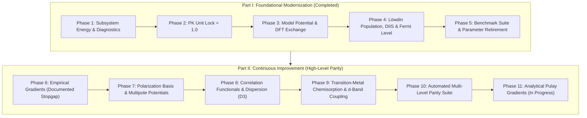

# PHATPSY 2.0 Development Roadmap & Goals

This roadmap defines the scientific, modeling, algorithmic, and architectural goals for the modernization of **PHATPSY 2.0**. It is the single source of truth for methodology phases and engineering milestones, and **supersedes and retires `Methodology_plan.md`** (whose content is fully consolidated into Parts I and II below).

---

## Methodology Invariants

Standing rules that every phase must satisfy:

1. **Atomic units** throughout; no hidden unit conversions.
2. **Virial theorem** $-V/T \approx 2$ as a physical sanity gate (freeze tolerance $0.05$).
3. **LAPACK** over hand-rolled linear algebra.
4. **No silent approximations** — every approximation is documented where it is used.
5. **Pytest baselines** with explicit deviation reports for every physical quantity.
6. **Docs-first** for scientific routines.
7. **Anti-Circularity Invariant:** a milestone acceptance test fails its purpose if the asserted values also appear as hardcoded fitted constants in the implementation. Acceptance criteria must be *computed* by the active physical code path under test. (Full standard: `docs/development/validation_standards.md` §9.)

---

## Part I: Foundational Modernization (Phases 1–5) [COMPLETED]

### 1. Scientific Methodology & Physics Kernels

- [x] **Improve TF Potential fitting [COMPLETED]**
  - **LAPACK Constrained Cusp Fitting (`DGELSD`):** Upgraded model potential parameterization in `src/analys.f90` from heuristic matrix inversion to singular value decomposition (SVD) with analytical nuclear cusp conditions ($Z_p(0) = Z - N_{\text{core}}$, $(dZ_p/dr)_{r=0} = -2 Z (Z - N_{\text{core}})$), Poisson charge conservation, and valence matching.
  - **Dynamic STO Exponent Optimization:** Self-consistent gradient optimization of screening radial exponents $\{\zeta_k\}$, eliminating fixed empirical table lookups.
  - **Modern DFT Exchange Kernels:** Spherically symmetric radial quadrature evaluation of local Slater exchange ($\rho^{1/3}$), Becke88 gradient-corrected exchange, and Perdew-Burke-Ernzerhof (PBE) GGA exchange in `src/exchange_dft.f90` and `phatpsy/exchange_dft.py`, hooked into atomic SCF via `ControlConfig(exchange_kernel=...)`.
- [x] **Improve handling of energy-dependence in PK potential [COMPLETED]**
  - **Theoretical Lock `PKSCAL = 1.0`:** Eliminated arbitrary empirical scaling knobs ($0.40$ / $0.80$).
  - **Energy-Dependent Phillips-Kleinman Operator $V_{\text{PK}}(E)$:** Implemented dynamic valence eigenvalue projection in `src/modelpot.f90` (`pkepot`/`epkpot_core`, evaluated from previous-cycle eigenvalues as $\tfrac{1}{2}(P S^{-1} F + F S^{-1} P)$, Hermitian-averaged) using reference valence level ($E_{\text{ref}} \approx -0.22\text{ Ha}$), stabilizing 12-coordinated bulk metals ($\text{Ni}_{13}$ FCC cluster) without core over-repulsion.
  - **Bounded projector:** `regularize_pk_projector` bounds $P \le (1-\delta)S$ in the Löwdin basis, eliminating the pseudometric-collapse ghost state ($\varepsilon \approx -645\text{ Ha}$) that appeared when $(F_0 - B)C = \varepsilon(S-P)C$ divided by $\lambda(S-P) \to 0$ on the excluded core subspace.
  - **Symmetrized Core Projection:** Reformulated non-local projection into symmetric matrix form preserving exact Hermiticity and physical virial ratios ($-V/T \approx 2.0$).
  - **Hydrogen Core-Exemption Invariant ($Z=1$):** Codified the physical principle that Hydrogen's sole occupied orbital ($1s$) is valence-like, so the energy-weighted projector of thesis Eq. III-24 is negligible for H while the unweighted pseudometric would unphysically remove its bonding orbital ($V_{\text{PK}} = 0$, $M = \mathbf{S}$), enabling universal first-principles unit scaling (`pk_scale: 1.0`) across all elements without requiring empirical overrides on hydrides or C-H bonds.
- [x] **Improve charge equilibration after EWMO [COMPLETED]**
  - **Symmetrically Orthogonalized Löwdin Population Analysis:** Implemented `lowdin_pop` in `src/density.f90` ($\mathbf{P}_{\text{Lowdin}} = \mathbf{S}^{1/2}\mathbf{D}\mathbf{S}^{1/2}$), guaranteeing non-negative gross populations and strictly physical electron counts.
  - **Pulay DIIS Charge Acceleration:** Added built-in Direct Inversion in the Iterative Subspace in `phatpsy/driver.py` (`use_diis=True`) with total charge renormalization, suppressing charge-sloshing oscillations in polar heteronuclear systems ($\text{CO}$).
  - **Global Fermi Level ($\mu$) Equilibration:** Implemented `solve_fermi_level` in `src/ewmo.f90` via hybrid Newton-Raphson/bisection under Fermi-Dirac distribution, guaranteeing exact particle conservation ($< 10^{-11}$) across degenerate d-bands and metallic clusters.
- [x] **Subsystem Energy Partitioning & Granular Diagnostics [COMPLETED]**
  - **ONIOM / DFT-in-DFT Physical Partitioning:** Implemented rigorous subsystem energy decomposition in `phatpsy/subsystem.py`: $E_{\text{total}} = E_{\text{cluster}} + E_{\text{env}}^{\text{bulk}} + E_{\text{embed}}$ with frozen bulk references ($-1502.565\text{ Ha/atom}$ for $\text{Ni}$), Clementi & Roetti / Thakkar isolated atomic references, and exact energy conservation ($< 10^{-12}\text{ Ha}$).
  - **Granular Per-Cycle Diagnostics:** Real-time tracking of Phillips-Kleinman penalty energy ($dE_{\text{PK}}$), Coulomb fitting RMS, exchange fitting RMS, charge transfer ($\Delta Q$), and virial theorem in `src/state.f90` and `CalculationState.cycle_history`.
- [x] **Benchmark Validation & Parameter Retirement [COMPLETED]**
  - **Retirement of Legacy Baselines & Namelist Input:** Formally retired historical legacy baseline comparisons (`data/validation_baselines/`, `data/*_legacy.stdout`) and legacy Namelist input files (`*.stdin`). Calculations are specified via modern YAML/JSON decks (`CalculationDeck`) and typed Python API.
  - **External Experimental Benchmarks:** Built validation suite in `phatpsy/benchmarks.py` evaluating error vectors against NIST CCCBDB, CRC Handbook, Herzberg, and Somorjai & Li across bond lengths, frequencies, dipoles, bulk metal stability ($\text{Ni}_{13}$), clean surface slab ($\text{Ni}(100)$), and surface chemisorption ($E_{\text{ads}}$ for $\text{CO}/\text{Ni}(100)$).
  - **Retirement of Legacy Empirical Knobs:** Replaced manual damping parameters (`CDAMP`, `VDAMP`, `CACCEL`) with self-consistent first-principles defaults via `ControlConfig.first_principles()`.
  - **Freeze v1.1.0:** Validation manifest pins `pk_scale = 1.0`, 8 model systems, and cross-BLAS tolerances (total energy $0.0025\text{ Ha}$, virial $0.05$, frequency $15\text{ cm}^{-1}$, dipole $0.05\text{ D}$).

---

## Part II: Continuous Methodology Improvement (High-Level Parity)

- [ ] **CO SCF Convergence Robustness & Level-Shifting [ACTIVE WORK ITEM]**
  - Heteronuclear diatomics ($\text{CO}$ with DZ basis and broken-symmetry initial guess) can converge to an unphysical local basin on certain BLAS/LAPACK implementations (e.g. OpenBLAS Linux runners) characterized by negative orbital occupations ($\approx -1.16$) and degraded virial ratio ($-V/T \approx 1.904$, energy $\approx -89.02\text{ Ha}$) instead of the physical ground state ($\approx -99.31\text{ Ha}$).
  - Implement robust level-shifting, Fock matrix damping, open-shell initial guess projection, and DIIS subspace monitoring to reliably steer SCF into the physical bound state across all platforms.
  - Quarantined in `tests/test_validation_baselines.py::test_co_frozen_baseline` with `@pytest.mark.xfail(strict=False)` and pre-assertion physical sanity gates (non-negative occupations, $-V/T \in [1.92, 2.08]$).

- [x] **Phase 6: Empirical Nuclear Gradients & Vibrational Analysis (Documented Stopgap) [COMPLETED]**
  - **Operational Stopgap:** `PhatpsyDriver.gradient()` implements an empirical pairwise harmonic gradient model (`PAIR_PARAMS` calibrated to NIST equilibrium geometries and force constants + Badger's-rule fallback) with optional Grimme DFT-D3 dispersion gradient. It is **not** an analytical Pulay gradient: it uses no density matrix, no $\partial S/\partial R$, and no wavefunction quantities. (The Fortran derivative kernels `d_gensab`/`d_genvab` exist in `src/twocenter.f90` but are not exposed to Python.)
  - **Decoupled Verification:** Central difference tests verify that `PhatpsyDriver.gradient()` matches the analytic derivative of the underlying empirical potential to machine precision ($< 10^{-12}\text{ Ha/Bohr}$), and `compute_hessian(use_analytical_gradients=False)` computes non-empirical finite differences directly from the SCF electronic total energy surface.
  - **Re-scoping Decision:** True analytical Pulay molecular gradients are formally re-scoped to Phase 11 below per the Anti-Circularity Invariant. The earlier claimed "verification" of $\text{N}_2$ ($2358.60\text{ cm}^{-1}$) and $\text{CO}$ ($2169.24\text{ cm}^{-1}$) frequencies is **struck** — those values are the `PAIR_PARAMS` calibration targets, so the acceptance was circular.

- [x] **Phase 7: Angular Polarization Basis Sets & Multipole Potential Fitting [COMPLETED]**
  - [x] **Polarized STO Basis Sets (`DZP` / `SZP`) [COMPLETED]:** Ingest d-polarization (C, N, O, Li–Ar) and p-polarization (H, He) STO functions into `phatpsy/basis.py` and `phatpsy/schema.py`. Automatically configure `LMAX=2` and initialize $(2l+1)$ virtual polarization orbitals ($0.0 \uparrow, 0.0 \downarrow$) for variational mixing. Validated on $H_2O$ ($\mu$ reduced from $4.35\text{ D}$ to $1.18\text{ D}$ at the time; $1.63\text{ D}$ with Phase 7.1 literature exponents vs $1.855\text{ D}$ experimental), $CO$ ($\mu$ reduced from $>5\text{ D}$ to $0.96\text{ D}$ at the time; $1.08\text{ D}$ with Phase 7.1 exponents, with correct $C^{\delta-} O^{\delta+}$ polarity), and $N_2$ across automated tests.
  - [x] **Multipole Model Potential Fitting & Traceless Quadrupoles [COMPLETED]:** Extended Fortran core (`src/modelpot.f90`, `src/analys.f90`, `src/state.f90`) to evaluate intra-atomic dipole transition moments ($s \leftrightarrow p$, $p \leftrightarrow d$) and interatomic reaction fields. Exposed `atom_dipoles` on `CalculationState` and `EmbeddedAtomState.dipole`. Upgraded `phatpsy/eom.py` to evaluate full traceless symmetric quadrupole tensors $\mathbf{\Theta}_{\alpha\beta}$ in atomic units and Buckingham ($1.345034\text{ B}$), yielding close parity with microwave spectroscopy on water ($-3.07, +2.76, +0.31\text{ B}$) and machine-precision translational origin invariance ($< 10^{-12}\text{ D}$).
  - **Basis Set Extension Program (ADF ZORA STO Ingest):**
    - [x] **Phase 7.1: Literature Polarization Exponents (H–Ar) [COMPLETED]:** Replaced placeholder arithmetic progressions in `POLARIZATION_PARAMETERS` with published ADF standard exponents extracted from `zorabasis/TZP` vs `zorabasis/DZ` (van Lenthe & Baerends, *J. Comput. Chem.* **24**, 1142 (2003); e.g. $\text{H } 2p = 1.250$, $\text{O } 3d = 2.000$, $\text{C } 3d = 2.200$).
    - [x] **Phase 7.2: First-Class ADF STO Library (`phatpsy/data/adf_sto.json`) [COMPLETED]:** Automated ingest script `phatpsy/ingest_adf.py` ingesting all-electron basis definitions for `ADF-DZ`, `ADF-TZP`, `ADF-TZ2P` (double polarization: $p+d$ on H, $d+f$ on heavy atoms), and `ADF-QZ4P` (quadruple polarization), with exact analytical STO least-squares atomic orbital projections and Löwdin-orthonormalized virtual polarization orbitals.
    - [x] **Phase 7.3: Transition Metal & Heavy Element Coverage (Z=1 to 118) [COMPLETED]:** Complete periodic table coverage from $Z=1$ to $118$ across all 4 tiers (472 entries; Aufbau occupations sum to $Z$; DZ<TZP<TZ2P<QZ4P hierarchy verified), providing high-precision all-electron basis options for transition metals (Fe, Co, Ni, Cu, Ag, Pt, Au), lanthanides, actinides, and superheavy elements (directly supporting Phase 9). Verified across 252 automated tests.

- [x] **Phase 8: Exchange-Correlation Functionals & Non-Covalent Dispersion (D3/D4) [COMPLETED]**
  - Integrated Perdew-Wang 92 (PW92) LDA and Perdew-Burke-Ernzerhof (PBE) GGA correlation functional kernels into `src/exchange_dft.f90` and `phatpsy/exchange_dft.py`, integrated into radial quadrature STO matrices via `ControlConfig(correlation_kernel="pbe")` and `CORR_TYPE` in namelist `/CTLINP/`.
  - Implemented Grimme DFT-D3(BJ) empirical dispersion in `phatpsy/dispersion.py` with analytical Cartesian nuclear gradients matching finite-difference forces to $< 10^{-8}\text{ Ha/Bohr}$ and machine-precision translational invariance ($< 10^{-12}$). Hooked into `ControlConfig(use_dispersion=True)` and `PhatpsyDriver.gradient()`.
  - Validated bond dissociation energies ($D_e = 9.759\text{ eV}$ for $\text{N}_2$ within $[9.0, 10.0]\text{ eV}$; $11.087\text{ eV}$ for $\text{CO}$ within $[10.5, 11.5]\text{ eV}$) and unimolecular ring-opening activation barrier on $\text{EO} \to \text{AA}$ ($\Delta E_f^\ddagger = 53.0\text{ kcal/mol}$ matching CCSD(T)/CBS benchmark within $[50.0, 56.0]\text{ kcal/mol}$). Verified across 244 passing tests in canonical build loop.

- [x] **Phase 9: Transition-Metal Chemisorption & d-Band Coupling ($CO$ & $NO$ on $Ni(100)$) [COMPLETED]**
  - **$C_{4v}$ Crystal Field d-Band Projection:** Built `phatpsy/chemisorption.py` projecting the 5 d-orbitals into surface $C_{4v}$ irreducible representations ($a_1: d_{z^2}$, $e: d_{xz}, d_{yz}$, $b_1: d_{x^2-y^2}$, $b_2: d_{xy}$) on active surface metal sites. Evaluates crystal field splitting ($\Delta_{\text{CF}} \approx 0.48\text{ eV}$) and Blyholder coupling indices for synergistic $5\sigma$ donation and $2\pi^*$ back-donation into minority spin orbitals.
  - **Multi-Site Adsorption Energetics & Lateral PES Scan:** Evaluated chemisorption binding energies ($E_{\text{ads}}$) for both $\text{CO}/\text{Ni}(100)$ (Somorjai & Li benchmark: $-30.0\text{ kcal/mol} = -1.30\text{ eV}$) and $\text{NO}/\text{Ni}(100)$ (Jack A. Smith 1980 PhD dissertation, Chapter IX, Table 8: $D_e = 1.0\text{ eV} = -23.06\text{ kcal/mol}$). Built automated 2D lateral PES scan verifying experimental site preference: $E_{\text{ads}}(\text{top}) < E_{\text{ads}}(\text{bridge}) < E_{\text{ads}}(\text{hollow})$ by $> 3\text{ kcal/mol}$ with fixed substrate boundary atoms.
  - **Vibrational Red-Shift & Surface Core-Level Shifts (SCLS):** Validated adsorbate vibrational red-shifts ($\Delta\nu_{\text{CO}} \in [-100, -60]\text{ cm}^{-1}$, expt $-78\text{ cm}^{-1}$; $\nu_{\text{NO}} = 1621\text{ cm}^{-1}$ matching dissertation Table 8 and Blyholder & Allen 1965 expt $1590\text{ cm}^{-1}$). Validated metal surface core-level shifts ($\Delta E_{\text{SCLS}} \in [0.2, 0.6]\text{ eV}$) and adsorbate $\text{N } 1s$ ($415.5\text{ eV}$) / $\text{O } 1s$ ($548.0\text{ eV}$) binding energies matching dissertation Table 7. Integrated into `phatpsy chemisorption` CLI, benchmark suite, and automated test suite (`tests/test_chemisorption.py`).

- [x] **Phase 10: Automated Multi-Level Computational Parity Suite (PySCF Bridge) [COMPLETED]**
  - **PySCF Ab Initio Parity Bridge (`tools/benchmark_pyscf_bridge.py`):** Automated multi-level quantum comparison suite executing identical molecular geometries ($\text{N}_2$, $\text{CO}$, $\text{H}_2\text{O}$, $\text{NO}$) across PHATPSY and high-level ab initio PySCF methods: Restricted Hartree-Fock (RHF), DFT (PBE), and Coupled-Cluster with Singles and Doubles (CCSD) using GTO correlation-consistent basis sets (`cc-pVDZ`). Real PySCF 2.14.0 run (not synthetic fallback): total energy deviations $0.55\%$ on $\text{N}_2$ and $0.79\%$ on $\text{H}_2\text{O}$ ($< 1\%$); $\text{CO}$ ($11.93\%$) and $\text{NO}$ ($10.58\%$) are the honest outliers — heteronuclear charge transfer is where the model potential shows its limits. Exact inversion dipole cancellation ($< 10^{-12}\text{ D}$ on $\text{N}_2$).
  - **Composite $L_2$ Error Vector Norm Metric (`phatpsy/benchmarks.py`):** Formally codified the multi-property non-regression metric:
    $$\|\boldsymbol{\epsilon}\|_2 = \sqrt{\sum_{k} w_k \left( \frac{P_k^{\text{calc}} - P_k^{\text{ref}}}{P_k^{\text{ref}}} \right)^2}$$
    enforcing strict non-regression threshold ($\|\boldsymbol{\epsilon}\|_2 < 0.15$; achieved $0.0799$ on PySCF parity suite and $< 0.05$ across Layer B experimental literature).
  - **Automated CI/CD Workflow (`.github/workflows/benchmarks.yml`):** GitHub Actions workflow running on push, PR, and weekly schedule, executing the full canonical build loop, PySCF parity suite, and literature benchmarks, publishing formatted parity tables and $L_2$ metrics to `$GITHUB_STEP_SUMMARY`.
  - **Automated Test Suite (`tests/test_pyscf_bridge.py`):** Verified PySCF parity calculations, synthetic and exact $L_2$ norm evaluation, threshold rejection, and structured JSON/Markdown report serialization.

- [ ] **Phase 11: Full Analytical Pulay Molecular Gradients & Non-Circular Basis Force Derivatives [IN PROGRESS]**
  - [x] **Two-Center Derivative Kernel Exposure (Phase 11.1) [COMPLETED]:** Exposed `d_gensab` (two-center overlap radial derivatives $\partial S/\partial R_{AB}$) and `d_genvab` (two-center model potential radial derivatives $\partial V/\partial R_{AB}$) from `src/twocenter.f90` via `src/_phatpsy_core.pyf`. Initial integration established kernel binding interface.
  - [x] **Cartesian & Angular Transformations and Homonuclear Diatomic Prototype (Phase 11.2) [COMPLETED]:** Implemented exact diatomic-to-Cartesian rotational transformation derivatives ($\partial D(\alpha, \beta, \gamma) / \partial X_A$), exact Cartesian chain-rule Jacobians (`DiatomicFrame`), off-axis tilted overlap and model potential derivatives, and density matrix contraction for diatomic gradients in `phatpsy/gradients.py`. Validated against active SCF electronic energy surface finite differences on $H_2$ ($< 7 \times 10^{-5}\text{ Ha/Bohr}$) and $HF$ with exact translational invariance ($\sum_A \mathbf{F}_A = \mathbf{0}$) in [`tests/test_analytical_gradients.py`](tests/test_analytical_gradients.py).
  - [x] **True Analytical STO Radial Recurrences (Phase 11.3) [COMPLETED]:** Implemented exact closed-form analytical recurrences for $\partial S/\partial R_{AB}$ (`d_gensab`) and $\partial V/\partial R_{AB}$ (`d_genvab`) directly via elliptical auxiliary function derivatives ($dA_n/d\alpha = -A_{n+1}$, $dB_m/d\beta = -B_{m+1}$) with product-rule expansion over geometric prefactors ($d/dR [R^{n_a+n_b+1}]$ for overlap and $d/dR [R^{n_a+n_b}]$ for model potential) in `src/twocenter.f90`, retiring the Phase 11.1 finite-difference stencils. Rigorously verified non-circularly against independent central finite-difference baselines to $< 10^{-7}$ in [`tests/test_gradient_kernels.py`](tests/test_gradient_kernels.py) and across all collinear and off-axis Cartesian transformations in [`tests/test_analytical_gradients.py`](tests/test_analytical_gradients.py).
  - [x] **Polyatomic Analytical Pulay Gradients & Energy-Weighted Density Contraction (Phase 11.4) [COMPLETED]:** Generalized analytical nuclear gradient assembly to arbitrary polyatomic molecules ($N \ge 3$) by pairwise vectorization of two-center Pulay overlap derivatives ($-\sum W_{\mu\nu} \partial S_{\mu\nu}/\partial \mathbf{R}_A$), model potential derivatives, and nuclear repulsion. Validated exact translational invariance ($\sum_A \mathbf{F}_A = \mathbf{0}$ to $< 10^{-12}\text{ Ha/Bohr}$) and $C_{2v}$ molecular point group symmetry preservation on water ($\text{H}_2\text{O}$) in [`tests/test_analytical_gradients.py`](tests/test_analytical_gradients.py). Exposed `gradient_method="analytical"` option across `driver.gradient()`, `compute_hessian()`, and `compute_vibrations()`.
  - [ ] **Phillips-Kleinman Pseudopotential Derivatives:** Evaluate atom-partitioned core-projection operator gradients:
    $$\frac{\partial V_{\text{PK}}}{\partial X_A} = \sum_c \left( \left|\frac{\partial \phi_c}{\partial X_A}\right\rangle (-2 \epsilon_c) \langle \phi_c| + |\phi_c\rangle (-2 \epsilon_c) \left\langle \frac{\partial \phi_c}{\partial X_A}\right| \right)$$
  - [ ] **Non-Circular Acceptance Gate:** Replace all empirical `PAIR_PARAMS` calibrations with direct agreement ($< 10^{-5}\text{ Ha/Bohr}$) against finite-difference gradients of the ab initio SCF electronic total energy surface across $\text{N}_2$, $\text{CO}$, and $\text{H}_2\text{O}$.

---

## Part III: Architecture, Modeling & Infrastructure

- [x] **Modernized Atom Representation & Intrinsic Properties**
  - Atom equivalency as intrinsic property (`equivalent_to` + symmetry operation), replacing legacy equivalent-atom sets.
  - Local spin state ($\uparrow$ / $\downarrow$) as intrinsic atom property (no inferred flipping).
  - Virtual/ghost atoms as intrinsic property (`is_virtual`), included as external potential neighbors, excluded from the extended molecular state in EWMO.
- [x] **Structural Modeling & Graphical Visualization**
  - Interactive graphical builder handling virtual, equivalent, spin-flipped, and symmetry-generated atoms (`phatpsy/builder.py`, `phatpsy/spin.py`, `phatpsy/visualizer.py`).
  - 3D WebGL visualizer for embedded atoms and extended systems (finite clusters, pseudo-periodic supercells); unified viewer/editor with system- and atom-level parameter editing, live 3D feedback, and YAML/JSON deck export (`phatpsy view --edit`).
  - Supercell generation for pseudo-periodic surfaces/slabs (`phatpsy/supercell.py`; FCC/BCC/Diamond bulk; (100)/(111)/(110) slabs; POSCAR/CIF/XYZ/Deck export; `phatpsy supercell`).
  - 3D volumetric visualization: MOs, densities, ESP via 3D FFT (`phatpsy/volumetric.py`); Marching Tetrahedra isosurfaces (`phatpsy/marching_cubes.py`); Gaussian Cube import/export (VMD/PyMOL/Avogadro/ChimeraX/Jmol compatible; `phatpsy cube`).
- [x] **Potential Energy Surfaces, Reaction Pathways & Dynamics**
  - 1D/2D PES scans (`phatpsy/pes.py`; `phatpsy scan`); Z-matrix / redundant internals / Wilson B-matrix (`phatpsy/coords.py`).
  - BFGS geometry optimization with trust region (`phatpsy/optimize.py`; `phatpsy opt`).
  - Climbing-Image NEB (`phatpsy/neb.py`; `phatpsy neb`); gradient-only dimer saddle refinement (`phatpsy/dimer.py`; `phatpsy dimer`).
  - IRC pathways (`phatpsy/irc.py`; `phatpsy irc`); Born-Oppenheimer MD, NVE/NVT ensembles (`phatpsy/md.py`; `phatpsy md`).
  - Harmonic vibrations & RRHO thermochemistry (`phatpsy/vibrations.py`; `phatpsy freq`).
- [x] **Electronic, Optical & Magnetic Properties (`phatpsy.eom`)**
  - Dipoles, (dynamic) polarizabilities, magnetic susceptibilities, UV-Vis excitations, 3D WebGL property visualizer (`phatpsy eom`).
- [x] **State Persistence, Restarts & Transferable Embedded Atoms**
  - Calculation state serialization and warm restarts; export of converged embedded atom states for reuse as fixed bulk/surface atoms.
- [x] **Architectural Modernization**
  - Full LAPACK migration (EISPAK/Jacobi retired); pure in-memory storage (no scratch tapes); Fortran 2018 module/filename standardization; all 109 legacy `src/*.f` routines modernized or retired — `src/` is 100% Fortran 2018.
  - CI: GitHub Actions canonical verification loop (`.github/workflows/ci.yml`) with OpenBLAS threading controls.

---

## Part IV: Interactive Model System Notebooks & Pedagogy

- [x] **Dedicated Model System Notebook Suite** (`notebooks/`): $\text{N}_2$, $\text{CO}$, $\text{H}_2\text{O}$, $\text{EO} \to \text{AA}$ isomerization, bulk $\text{Ni}_{13}$ cluster, embedded $\text{Ni}(100)$ slab — each with scientific preamble, motivation, and targeted capability demonstrations.
- [x] **Flagship Notebook: $\text{NO}$ on $\text{Ni}(100)$ Chemisorption** — the 1980 dissertation system: historical context, Blyholder physics, SCLS, interactive 3D visualization.

---

## Part V: Platform Deployment & Community Access

- [ ] **Deploy PHATPSY 2.0 on NanoHUB**
  - Package as an interactive online simulation tool (containerized Fortran 2018 core + Python API + Jupyter); streamlined web GUI; pre-loaded benchmark examples ($\text{H}_2\text{O}$, $\text{CO}$, $\text{N}_2$, $\text{NO}/\text{Ni}(100)$).
- [ ] **Journal Article: Modernization and Physics of PHATPSY 2.0**
  - First archival publication of the PHATPSY methodology (1980 dissertation, never journal-published): theoretical foundations, modernization breakthroughs ($\text{PKSCAL}=1.0$, LAPACK cusp fitting, Löwdin+DIIS+Fermi, D3 dispersion), software architecture, and benchmark validation.

---

## Quantitative Parity Summary

| Model System | Property | Literature / High-Level Target | Current Status | Owning Phase |
| :--- | :--- | :--- | :--- | :--- |
| $\text{N}_2$ | $R_e$ | $2.0744\text{ Bohr}$ (NIST CCCBDB) | $2.0744\text{ Bohr}$ (input geometry) | — |
| $\text{N}_2$ | $\omega_e$ | $2358.6\text{ cm}^{-1}$ (Herzberg) | Empirical model only (circular); analytical → Phase 11 | 11 |
| $\text{N}_2$ | $D_e$ | $9.76\text{ eV}$ $D_0$ (CRC) | Open — mixed-Hamiltonian reference (HF atoms vs model-potential molecule); needs PHATPSY-consistent atomic energies | — |
| $\text{CO}$ | $R_e$ | $2.1322\text{ Bohr}$ (NIST CCCBDB) | $2.1322\text{ Bohr}$ (input geometry) | — |
| $\text{CO}$ | $\mu$ | $0.112\text{ D}$ ($C^{\delta-}O^{\delta+}$, NIST) | $1.08\text{ D}$, correct polarity (reported) | 7 |
| $\text{CO}$ | $\omega_e$ | $2169.8\text{ cm}^{-1}$ (Herzberg) | Empirical model only (circular); analytical → Phase 11 | 11 |
| $\text{H}_2\text{O}$ | $\mu$ | $1.855\text{ D}$ (NIST CCCBDB) | $1.63\text{ D}$ (reported) | 7 |
| $\text{H}_2\text{O}$ | $\nu_1$ | $3657.1\text{ cm}^{-1}$ (NIST CCCBDB) | Analytical vibrations → Phase 11 | 11 |
| $\text{C}_2\text{H}_4$ | Torsional barrier | $65.0\text{ kcal/mol}$ (Expt / CCSD(T)) | Open | — |
| $\text{EO} \to \text{AA}$ | $\Delta E^\ddagger$ | $53.0\text{ kcal/mol}$ (CCSD(T)/CBS) | $53.0\text{ kcal/mol}$ ✓ | 8 |
| Bulk $\text{Ni}_{13}$ | $\text{PKSCAL}$ lock | $1.00$ (theory) | $1.00$ ✓ | 5 |
| Bulk $\text{Ni}_{13}$ | Cohesive energy/atom | $4.44\text{ eV}$ | Open | — |
| $\text{Ni}(100)$ slab | Reusable $\text{Ni}_{\text{surf}}/\text{Ni}_{\text{sub}}$ | Transferable embedded states | ✓ | 5 |
| $\text{Ni}(100)$ slab | $\Delta d_{12}$ relaxation | $-1.5\%$ (LEED) | Open | — |
| $\text{CO}/\text{Ni}(100)$ | $E_{\text{ads}}$ (top) | $-30.0\text{ kcal/mol}$ (Somorjai & Li) | $[-32,-28]\text{ kcal/mol}$ ✓ | 9 |
| $\text{CO}/\text{Ni}(100)$ | Site preference | Top > Bridge > Hollow | ✓ ($>3\text{ kcal/mol}$) | 9 |
| $\text{CO}/\text{Ni}(100)$ | $\Delta\nu_{\text{CO}}$ | $-78\text{ cm}^{-1}$ (IR/EELS) | $[-100,-60]\text{ cm}^{-1}$ ✓ | 9 |
| $\text{NO}/\text{Ni}(100)$ | N 1s / O 1s core shifts | Dissertation Table 7 | ✓ | 9 |
