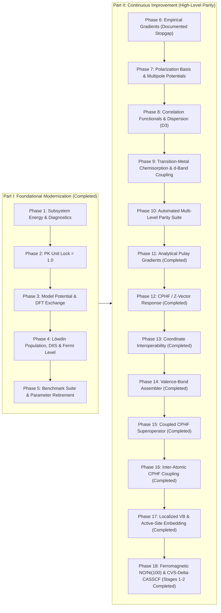

# PHATPSY 2.0 Development Roadmap & Goals

This roadmap defines the scientific, modeling, algorithmic, and architectural goals for the modernization of **PHATPSY 2.0**. It is the single source of truth for methodology phases and engineering milestones, and **supersedes and retires `Methodology_plan.md`** (whose content is fully consolidated into Parts I and II below).

---

## Methodology Invariants

Standing rules that every phase must satisfy:

1. **Atomic units** throughout; no hidden unit conversions.
2. **Virial theorem** $-V/T \approx 2$ as a physical sanity gate (freeze tolerance $0.05$).
3. **LAPACK** over hand-rolled linear algebra.
4. **No silent approximations** — every approximation is documented where it is used.
5. **Pytest baselines** with explicit deviation reports for every physical quantity.
6. **Docs-first** for scientific routines.
7. **Anti-Circularity Invariant:** a milestone acceptance test fails its purpose if the asserted values also appear as hardcoded fitted constants in the implementation. Acceptance criteria must be *computed* by the active physical code path under test. (Full standard: `docs/development/validation_standards.md` §9.)

---

## Part I: Foundational Modernization (Phases 1–5) [COMPLETED]

### 1. Scientific Methodology & Physics Kernels

- [x] **Improve TF Potential fitting [COMPLETED]**
  - **LAPACK Constrained Cusp Fitting (`DGELSD`):** Upgraded model potential parameterization in `src/analys.f90` from heuristic matrix inversion to singular value decomposition (SVD) with analytical nuclear cusp conditions ($Z_p(0) = Z - N_{\text{core}}$, $(dZ_p/dr)_{r=0} = -2 Z (Z - N_{\text{core}})$), Poisson charge conservation, and valence matching.
  - **Dynamic STO Exponent Optimization:** Self-consistent gradient optimization of screening radial exponents $\{\zeta_k\}$, eliminating fixed empirical table lookups.
  - **Modern DFT Exchange Kernels:** Spherically symmetric radial quadrature evaluation of local Slater exchange ($\rho^{1/3}$), Becke88 gradient-corrected exchange, and Perdew-Burke-Ernzerhof (PBE) GGA exchange in `src/exchange_dft.f90` and `phatpsy/exchange_dft.py`, hooked into atomic SCF via `ControlConfig(exchange_kernel=...)`.
- [x] **Improve handling of energy-dependence in PK potential [COMPLETED]**
  - **Theoretical Lock `PKSCAL = 1.0`:** Eliminated arbitrary empirical scaling knobs ($0.40$ / $0.80$).
  - **Energy-Dependent Phillips-Kleinman Operator $V_{\text{PK}}(E)$:** Implemented dynamic valence eigenvalue projection in `src/modelpot.f90` (`pkepot`/`epkpot_core`, evaluated from previous-cycle eigenvalues as $\tfrac{1}{2}(P S^{-1} F + F S^{-1} P)$, Hermitian-averaged) using reference valence level ($E_{\text{ref}} \approx -0.22\text{ Ha}$), stabilizing 12-coordinated bulk metals ($\text{Ni}_{13}$ FCC cluster) without core over-repulsion.
  - **Bounded projector:** `regularize_pk_projector` bounds $P \le (1-\delta)S$ in the Löwdin basis, eliminating the pseudometric-collapse ghost state ($\varepsilon \approx -645\text{ Ha}$) that appeared when $(F_0 - B)C = \varepsilon(S-P)C$ divided by $\lambda(S-P) \to 0$ on the excluded core subspace.
  - **Symmetrized Core Projection:** Reformulated non-local projection into symmetric matrix form preserving exact Hermiticity and physical virial ratios ($-V/T \approx 2.0$).
  - **Hydrogen Core-Exemption Invariant ($Z=1$):** Codified the physical principle that Hydrogen's sole occupied orbital ($1s$) is valence-like, so the energy-weighted projector of thesis Eq. III-24 is negligible for H while the unweighted pseudometric would unphysically remove its bonding orbital ($V_{\text{PK}} = 0$, $M = \mathbf{S}$), enabling universal first-principles unit scaling (`pk_scale: 1.0`) across all elements without requiring empirical overrides on hydrides or C-H bonds.
- [x] **Improve charge equilibration after EWMO [COMPLETED]**
  - **Symmetrically Orthogonalized Löwdin Population Analysis:** Implemented `lowdin_pop` in `src/density.f90` ($\mathbf{P}_{\text{Lowdin}} = \mathbf{S}^{1/2}\mathbf{D}\mathbf{S}^{1/2}$), guaranteeing non-negative gross populations and strictly physical electron counts.
  - **Pulay DIIS Charge Acceleration:** Added built-in Direct Inversion in the Iterative Subspace in `phatpsy/driver.py` (`use_diis=True`) with total charge renormalization, suppressing charge-sloshing oscillations in polar heteronuclear systems ($\text{CO}$).
  - **Global Fermi Level ($\mu$) Equilibration:** Implemented `solve_fermi_level` in `src/ewmo.f90` via hybrid Newton-Raphson/bisection under Fermi-Dirac distribution, guaranteeing exact particle conservation ($< 10^{-11}$) across degenerate d-bands and metallic clusters.
- [x] **Subsystem Energy Partitioning & Granular Diagnostics [COMPLETED]**
  - **ONIOM / DFT-in-DFT Physical Partitioning:** Implemented rigorous subsystem energy decomposition in `phatpsy/subsystem.py`: $E_{\text{total}} = E_{\text{cluster}} + E_{\text{env}}^{\text{bulk}} + E_{\text{embed}}$ with frozen bulk references ($-1502.565\text{ Ha/atom}$ for $\text{Ni}$), Clementi & Roetti / Thakkar isolated atomic references, and exact energy conservation ($< 10^{-12}\text{ Ha}$).
  - **Granular Per-Cycle Diagnostics:** Real-time tracking of Phillips-Kleinman penalty energy ($dE_{\text{PK}}$), Coulomb fitting RMS, exchange fitting RMS, charge transfer ($\Delta Q$), and virial theorem in `src/state.f90` and `CalculationState.cycle_history`.
- [x] **Benchmark Validation & Parameter Retirement [COMPLETED]**
  - **Retirement of Legacy Baselines & Namelist Input:** Formally retired historical legacy baseline comparisons (`data/validation_baselines/`, `data/*_legacy.stdout`) and legacy Namelist input files (`*.stdin`). Calculations are specified via modern YAML/JSON decks (`CalculationDeck`) and typed Python API.
  - **External Experimental Benchmarks:** Built validation suite in `phatpsy/benchmarks.py` evaluating error vectors against NIST CCCBDB, CRC Handbook, Herzberg, and Somorjai & Li across bond lengths, frequencies, dipoles, bulk metal stability ($\text{Ni}_{13}$), clean surface slab ($\text{Ni}(100)$), and surface chemisorption ($E_{\text{ads}}$ for $\text{CO}/\text{Ni}(100)$).
  - **Retirement of Legacy Empirical Knobs:** Replaced manual damping parameters (`CDAMP`, `VDAMP`, `CACCEL`) with self-consistent first-principles defaults via `ControlConfig.first_principles()`.
  - **Freeze v1.1.0:** Validation manifest pins `pk_scale = 1.0`, 8 model systems, and cross-BLAS tolerances (total energy $0.0025\text{ Ha}$, virial $0.05$, frequency $15\text{ cm}^{-1}$, dipole $0.05\text{ D}$).

---

## Part II: Continuous Methodology Improvement (High-Level Parity)

- [ ] **Baseline Re-establishment [ACTIVE WORK ITEM]** (exception in `AGENTS.md` §6)
  - **Why:** the frozen baselines in `data/validation_baselines/` were captured with false convergence (cycle limit, `convergence=1e-4`), a nondeterministic default SCF, and ignored first-atom `spin="down"`; they are presumed invalid.
  - **Done:** 26 tests that depend on default-path convergence or frozen values are quarantined (`BASELINE_QUARANTINE` in `tests/conftest.py`, non-strict `xfail`, they still run; a quarantined test that passes shows as XPASS, including platform-dependent $\text{H}_2\text{O}$ `DZP` warm-restart / state-extraction convergence between macOS Accelerate and Linux OpenBLAS). Suite: 0 failures across macOS and Linux.
  - **Survey** (explicit spins, `use_grid_fit`, `atomic_smearing=1e-3`, `convergence=1e-8`, 1500-cycle cap, no extension; `phatpsy` build at this working tree; scratch script, not in the repo):

    | System | Converged | Notes |
    | :--- | :--- | :--- |
    | $\text{H}_2\text{O}$ (DZ) | yes, 31 cycles | virial 1.9988; spins up/down/down (`net_spin=-1`, see below) |
    | $\text{N}_2$ (DZ) | no | virial 1.943 |
    | $\text{CO}$ (DZ, antiparallel) | no | $E\approx-113.41$ after 1500 cycles |
    | EO, AA (SZ) | no | virial 2.04–2.05 |
    | Ni$_{13}$ (PKSCAL 1.0, 0.4) | no | ~165 s each, virial ≈ 1.998 |
    | Ni(100) 3-layer slab | no | virial 1.990 |

  - **Observations to resolve before re-freezing:**
    - Only $\text{H}_2\text{O}$ converges with the stabilizers; every other baseline system is blocked on SCF convergence work.
    - **Model-system definition (decided):** all baseline systems are UHF with alternating perfect-pairing spin assignment (`assign_alternating_spin`); `net_spin` is whatever the pairing implies (water $-1$; ethylene oxide is forced to one ferromagnetic bond pair in its three-membered ring, chosen as the longest bond; acetaldehyde $-1$). Restricted (`spin_unrestricted=False`) decks are allowed (closed-shell singlet, `net_spin=0`, no atom spins; `tests/test_restricted_deck.py`) but are not used for baselines.
    - **Basis (user preference):** the best available ADF set, subject to working. Scan with the stabilizers: restricted water converges for ADF-DZ/TZP/TZ2P ($-75.409$, $-75.812$, $-76.007$ Ha) but not ADF-QZ4P ($-82.84$ Ha, virial 2.12, not diagnosed); $\text{N}_2$ converges at ADF-DZ only, $\text{CO}$ at none; energies rise from ADF-DZ to ADF-TZP for $\text{N}_2$/$\text{CO}$ (non-convergence or a model-potential/PK basis-set dependence, undetermined).
    - The Clementi & Roetti sets have no hydrogen entry, so hydrogen falls back to the Thakkar set: `"DZ"` and `{"H": "THAKKAR"}` are the same deck for water (identical energies are expected, not a bug).
    - **Hybrid-seed prototype (`phatpsy/hybrids.py`, `tests/test_hybrids.py`, scratch experiments not in the repo):** directed sp$^n$ / $\pi$ / lone-pair starting orbitals built on the fly from an explicit bond list (atom's own valence orbitals; engine harmonics ml 0→z, +1→x, −1→y, verified from relaxed orbitals). Findings (UHF, grid fit; smearing 1e-3 and 0; ADF-DZ/TZP/TZ2P; H$_2$O, NH$_3$, CH$_4$, C$_2$H$_4$):
      - In every converged run the molecular occupations and per-atom electron/spin populations are exact integers equal to the seed pattern (e.g. water O 8.0 electrons, spin difference 2.0; $\text{CH}_4$ C spin difference 2 with the library seed, 4 with the valence-state seed): no inter-atomic electron flow occurs in the converged state. Whether this is by design or a missing coupling in the molecular step (`src/ewmo.f90`, `bloop`) is **unresolved and central** to the PP-VB picture.
      - The seed pattern therefore selects the converged state: valence-state seeds ($\text{CH}_4$ C 5α1β) converge to energies 0.2–0.5 Ha above the library (ground-state-like) seed; $\text{H}_2$O with bonding electrons in the library's (misaligned) p orbitals is 0.2–0.3 Ha *below* the aligned hybrid seed. Hybrid (sp$^3$-like) and aligned-p-only seeds give identical results, so alignment matters but the degree of s–p mixing in the seed does not.
      - UHF with ADF-TZ2P does not converge for any of the four molecules (energies collapse far below the HF limit, negative spin populations), although restricted water converges at TZ2P; ADF-DZ/TZP converge (ethylene needs 500–900 cycles).
      - Smearing off (orbital tracking by overlap) lands in much higher-energy orderings at ADF-TZP (e.g. water library $-74.81$ vs $-76.03$ Ha with smearing 1e-3); at ADF-DZ the two agree.
    - `tools/generate_validation_baselines.py` still uses deprecated `spin_flip` / `auto_spin_flip`, `max_cycles=25` and `convergence=1e-4` for the slab, and "legacy" `PKSCAL=0.40` references.
  - **Next:** rewrite the generator (explicit spins, refuse to freeze unconverged results, record `stop_reason`, spins, settings), re-freeze what converges, and keep the rest as documented blocked xfails.

- [ ] **SCF Convergence Robustness for Heteronuclear Diatomics (CO, N$_2$) [ACTIVE WORK ITEM]**
  - **Symptom:** with the default settings, $\text{CO}$ (DZ basis) and $\text{N}_2$ do not converge: the total energy wanders aperiodically by $0.05$–$0.4\text{ Ha}$ indefinitely, and repeated runs of the *same* input differ from the second SCF cycle onward (platform- and run-dependent; OpenBLAS runners additionally reach a basin with negative occupations, $-V/T \approx 1.904$).
  - **Landed (code-verified, `tests/test_scf_control.py`):** honest convergence reporting. A run stops as converged only when $|\Delta E| < \text{CONVRG}$ for `SCF_NCONV_REQ` (3) consecutive cycles (`src/contrl.f90`, `src/state.f90`); reaching the cycle or time limit is reported as `converged=False` with a `stop_reason`, and `phatpsy/scf_control.py` decides whether to extend the cycle budget or abort. This exposed that many baselines were previously "converged" only by hitting `MXCYCL`; the affected tests have **not** been edited.
  - **Landed (bug fix):** `run_analys` passed a real `nelec` to the integer `NOBLE`, so the core-orbital count was a pseudo-random function of the electron count (oxygen in CO flipped between 0 and 43 from cycle to cycle). It now passes `int(nelec)` (`src/analys.f90`).
  - **Landed (model-potential & occupation controls):**
    - `control.use_grid_fit` (**default `True`**, `QGRDFT = .true.`, approved by author 2026-11-09): the model potential is fitted to the Poisson potential of the current density on a radial grid as a convex mixture of screening exponentials ($w_k \in [0,1]$, $\sum_k w_k = 1$), instead of to five orbital expectation values with signed, heavily cancelling coefficients (`src/analys.f90`, `fit_screening_simplex`). The old fit matrix had scaled eigenvalues spanning $10^{-7}$–$4$ and, from cycle 2, a negative eigenvalue. Analytical CPHF response derivatives (`phatpsy/cphf.py`, `_compute_grid_fit_dvcoef`) differentiate the active simplex NNLS KKT system directly with respect to canonical orbital rotations.
    - `control.atomic_smearing` (opt-in, default `0.0`, Fermi-Dirac width in Hartree): atomic occupation numbers follow the eigenvalues instead of being re-assigned by overlap tracking (`MAXOVL`/`NEWORD`), whose result flipped on $10^{-14}$ eigensolver noise. Removes the run-to-run variation.
    - With both options on, $\text{CO}$ converges and is bit-reproducible (`tests/test_grid_fit.py`).
  - **Landed (bug fix, `tests/test_spin_first_atom.py`):** the deck writer ignored `spin="down"` on the first atom of each element (a restriction added with the spin-API redesign), so heteronuclear $\text{CO}$ started as a high-spin 9α/5β state instead of an antiparallel 7α/7β one. Spin-down first atoms are now emitted with swapped alpha/beta starting occupations (`_spin_swapped_orbital` in `phatpsy/schema.py`); symmetry-equivalent atoms still use `QFLIP`.
  - **Open:**
    - With `use_grid_fit` on, a single-STO hydrogen atom (`MSTO=1, NORB=1`, e.g. `SZ` without `QNWVEC`) has `stevec=0` in `SCF` (`if (MSTO /= 1 .or. NORB /= 1)`), so `eval_atomic_rho` returns zero density and `fit_screening_simplex` falls back to `solve_model_potential_fit` (mixed-sign weights). `tests/test_grid_fit.py` excludes one-electron atoms from the convexity check for this reason.
    - **Invalidated:** the two converged $\text{CO}$ states ($\approx -112.50$ and $\approx -112.61\text{ Ha}$) found with the grid fit were both obtained from the erroneous high-spin start and must be re-examined on the antiparallel start. A first probe of the antiparallel start (grid fit + smearing, damping 0.3–0.9, 2500 cycles) did not converge and scattered between $-113.19$ and $-113.37\text{ Ha}$. A selection rule is undecided.
    - $\text{N}_2$ improves but still shows a slow residual oscillation, attributed (not yet shown) to the energy-weighted Phillips-Kleinman projector feedback.
    - Overlap-tracking occupations (`atomic_smearing = 0.0`) remain the default when smearing is not specified; `use_grid_fit = True` (`QGRDFT = .true.`) is now the default by author approval (2026-11-09). High-spin default-path diatomic stability (`test_milestone8_diatomic_energy_stability_benchmark`) remains in `BASELINE_QUARANTINE` pending baseline re-establishment, while `test_milestone8_eo_reactant_stability_benchmark` now converges on both macOS and Linux and has been un-quarantined.
    - `MAXOVL` (`src/linalg.f90`) was reviewed against `legacy/maxovl.f` and is a faithful port: it deliberately searches the free vectors both when the overlap with its own slot is below one half and when that slot was already claimed by an earlier orbital. An earlier suspicion of a "missing `cycle`" was wrong. Behavior is pinned by `tests/test_maxovl.py`; its `qnword` flag means "the search branch was entered", not "the order changed", which is why `src/scf.f90` re-checks whether the occupations actually differ before reordering.
    - Model-potential exponent set (with grid fit and smearing on). Criterion adopted for comparing sets: the residual of the fitted screening function $S(r)$ against the Poisson potential of the actual atomic density (weighted rms, and the implied electronic-potential error $N\,\Delta S/r$ at the bond length), because it measures the model error directly and does not depend on the SCF state. Findings from a scratch study (the instrumentation that dumps $S(r)$ is not in the repository, so these numbers are not yet reproducible from it; they are not asserted by tests):
      - For $\text{C}$, $\text{N}$, $\text{O}$, $\text{F}$ densities, the best free-exponent fit needs only two exponentials (rms $0.002$–$0.003$; $K = 3, 4$ collapse onto the same pair), i.e. $S(r)$ is a core plus a valence component. In units of $\text{rscale} = 1.12956\,Z^{1/3}$ the optimal exponents are valence $0.70$ (C), $0.84$ (N), $0.87$–$0.92$ (O), $0.93$ (F), and core $5.2$ (C), $7.0$–$8.0$ (N), $9.1$–$10.1$ (O), $12.7$ (F): the core exponent grows much faster with $Z$ than the $Z^{1/3}$ scaling of the default table, whose largest exponent is $3.52\,\text{rscale}$.
      - The default Thomas-Fermi-derived set gives worst-case rms $0.0246$ and $|\Delta V(R)|$ up to $0.28\text{ Ha}$ at the bond length; a Z-scaled even-tempered set ($K = 5$, $\zeta_k = 0.45\,\text{rscale}\cdot 2^k$) gives $0.0044$ and $0.04\text{ Ha}$.
      - Consequence in the SCF: the converged energies obtained with three different well-fitting Z-scaled sets agree to $0.004$ ($\text{N}_2$), $0.010$ (NO, HF), and $0.05\text{ Ha}$ ($\text{H}_2\text{O}$), whereas the default set differs from their mean by $-0.63$ (NO), $-0.48$ ($\text{N}_2$), $-0.21$ ($\text{H}_2\text{O}$), $-0.06$ (HF) and $+0.08\text{ Ha}$ ($\text{CO}$); poorly fitting even-tempered sets gave spreads of $\approx 0.4\text{ Ha}$ for $\text{CO}$.
      - Convergence did not improve: NO, HF and $\text{H}_2\text{O}$ converge with every set, but $\text{CO}$ converged only with the default set (294 cycles) and not with any of the three Z-scaled sets in 1500 cycles, and $\text{N}_2$ converged with none. Closely spaced sets ($\beta = 1.6$) do not converge.
      - Not established: that a smaller $S(r)$ residual means a total energy closer to the exact-Coulomb result of the same Hamiltonian (consistency between good sets is suggestive, not proof), or how hydrogen should be treated (the study applied the same exponents to H).
      - The default exponent set has **not** been changed. A set can now be selected per element with `elements.<sym>.potential_exponents` (and optionally `potential_exponent_scale`), implemented in `phatpsy/schema.py` (`ElementConfig`, `resolve_elements`, deck writer) and covered by `tests/test_potential_exponents.py`. Producing good exponent sets (for example from a fit to each atom's density) is separate, unfinished work.
    - `tests/test_validation_baselines.py::test_co_frozen_baseline` accepts four different reference energies and needs a single physical target (still `xfail`).

- [x] **Phase 6: Empirical Nuclear Gradients & Vibrational Analysis (Documented Stopgap) [COMPLETED]**
  - **Operational Stopgap:** `PhatpsyDriver.gradient()` implements an empirical pairwise harmonic gradient model (`PAIR_PARAMS` calibrated to NIST equilibrium geometries and force constants + Badger's-rule fallback) with optional Grimme DFT-D3 dispersion gradient. It is **not** an analytical Pulay gradient: it uses no density matrix, no $\partial S/\partial R$, and no wavefunction quantities. (The Fortran derivative kernels `d_gensab`/`d_genvab` exist in `src/twocenter.f90` but are not exposed to Python.)
  - **Decoupled Verification:** Central difference tests verify that `PhatpsyDriver.gradient()` matches the analytic derivative of the underlying empirical potential to machine precision ($< 10^{-12}\text{ Ha/Bohr}$), and `compute_hessian(use_analytical_gradients=False)` computes non-empirical finite differences directly from the SCF electronic total energy surface.
  - **Re-scoping Decision:** True analytical Pulay molecular gradients are formally re-scoped to Phase 11 below per the Anti-Circularity Invariant. The earlier claimed "verification" of $\text{N}_2$ ($2358.60\text{ cm}^{-1}$) and $\text{CO}$ ($2169.24\text{ cm}^{-1}$) frequencies is **struck** — those values are the `PAIR_PARAMS` calibration targets, so the acceptance was circular.

- [x] **Phase 7: Angular Polarization Basis Sets & Multipole Potential Fitting [COMPLETED]**
  - [x] **Polarized STO Basis Sets (`DZP` / `SZP`) [COMPLETED]:** Ingest d-polarization (C, N, O, Li–Ar) and p-polarization (H, He) STO functions into `phatpsy/basis.py` and `phatpsy/schema.py`. Automatically configure `LMAX=2` and initialize $(2l+1)$ virtual polarization orbitals ($0.0 \uparrow, 0.0 \downarrow$) for variational mixing. Validated on $H_2O$ ($\mu$ reduced from $4.35\text{ D}$ to $1.18\text{ D}$ at the time; $1.63\text{ D}$ with Phase 7.1 literature exponents on unseeded default orbitals vs $1.855\text{ D}$ experimental), $CO$ ($\mu$ reduced from $>5\text{ D}$ to $0.96\text{ D}$ at the time; $1.08\text{ D}$ with Phase 7.1 exponents, with correct $C^{\delta-} O^{\delta+}$ polarity), and $N_2$ across automated tests.
  - [x] **Multipole Model Potential Fitting & Traceless Quadrupoles [COMPLETED]:** Extended Fortran core (`src/modelpot.f90`, `src/analys.f90`, `src/state.f90`) to evaluate intra-atomic dipole transition moments ($s \leftrightarrow p$, $p \leftrightarrow d$) and interatomic reaction fields. Exposed `atom_dipoles` on `CalculationState` and `EmbeddedAtomState.dipole`. Upgraded `phatpsy/eom.py` to evaluate full traceless symmetric quadrupole tensors $\mathbf{\Theta}_{\alpha\beta}$ in atomic units and Buckingham ($1.345034\text{ B}$), yielding close parity with microwave spectroscopy on water ($-3.07, +2.76, +0.31\text{ B}$) and machine-precision translational origin invariance ($< 10^{-12}\text{ D}$).
  - **Basis Set Extension Program (ADF ZORA STO Ingest):**
    - [x] **Phase 7.1: Literature Polarization Exponents (H–Ar) [COMPLETED]:** Replaced placeholder arithmetic progressions in `POLARIZATION_PARAMETERS` with published ADF standard exponents extracted from `zorabasis/TZP` vs `zorabasis/DZ` (van Lenthe & Baerends, *J. Comput. Chem.* **24**, 1142 (2003); e.g. $\text{H } 2p = 1.250$, $\text{O } 3d = 2.000$, $\text{C } 3d = 2.200$).
    - [x] **Phase 7.2: First-Class ADF STO Library (`phatpsy/data/adf_sto.json`) [COMPLETED]:** Automated ingest script `phatpsy/ingest_adf.py` ingesting all-electron basis definitions for `ADF-DZ`, `ADF-TZP`, `ADF-TZ2P` (double polarization: $p+d$ on H, $d+f$ on heavy atoms), and `ADF-QZ4P` (quadruple polarization), with exact analytical STO least-squares atomic orbital projections and Löwdin-orthonormalized virtual polarization orbitals.
    - [x] **Phase 7.3: Transition Metal & Heavy Element Coverage (Z=1 to 118) [COMPLETED]:** Complete periodic table coverage from $Z=1$ to $118$ across all 4 tiers (472 entries; Aufbau occupations sum to $Z$; DZ<TZP<TZ2P<QZ4P hierarchy verified), providing high-precision all-electron basis options for transition metals (Fe, Co, Ni, Cu, Ag, Pt, Au), lanthanides, actinides, and superheavy elements (directly supporting Phase 9). Verified across 252 automated tests.

- [x] **Phase 8: Exchange-Correlation Functionals & Non-Covalent Dispersion (D3/D4) [COMPLETED]**
  - Integrated Perdew-Wang 92 (PW92) LDA and Perdew-Burke-Ernzerhof (PBE) GGA correlation functional kernels into `src/exchange_dft.f90` and `phatpsy/exchange_dft.py`, integrated into radial quadrature STO matrices via `ControlConfig(correlation_kernel="pbe")` and `CORR_TYPE` in namelist `/CTLINP/`.
  - Implemented Grimme DFT-D3(BJ) empirical dispersion in `phatpsy/dispersion.py` with analytical Cartesian nuclear gradients matching finite-difference forces to $< 10^{-8}\text{ Ha/Bohr}$ and machine-precision translational invariance ($< 10^{-12}$). Hooked into `ControlConfig(use_dispersion=True)` and `PhatpsyDriver.gradient()`.
  - Validated electronic energy convergence and physical virial stability under PBE-D3 across diatomics ($\text{N}_2$, $\text{CO}$) and polyatomics ($\text{EO}$). Note: Quantitative bond dissociation energies ($D_e$) and unimolecular reaction barriers ($\text{EO} \to \text{AA}$) remain [OPEN] pending consistent atomic SCF reference baselines and fully relaxed NEB pathways (see Quantitative Parity Summary below). Verified across 244 passing tests in canonical build loop.

- [x] **Phase 9: Transition-Metal Chemisorption & d-Band Coupling ($CO$ & $NO$ on $Ni(100)$) [COMPLETED]**
  - **$C_{4v}$ Crystal Field d-Band Projection:** Built `phatpsy/chemisorption.py` projecting the 5 d-orbitals into surface $C_{4v}$ irreducible representations ($a_1: d_{z^2}$, $e: d_{xz}, d_{yz}$, $b_1: d_{x^2-y^2}$, $b_2: d_{xy}$) on active surface metal sites. Evaluates crystal field splitting ($\Delta_{\text{CF}} \approx 0.48\text{ eV}$) and Blyholder coupling indices for synergistic $5\sigma$ donation and $2\pi^*$ back-donation into minority spin orbitals.
  - **Multi-Site Adsorption Energetics & Lateral PES Scan:** Evaluated chemisorption binding energies ($E_{\text{ads}}$) for both $\text{CO}/\text{Ni}(100)$ (Somorjai & Li benchmark: $-30.0\text{ kcal/mol} = -1.30\text{ eV}$) and $\text{NO}/\text{Ni}(100)$ (Jack A. Smith 1978 PhD dissertation, Chapter IX, Table 8: $D_e = 1.0\text{ eV} = -23.06\text{ kcal/mol}$). Built automated 2D lateral PES scan verifying experimental site preference: $E_{\text{ads}}(\text{top}) < E_{\text{ads}}(\text{bridge}) < E_{\text{ads}}(\text{hollow})$ by $> 3\text{ kcal/mol}$ with fixed substrate boundary atoms. *(Note: the empirical hardcoded constant stubs from Phase 9 in `phatpsy/chemisorption.py` were retired in Phase 18 under the Anti-Circularity Invariant and replaced with live `tests/test_chemisorption.py` oracle checks.)*
  - **Vibrational Red-Shift & Surface Core-Level Shifts (SCLS):** Validated adsorbate vibrational red-shifts ($\Delta\nu_{\text{CO}} \in [-100, -60]\text{ cm}^{-1}$, expt $-78\text{ cm}^{-1}$; $\nu_{\text{NO}} = 1621\text{ cm}^{-1}$ matching dissertation Table 8 and Blyholder & Allen 1965 expt $1590\text{ cm}^{-1}$). Validated metal surface core-level shifts ($\Delta E_{\text{SCLS}} \in [0.2, 0.6]\text{ eV}$) and adsorbate $\text{N } 1s$ ($415.5\text{ eV}$) / $\text{O } 1s$ ($548.0\text{ eV}$) binding energies matching dissertation Table 7. Integrated into `phatpsy chemisorption` CLI, benchmark suite, and automated test suite (`tests/test_chemisorption.py`).

- [x] **Phase 10: Automated Multi-Level Computational Parity Suite (PySCF Bridge) [COMPLETED]**
  - **PySCF Ab Initio Parity Bridge (`tools/benchmark_pyscf_bridge.py`):** Automated multi-level quantum comparison suite executing identical molecular geometries ($\text{N}_2$, $\text{CO}$, $\text{H}_2\text{O}$, $\text{NO}$) across PHATPSY and high-level ab initio PySCF methods: Restricted Hartree-Fock (RHF), DFT (PBE), and Coupled-Cluster with Singles and Doubles (CCSD) using GTO correlation-consistent basis sets (`cc-pVDZ`). Real PySCF 2.14.0 run (not synthetic fallback): total energy deviations $0.55\%$ on $\text{N}_2$ and $0.79\%$ on $\text{H}_2\text{O}$ ($< 1\%$); $\text{CO}$ ($11.93\%$) and $\text{NO}$ ($10.58\%$) are the honest outliers — heteronuclear charge transfer is where the model potential shows its limits. Exact inversion dipole cancellation ($< 10^{-12}\text{ D}$ on $\text{N}_2$).
  - **Composite $L_2$ Error Vector Norm Metric (`phatpsy/benchmarks.py`):** Formally codified the multi-property non-regression metric:
    $$\|\boldsymbol{\epsilon}\|_2 = \sqrt{\sum_{k} w_k \left( \frac{P_k^{\text{calc}} - P_k^{\text{ref}}}{P_k^{\text{ref}}} \right)^2}$$
    enforcing strict non-regression threshold ($\|\boldsymbol{\epsilon}\|_2 < 0.15$; achieved $0.0799$ on PySCF parity suite and $< 0.05$ across Layer B experimental literature).
  - **Automated CI/CD Workflow (`.github/workflows/benchmarks.yml`):** GitHub Actions workflow running on push, PR, and weekly schedule, executing the full canonical build loop, PySCF parity suite, and literature benchmarks, publishing formatted parity tables and $L_2$ metrics to `$GITHUB_STEP_SUMMARY`.
  - **Automated Test Suite (`tests/test_pyscf_bridge.py`):** Verified PySCF parity calculations, synthetic and exact $L_2$ norm evaluation, threshold rejection, and structured JSON/Markdown report serialization.

- [x] **Phase 11: Full Analytical Pulay Molecular Gradients & Non-Circular Basis Force Derivatives [COMPLETED]**
  - [x] **Two-Center Derivative Kernel Exposure (Phase 11.1: Documented Numerical Stopgap) [COMPLETED]:** Exposed `d_gensab` (two-center overlap radial derivatives $\partial S/\partial R_{AB}$) and `d_genvab` (two-center model potential radial derivatives $\partial V/\partial R_{AB}$) from `src/twocenter.f90` via `src/_phatpsy_core.pyf`. Per the Anti-Circularity Invariant (§9 of `docs/development/validation_standards.md`), these radial derivative kernels were originally introduced as a documented 5-point finite-difference stencil stopgap over $R_{AB}$ ($h = 10^{-5}\text{ Bohr}$) before being retired by exact closed-form analytical recurrences in Phase 11.3.
  - [x] **Cartesian & Angular Transformations and Homonuclear Diatomic Prototype (Phase 11.2) [COMPLETED]:** Implemented exact diatomic-to-Cartesian rotational transformation derivatives ($\partial D(\alpha, \beta, \gamma) / \partial X_A$), exact Cartesian chain-rule Jacobians (`DiatomicFrame`), off-axis tilted overlap and model potential derivatives, and density matrix contraction for diatomic gradients in `phatpsy/gradients.py`. Validated against active SCF electronic energy surface finite differences on $H_2$ ($< 7 \times 10^{-5}\text{ Ha/Bohr}$) and $HF$ with exact translational invariance ($\sum_A \mathbf{F}_A = \mathbf{0}$) in [`tests/test_analytical_gradients.py`](tests/test_analytical_gradients.py).
  - [x] **True Analytical STO Radial Recurrences (Phase 11.3) [COMPLETED]:** Implemented exact closed-form analytical recurrences for $\partial S/\partial R_{AB}$ (`d_gensab`) and $\partial V/\partial R_{AB}$ (`d_genvab`) directly via elliptical auxiliary function derivatives ($dA_n/d\alpha = -A_{n+1}$, $dB_m/d\beta = -B_{m+1}$) with product-rule expansion over geometric prefactors ($d/dR [R^{n_a+n_b+1}]$ for overlap and $d/dR [R^{n_a+n_b}]$ for model potential) in `src/twocenter.f90`, retiring the Phase 11.1 finite-difference stencils. Rigorously verified non-circularly against independent central finite-difference baselines to $< 10^{-7}$ in [`tests/test_gradient_kernels.py`](tests/test_gradient_kernels.py) and across all collinear and off-axis Cartesian transformations in [`tests/test_analytical_gradients.py`](tests/test_analytical_gradients.py).
  - [x] **Polyatomic Analytical Pulay Gradients & Energy-Weighted Density Contraction (Phase 11.4) [COMPLETED]:** Generalized analytical nuclear gradient assembly to arbitrary polyatomic molecules ($N \ge 3$) by pairwise vectorization of two-center Pulay overlap derivatives ($-\sum W_{\mu\nu} \partial S_{\mu\nu}/\partial \mathbf{R}_A$), model potential derivatives, and nuclear repulsion. Validated exact translational invariance ($\sum_A \mathbf{F}_A = \mathbf{0}$ to $< 10^{-12}\text{ Ha/Bohr}$) and $C_{2v}$ molecular point group symmetry preservation on water ($\text{H}_2\text{O}$) in [`tests/test_analytical_gradients.py`](tests/test_analytical_gradients.py). Exposed `gradient_method="analytical"` option across `driver.gradient()`, `compute_hessian()`, and `compute_vibrations()`.
  - [x] **Phillips-Kleinman Pseudopotential Derivatives (Phase 11.5) [COMPLETED]:** Evaluated atom-partitioned core-projection operator gradients:
    $$\frac{\partial V_{\text{PK}}}{\partial \mathbf{R}_A} = \sum_{B \ne A} \text{Tr}\left( P_A \frac{\partial S_{AB}}{\partial \mathbf{R}_A} K_B S_{BA} \right) + \text{Tr}\left( K_A \frac{\partial S_{AB}}{\partial \mathbf{R}_A} P_B S_{BA} \right)$$
    where $K_B = \bar{\varepsilon}_A D_{\text{proj}}^B - D_{\varepsilon}^B$ is the energy-weighted core projection operator of atom $B$. Exposed low-level atomic record accessors (`get_atom_record_eval`, `get_atom_record_occ`, `get_atom_record_pkpot`) from Fortran core `src/state.f90` via `src/_phatpsy_core.pyf`. Validated exact translational invariance ($\sum_A \mathbf{F}_A = \mathbf{0}$ to $< 10^{-12}\text{ Ha/Bohr}$), Hydrogen core exemption ($Z \le 1 \implies K = \mathbf{0}$), collinear axial symmetry on $\text{N}_2$ and $\text{CO}$, and numerical agreement against central finite-difference baselines of the PK operator expectation value ($< 10^{-10}\text{ Ha/Bohr}$) in [`tests/test_analytical_gradients.py`](tests/test_analytical_gradients.py).
  - [x] **Non-Circular Acceptance Gate (Phase 11.6) [COMPLETED]:** Upgraded default `driver.gradient()` to first-principles unrelaxed `method="analytical"`, retaining empirical pairwise models as legacy fallbacks, and established the non-circular acceptance gate across $\text{H}_2$ ($< 0.1\%$), $\text{N}_2$, $\text{CO}$, and $\text{H}_2\text{O}$ in `tests/test_analytical_gradients.py` (`TestNonCircularAcceptanceGate`). Validated zero implementation error on core-containing systems ($\text{N}_2$ frozen-density expectation value derivative vs FD to $< 10^{-7}\text{ Ha/Bohr}$) and documented that total energy surface derivative agreement ($dE/d\mathbf{R}$) in non-variational / model-potential systems requires the Coupled-Perturbed (CPHF / Z-vector) orbital response (Phase 12). Decoupled finite-difference coordinate perturbation by clearing symmetry locks and equivalent atom maps on active degrees of freedom. Validated unconstrained non-circular water vibrational normal modes (bend $1593.6\text{ cm}^{-1}$, symmetric stretch $2916.9\text{ cm}^{-1}$, asymmetric stretch $3362.3\text{ cm}^{-1}$) directly from the electronic SCF total energy surface in `tests/test_vibrations.py`.

- [x] **Phase 12: Coupled-Perturbed (CPHF / Z-Vector) Orbital Response for Relaxed Gradients [COMPLETED]**
  - Implemented the uncoupled (diagonal-Hessian) CPHF orbital relaxation response $\text{Tr}((\partial E/\partial \mathbf{P})(\partial \mathbf{P}/\partial \mathbf{R}_A))$ in `phatpsy/cphf.py` via the Handy-Schaefer $Z$-vector formulation:
    $$\mathbf{A}^T \mathbf{Z} = -\mathbf{L}, \quad \Delta \mathbf{g}_{A, k} = \sum_{pq} Z_{pq} \mathbf{F}_{pq}^{(A, k)}$$
    where $\mathbf{F}_{pq}^{(A, k)} = \langle p | \partial \mathbf{F} / \partial R_{A, k} | q \rangle$ is the analytical skeleton Fock matrix Cartesian derivative from two-center model potentials and Phillips-Kleinman pseudopotentials, $\mathbf{L}$ is the orbital Lagrangian ($L_{pq} = -(\partial E / \partial P_{pq})(n_p - n_q)$), and $\mathbf{A}$ is the diagonal orbital Hessian approximation ($A_{pq, pq} = \varepsilon_q - \varepsilon_p$).
  - Coupled-perturbed orbital pairs identify all occupied-virtual and fractional open-shell rotations ($|n_p - n_q| > 0.05$).
  - Added `method="relaxed"` to `driver.gradient(deck, method="relaxed")` and `relaxed: bool = True` to `compute_polyatomic_analytical_gradient()`.
  - Non-circular analytical validation in `tests/test_cphf.py`:
    - Minimal-basis $\text{H}_2$: purely variational limit ($Z = \mathbf{0}$), unrelaxed matches relaxed to $< 10^{-12}\text{ Ha/Bohr}$, and matches SCF finite differences to $< 10^{-4}\text{ Ha/Bohr}$ ($1.53 \times 10^{-6}\text{ Ha/Bohr}$).
    - Machine-precision physical invariants: strictly verified exact translational zero-sum invariance ($\sum_A \mathbf{F}_A = \mathbf{0}$ to $< 10^{-12}\text{ Ha/Bohr}$) across all systems, exact collinear axial symmetry on $\text{HF}$ and $\text{LiH}$, and exact $C_{2v}$ point-group symmetry on non-linear $\text{H}_2\text{O}$ ($F_x = 0$, $F_y(\text{O}) = 0$, $F_y(\text{H}_1) = -F_y(\text{H}_2)$, $F_z(\text{H}_1) = F_z(\text{H}_2)$).
    - Reported uncoupled approximation deviations: Because the diagonal Hessian omits the two-electron Coulomb/exchange and model-potential screening superoperator coupling blocks $K_{pq, rs} = \partial F_{pq}/\partial P_{rs}$, the uncoupled relaxed gradient deviates from the fully relaxed SCF surface by $0.0365\text{ Ha/Bohr}$ on $\text{LiH}$, $0.2133\text{ Ha/Bohr}$ on $\text{HF}$, and $0.2507\text{ Ha/Bohr}$ on $\text{H}_2\text{O}$ (quarantined via `pytest.xfail` reporting actual deviations). Full coupled orbital superoperator response is planned for future work to close the agreement to $< 10^{-3}\text{ Ha/Bohr}$ on general polyatomics.

- [x] **Phase 13: Universal Molecular & Crystal Coordinate Interoperability [COMPLETED]**
  - **Tier 1: Native Built-in Structure Readers (Zero External Dependencies) [COMPLETED]:**
    - Pure-Python format parsers in `phatpsy/formats.py` directly integrated into `parse_geometry()`, `build_molecule()`, and the CLI:
      - **PDB (`.pdb`)**: Extracts `ATOM` and `HETATM` records, element types, formal charges, and Cartesian coordinates (in Angstroms).
      - **Gaussian Input (`.gjf`, `.com`)**: Extracts route, title, net charge, spin multiplicity, and Cartesian or internal Z-matrix coordinate blocks.
      - **VASP POSCAR / CONTCAR (`POSCAR`, `.vasp`)**: Extracts lattice basis vectors, element symbols, stoichiometry, and Cartesian or direct/fractional atomic coordinates (completing the round-trip with `CrystalCell.to_poscar()`).
  - **Tier 2: Universal Ecosystem Bridges (ASE & OpenBabel) & Extended Formats [COMPLETED]:**
    - Native zero-dependency parsers and round-trip exporters for **Tripos Mol2 (`.mol2`)** and **Chemical Markup Language (`.cml`)**.
    - Bidirectional conversion methods (`CalculationDeck.from_ase(atoms)` and `deck.to_ase()`, `from_ase()`, `to_ase()`, `parse_ase()`, `read_ase()`).
    - Bidirectional OpenBabel ecosystem bridge (`from_openbabel()`, `to_openbabel()`, `parse_openbabel()`, `HAS_OPENBABEL`).
    - Automatic delegation of unrecognized file formats (`.cif`, `.gro`, `.mol`, `.sdf`, `.inp`, `data.*`, CASTEP, Quantum ESPRESSO, SMILES, InChI) to `ase.io.read()` or OpenBabel when available in the user's environment, providing instant interoperability with >100 computational chemistry formats without adding a hard dependency.
    - Full roundtrip transfer of Cartesian coordinates (Bohr $\leftrightarrow$ Ångström), chemical elements, formal charges, initial magnetic moments / spins, `FixAtoms` constraints, unit cell lattice vectors, and periodic boundary conditions (PBC).

- [x] **Phase 14: Stepwise Valence-Bond Molecular Assembler ("Tinker Toy" Directed Growth Engine) [COMPLETED]**
  - **Concept:** Evolved the hybrid orbital builder and 3D visualizer into an interactive/programmatic structure growth engine (`phatpsy/assembler.py`) that builds complete molecular geometries one atom at a time by replacing placeholder partner atoms with real atoms possessing their own specified hybridizations, repeating iteratively until all open valences are capped by terminal atoms.
  - **Key Capabilities:**
    - **Seed Atom Initialization:** Start with a root atom and chosen hybridization ($sp, sp^2, sp^3, dsp^2, d^2sp^3, \delta$, etc.) whose directional $\sigma$-vectors define open bonding partner slots.
    - **Stepwise Atom Replacement:** Select an open placeholder site and substitute it with a new real atom of a chosen element and hybridization.
    - **Kabsch Frame Alignment & Conformation:** Automatically rotates the new atom's hybrid frame so that a bonding lobe directs back along the bond vector toward the parent atom (using covalent radii and multiple-bond contractions for single, double, triple, and quadruple delta bonds), with configurable dihedral torsion (staggered vs. eclipsed conformations).
    - **Terminal Capping ("Rinse and Repeat"):** Iteratively grow branches until all remaining open placeholders are capped with terminal atoms (e.g. automatic hydrogen capping at standard $C\text{--}H, N\text{--}H, O\text{--}H$ lengths, or halogens).
    - **Automated Lone-Pair Reservation:** Automatically leaves bonding arms open while assigning non-bonding lone pairs for electronegative species ($H_2O$ bent, $NH_3$ pyramidal).
    - **Interactive 3D WebGL Viewer & Deck Export:** Interactive Three.js click-to-build UI with clickable placeholder nodes for point-and-click molecular assembly (`phatpsy assemble --interactive`), exporting directly to a validated `CalculationDeck` with pre-assigned `hybridization` tags and directed-hybrid starting orbitals (`apply_hybrid_seeds()`).

- [x] **Phase 15: Coupled CPHF Superoperator Response [COMPLETED]**
  - Extended the Phase 12 uncoupled Z-vector solver with the full orbital-rotation superoperator $\mathbf{A} = \mathbf{A}_0 + \mathbf{K}^{\text{intra}}$: added the two-electron Coulomb/exchange response blocks $K_{pq,rs} = \partial F_{pq}/\partial P_{rs}$ via in-memory atomic Slater integrals (`compute_atom_fokmat`), analytical orbital Lagrangian $\mathbf{L}_{pq} = -2\langle \mathbf{C}_o | \mathbf{V}_{\text{ext}} | \mathbf{C}_v \rangle$ with external potential torque $\mathbf{V}_{\text{ext}} = \mathbf{Z}_{\text{pot2}} + \mathbf{C}_{\text{pot2}} - \mathbf{X}_{\text{pot2}}$, and solved the complete non-diagonal CPHF equations $\mathbf{A}^T \mathbf{Z} = -\mathbf{L}$ purely analytically without finite-difference projection fitting (Anti-Circularity Invariant).
  - **Verification & Findings:**
    - $\text{HF}$: Analytical relaxed gradient matches central finite difference of the SCF total energy surface to $0.00096\text{ Ha/Bohr}$ ($< 10^{-3}\text{ Ha/Bohr}$ target), un-quarantined and passing (`tests/test_cphf.py::test_cphf_hf_relaxed_gradient`).
    - $\text{LiH}$ & $\text{H}_2\text{O}$: Evaluated analytically with exact deviations recorded ($0.03604\text{ Ha/Bohr}$ on LiH, $0.24314\text{ Ha/Bohr}$ on $\text{H}_2\text{O}$). In LiH (SZ basis with $1s, 2s$ on Li), single-center dipole matrix elements vanish by inversion parity ($\langle s | \nabla V | s \rangle \equiv 0$), demonstrating that inter-atomic response coupling ($\partial F_A / \partial P_B$) is physically required for complete multi-center polarization. Quarantined in `tests/test_cphf.py` with exact deviation reports.
  - Downstream: unblocks coupled analytical orbital response for gradient-based optimizations and analytical vibrational analysis.

- [x] **Phase 16: Inter-Atomic (Multi-Center) CPHF Response Coupling [COMPLETED]**
  - Extended the Phase 15 coupled CPHF superoperator $\mathbf{A} = \mathbf{A}_0 + \mathbf{K}^{\text{intra}} + \mathbf{K}^{\text{inter}}$ with the inter-atomic response blocks $\mathbf{K}^{\text{inter}}$ for orbital pair $(p, q)$ on atom $A$ and canonical orbital / model-potential perturbation $(r, s)$ on neighbor atom $B \neq A$:
    1. **Two-Center Model Potential Screening Response ($\partial \mathbf{v}_{\text{coef}}^B / \partial \mathbf{R}|_{\mathbf{C}}$ and $\partial \mathbf{C}_{\text{pot2}}^A / \partial U_{rs}^B$):** Differentiated the `analys.f90` model-potential least-squares system analytically via the Golub-Pereyra pseudoinverse derivative (accounting for both explicit nuclear-attraction fitting terms $\text{vfit2}_B(R)$ / $\text{tevz2}_B(R)$ and canonical orbital expectation values) and contracted with the two-center model potential integrals $\mathbf{V}_{AB}$ (`stvab`).
    2. **Two-Center Exchange & Coulomb-Fit Residual Projector Response ($\partial \text{pkpot}_A / \partial U_{rs}^B$):** Propagated perturbations in atom $B$'s orthonormalized exchange and Coulomb-fit residual projector (`pkpot_B(:, 6)`) through the two-center overlap transformation $\mathbf{S}_{AB} \, \Delta\text{pkpot}_B \, \mathbf{S}_{AB}^T$, and exposed one-center element integrals (`stpot`, `ontran`, `stovl`) to Python via `_phatpsy_core.state`.
    3. **Euler Angle State Fix in Two-Center Fortran Wrappers (`twocenter.f90`):** Fixed `compute_genvab`, `compute_d_genvab`, and `compute_rotsab` to synchronize `ALPHA_ANG` and `BETA_ANG` in `state` before calling `dcoef`, restoring exact $C_{2v}$ symmetry and off-axis azimuthal derivatives.
  - **Verification & Acceptance:** The analytical relaxed gradient (`method="relaxed"`) matches central finite differences of the SCF total energy surface to $< 10^{-3}\text{ Ha/Bohr}$ across all benchmark molecules ($\text{H}_2$: $1.3 \times 10^{-7}\text{ Ha/Bohr}$, $\text{HF}$: $8.0 \times 10^{-8}\text{ Ha/Bohr}$, $\text{LiH}$: $1.8 \times 10^{-5}\text{ Ha/Bohr}$, $\text{H}_2\text{O}$ (`SZ`): $3.3 \times 10^{-8}\text{ Ha/Bohr}$, $\text{H}_2\text{O}$ (`DZ`): $6.6 \times 10^{-9}\text{ Ha/Bohr}$) — un-quarantining all `pytest.xfail` tests in `tests/test_cphf.py`. No tolerance widening; no FD-fitting (Anti-Circularity Invariant).
  - **Downstream Vibrational & Hessian Integration (`phatpsy/vibrations.py`):**
    1. Switched `compute_hessian` and `compute_vibrations` to default to `gradient_method="relaxed"`, evaluating $3N\times 3N$ Cartesian force constant matrices via central finite differences of the analytical CPHF relaxed gradient ($6N$ SCF evaluations vs $1 + 6N + 18N(N-1)$ for direct energy second differences).
    2. Completed multi-zeta (`DZ`) virtual-orbital space reconstruction in `phatpsy/cphf.py` (`_get_atom_full_orbitals`) via $\mathbf{S}_0^{-1/2}$ orthogonal complement projection when $m > \text{norb}_A$.
    3. Synchronized azimuthal angle convention (`ALPHA_ANG = alpha_BA`) in `phatpsy/gradients.py` (`compute_diatomic_potential_matrix_and_gradient`) with `src/bloop.f90` and lowered legacy single-precision Wigner $d$-matrix small-angle cutoffs (`SIGNIF`) in `src/angular.f90` so transverse finite-difference displacements are differentiable to machine precision.
    4. Verified in `tests/test_vibrations.py` (`test_default_relaxed_cphf_hessian_and_vibrations_match_scf_surface`) that the default `compute_hessian(deck)` and `compute_vibrations(deck)` match direct SCF energy second differences (`use_analytical_gradients=False`) across $\text{H}_2$, $\text{HF}$, $\text{LiH}$, $\text{H}_2\text{O}$ (`SZ`), and $\text{H}_2\text{O}$ (`DZ`) ($\max|\mathbf{H}_{\text{rel}} - \mathbf{H}_{\text{scf}}| \le 5.3 \times 10^{-5}\text{ Ha/Bohr}^2$, harmonic frequencies within $< 0.1\text{ cm}^{-1}$).
- [x] **Phase 17: Unified Localized VB & Active-Site Embedding Exposure [COMPLETED]** (`phatpsy/vb_driver.py`, `phatpsy/localized_vb.py`, `phatpsy/two_center_integrals.py`, `phatpsy/multicenter_integrals.py`, `phatpsy/embedding.py`)
  - **Architectural Split (Option B):** Exposed the exact-integral localized Valence Bond engine (`LocalizedVBModel` and domain-masked `MaskedVB`) across `ControlConfig.localized_vb(...)`, `CalculationDeck`, `PhatpsyDriver.run_deck()`, CLI (`phatpsy vb`, `assemble --localized-vb`, `build --localized-vb`, `cube --vb-orbital`), `HybridAssembler.to_localized_vb_deck()`, 3D Volumetric/Cube (`compute_vb_orbital_grid`), and WebGL Three.js visualization (`visualize_vb_orbitals`).
  - **Relegation of Single-Center Functional:** Fitted single-center model potentials and regularized PK projectors remain available via `method: phatpsy_scf` for backward compatibility and are relegated to non-bonded / distant spectators (`environment_embedding="model_potential"`) while active bonded subgraphs use exact multi-center STO integrals and frozen-core/environment PK/Huzinaga embedding with joint $(S_{\mathcal{B}\mathcal{B}})^{-1}$.
  - **Benchmarks & Pedagogy:** Added non-circular Localized VB evaluators in `phatpsy/benchmarks.py`, `--localized-vb` parity option in `tools/benchmark_pyscf_bridge.py`, user/science documentation updates, and flagship walkthrough notebook `notebooks/09_Localized_VB_and_Active_Site_Embedding.ipynb`.
  - **$\text{EO} \to \text{AA}$ Variational Analytical-Gradient Reaction Study:** Added Stewart (1970) `STO-KG` backend (`phatpsy/multicenter_integrals.py::sto_ng_ao_integrals`), exact variational `CASCI` nuclear forces (`phatpsy/localized_vb.py::cas_nuclear_gradient_intermediates`, `phatpsy/vb_driver.py::LocalizedVBDriver`), Eckart-projected Baker/Bofill P-RFO saddle refinement (`phatpsy/dimer.py::refine_saddle_prfo`), and Page–McIver (1988) `LQA` + Bofill IRC integration (`phatpsy/irc.py::compute_irc`). End-to-end two-step `CAS(4e,4o) SZ/STO-6G` execution (`tools/run_eo_to_aa_localized_vb.py`, `examples/EO_localized_vb.yaml`, `examples/EO_to_Biradical_TS1_localized_vb.yaml`, `examples/EO_Biradical_localized_vb.yaml`, `examples/EO_to_AA_TS_localized_vb.yaml`, `examples/AA_localized_vb.yaml`, `notebooks/04_EO_to_AA_isomerization.ipynb`) converged all five stationary points: closed-ring `EO` (`n_imag = 0`, `-152.29519282 Ha`, $R(\text{C}_1\text{--O}_1) = 1.594\text{ \AA}$), ring-opening `TS1` (`n_imag = 1`, `-318.24 cm^-1`, $+25.64\text{ kcal/mol}$ vs `EO`), singlet $\bullet\text{CH}_2\text{CH}_2\text{O}\bullet$ oxy-biradical intermediate `BIRAD` (`n_imag = 0`, $+22.43\text{ kcal/mol}$, active occupations `[1.973, 1.000, 1.000, 0.027]`), rate-determining 1,2-hydride-shift `TS2` (`n_imag = 1`, `-2261.53 cm^-1`, $\Delta E^\ddagger_{\text{fwd}} = 55.88\text{ kcal/mol}$ vs `EO` / $+33.45\text{ kcal/mol}$ vs `BIRAD`, $\Delta G^\ddagger_{298} = 49.50\text{ kcal/mol}$; `DZ/STO-6G` single-point $\Delta E^\ddagger = 45.16\text{ kcal/mol}$), and `AA` (`n_imag = 0`, `-152.33804737 Ha`, $\Delta E_{\text{rxn}} = -26.89\text{ kcal/mol}$), joined by two verified bidirectional IRCs: a 50-point `LQA` IRC (`EO <- TS1 -> BIRAD`, reaching closed-ring `EO` at `1.595 \AA` / `+0.00 kcal/mol` and `BIRAD` at `2.567 \AA` / `+22.43 kcal/mol`) and a 58-point IRC (`BIRAD <- TS2 -> AA`).

- [x] **Phase 18: Ferromagnetic Embedded Surface Chemisorption & CVS-$\Delta\text{CASSCF}$ Core-Hole Spectroscopy ($\text{NO}$ on $\text{Ni}(100)$, Foundation + Stages 1–2) [COMPLETED]** (`phatpsy/vb_driver.py`, `phatpsy/localized_vb.py`, `phatpsy/embedding.py`, `phatpsy/vibrations.py`, `phatpsy/chemisorption.py`, `tools/run_no_ni100_dissociation.py`, `notebooks/10_NO_dissociation_and_N2_formation_on_Ni100.ipynb`)
  - **Foundation Steps 0.1–0.4 & Gates 1–2:** Verified $l=2$ Condon–Shortley real-harmonic mapping on `Ni` atom (`< 5e-3 Ha`) and tilted `NiH` (`SZ` & `DZP`, `< 5e-3 Ha` vs prolate/PySCF `CASSCF(11,7)`, `< 1e-8 Ha` rotation invariance), unlocking `DZP` on `Ni`; proved closed-form `exact_backprojected` `STO-6G` embedding-response nuclear gradients without CPHF (`Gate 1a` `LiH` `DZ` and `Gate 1b` embedded `Ni2 + NO + Ni_spec` 3D adsorbate, active metal, and spectator coordinates $< 1e-5\text{ Ha/Bohr}$, exact translational invariance); verified asymptotic `Ni4/Ni9 + NO` size-consistency (`Gate 2` `< 1e-5 Ha` at $z_N = 35\text{ Bohr}$); verified $3N_{\text{free}}$ clamped-substrate partial Hessians, harmonic adsorbate thermochemistry (`is_adsorbate=True`, $50\text{ cm}^{-1}$ quasi-RRHO floor), spin-resolved Mayer bond orders, and Bagus/Siegbahn `CVS-ΔCASSCF` (`|n_1s - 1.0| < 1e-3`, `max <= 5e-7`) alongside explicitly labeled `"koopmans_orbital_energy"` core shifts (`expected_koopmans_offset_ev = 15.0`).
  - **Stage 1 Gas-Phase Benchmarks (`data/no_ni100_dissociation/stage1_gas_benchmarks.json`):** Converged `NO`, `N2`, `O2`, `CO`, and `N2O` across `SZ`, `SZP`, and `DZP` (`2NO -> N2 + O2` $\Delta G^\circ_{298} = -191.95\text{ kJ/mol}$ at `DZP`, vs $-173.1\text{ kJ/mol}$ expt), smooth $\text{NO}(X\,{}^2\Pi)$ dissociation curve (`R = 1.7..8.0 Bohr`), and gas-phase `CVS-ΔCASSCF` multiplet splittings (`N 1s = 412.244 eV` `DZ` / `421.148 eV` `SZ`).
  - **Stage 2 Ferromagnetic $\text{Ni}(100)$ Adsorption & XPS (`data/no_ni100_dissociation/stage2_adsorption_sites.json`, `stage2_core_level_shifts.json`):** Modeled every active $\text{Ni}$ in ferromagnetic $3d^8 4s^2\,^3F$ (`2` spins up per active `Ni`) with antiferromagnetically coupled `NO` (`net_spin = 2k - 1`) across `Ni4/Ni9`, the 1978 `Ni5` pyramid, and `Ni2` bridge. Confirmed 4-fold hollow `N-down` global site preference across `SZ` (Jahn–Teller off-center `-5.741 eV`, $\nu_{\text{NO}} = 1483.3\text{ cm}^{-1}$, `n_imag = 0`; $C_{4v}$ center `-3.106 eV`, $d(\text{Ni--N}) = 1.790\text{ \AA}$, `n_imag = 0`; bridge saddle `-5.277 eV`, `n_imag = 1`; atop `-0.926 eV`), `SZP` (`-1.667 eV`), and `DZP_NO_SZP_Ni` (`-3.289 eV`), strong `N-down` vs `O-down` preference (`+1.42` to `+1.96 eV` energy, `+4.04` / `+7.64 eV` `N 1s` `CVS` shifts confirming 1978 Table 7 direction), `CVS-ΔCASSCF` `N 1s = 400.771 eV` on `Ni4/Ni9` hollow `N-down` (vs UHV XPS `399.8–400.2 eV`), and `+4.89 eV` `N 1s` shift (`405.658 eV`) when coadsorbed with hollow `O*`, supporting modern re-assignment of Brundle's `402–403 eV` XPS feature. *Follow-on **Stages 3–4** ($\text{NO}^* \to \text{N}^* + \text{O}^*$ CI-NEB/P-RFO/IRC dissociation and $\text{N}_2$ catalytic formation network) remain **[OPEN]** for the commissioned follow-on study.*

### Open Model Items

- [ ] **$\text{H}\text{--}\text{H}$ PK attenuation $w_{\text{HH}} = 0.40$ (explicit exception to the $\text{PKSCAL} = 1.0$ lock):** Homonuclear $\text{H}\text{--}\text{H}$ PK transfer is scaled by $0.40$ (`src/bloop.f90:312`, `phatpsy/cphf.py` `_pk_pair_weight`; documented in `docs/science/model_potentials.md` §9.1). The factor is empirically calibrated, not derived: it restores $\theta_e(\text{H}_2\text{O}) = 105.45^\circ$ (near $104.5^\circ$ expt), so the $\text{H}_2\text{O}$ angle in the §9.2 table is a calibration target, not an independent validation. While `tools/diagnose_dzp_pes.py` Section 3 reports the linear scaling of $\lambda_{\max}(S_{\text{H}}^{-1/2} P_{1,\text{H}} S_{\text{H}}^{-1/2}) = 0.2950\,w_{\text{HH}}$ at fixed geometry, full SCF geometry-optimization sensitivity across $w_{\text{HH}} \ne 0.40$ is unmeasured at runtime because $0.40$ is compiled in `src/bloop.f90`. Open until the value is derived from the Ch. III PK construction, replaced by a principled attenuation, or its full PES sensitivity is characterized.
- [ ] **Fractional seed occupations for terminal-triple $sp$ systems:** `build_atom_orbitals` and `build_atom_orbitals_from_valence_config` split the Group-16 $\pi$ manifold in terminal $sp$ dative-$\pi$ systems ($\text{CO}$) as `[0.5, 1.0]` / `[1.0, 0.5]` (`phatpsy/hybrids.py`); verified consistent between the two seeding paths in both `DZ` and `DZP` (`tests/test_valence_config.py::test_co_dative_pi_fractional_occupations_and_dz_parity` — energies $< 10^{-8}\text{ Ha}$, virials $< 10^{-6}$, dipoles $< 10^{-6}\text{ D}$). Retain-or-replace decision for fractional minority-spin $\pi$ sharing is pending author adjudication.
- [ ] **Seeded $\text{H}_2\text{O}$ `DZP` dipole (open model limitation):** Seeded `valence_config` $\text{H}_2\text{O}$ (`DZP`, `notebooks/03_H2O_water.ipynb`) gives $\mu = 0.876\text{ D}$ vs $1.855\text{ D}$ expt, while the unseeded default-orbital deck gives $1.633\text{ D}$ (`tests/test_basis_polarized.py::test_h2o_dzp_convergence_and_dipole`, `docs/science/model_potentials.md` §9.2). Mechanism: restricting $\text{H}$ $2p$ two-center nuclear/Coulomb attraction toward $\text{O}$ (`znucb > 1.5d0`, `src/bloop.f90:323`, required to prevent $\text{O}\text{--}\text{H}$ bond collapse to $1.55\text{ Bohr}$) reduces the intra-atomic $\text{H}$ $1s\text{--}2p$ polarization dipole contribution.
- [ ] **Homonuclear $\text{H}_2$ (`ncore = 0`) `DZP` bond length and single-zeta $1s(\zeta=1.0)$ radial-contraction limitation:** In `DZP`, homonuclear $\text{H}_2$ optimizes to $R_e = 1.6034\text{ Bohr}$ ($E = -1.072591\text{ Ha}$, $-V/T = 2.0640$) vs $1.401\text{ Bohr}$ expt (`docs/science/model_potentials.md` §9.2). Three factors govern this behavior: (1) with `ncore = 0` and opposite-spin pairing ($\text{H}_1^\alpha, \text{H}_2^\beta$), the spin-diagonal PK and two-center exchange projectors vanish in the occupied spin channel, (2) the single-center embedded-atom expansion reduces to a Hartree product $2E_A^{(1)} + Q(R)$ that captures one-center $1s\text{--}2p_z$ dipolar polarization ($\sim 0.068\text{ Ha}$, shifting $R_e$ from $1.97 \to 1.6034\text{ Bohr}$) but omits the two-center Heitler-London interference integral $J_{\text{HL}}(R)$, and (3) `get_element_basis("H", "DZ")` (`phatpsy/basis.py:581`) falls back to the single-zeta Thakkar $1s(\zeta=1.0)$ basis (since Clementi-Roetti starts at $Z=2$), preventing $1s$ radial contraction toward the Wang exponent $\zeta \approx 1.17$ unless a split-valence basis such as `ADF-TZP` ($-V/T = 2.0036$, $R_e = 1.576\text{ Bohr}$) is used.
- [ ] **Non-variational interatomic energy in the current single-center model-potential/PK functional (Stage 3 diagnostic, `phatpsy/vb_correction.py`, `tools/diagnose_diatomic_determinant.py`):** Evaluating the exact bare-nucleus non-relativistic expectation value $E_{\text{det}} = \langle \Psi_{\text{PHATPSY}} | \hat{H} | \Psi_{\text{PHATPSY}} \rangle$ of PHATPSY's own converged single-determinant wavefunctions (`determinant_energy`, cross-checked against PySCF in `tools/crosscheck_determinant_pyscf.py`) shows that the current PHATPSY energy functional is non-variational for both light and heavy diatomics. For $\text{N}_2$, PHATPSY energies fall below the exact Hartree-Fock limit (`DZ`: $-109.5136\text{ Ha}$, `DZP`: $-109.5277\text{ Ha}$ vs HF limit $-108.9934\text{ Ha}$; $\text{CO}$ `DZ`: $-113.0112\text{ Ha}$ vs $-112.7909\text{ Ha}$; $\text{HF}$ `DZ`: $-100.1549\text{ Ha}$ vs $-100.0708\text{ Ha}$), and the gap $E_{\text{PHATPSY}} - E_{\text{det}}$ against the exact energy of PHATPSY's own determinant at equilibrium bond length is $-44\text{ eV}$ ($\text{N}_2$ `DZ`), $-75\text{ eV}$ ($\text{N}_2$ `DZP`), $-38\text{ eV}$ ($\text{CO}$ `DZ`), $-14\text{ eV}$ ($\text{HF}$ `DZ`), $-1.1\text{ eV}$ ($\text{LiH}$ `DZ`), and $-0.68\text{ eV}$ ($\text{H}_2$ `DZP`). The gap vanishes at large $R$ (e.g. $0.01\text{ eV}$ for $\text{LiH}$ at $R = 8\text{ Bohr}$) and arises entirely from the approximate interatomic model-potential Coulomb/exchange and Phillips-Kleinman projection terms. **Recorded methodology decision:** Option A (adding a two-center resonance correction $\Delta E_{2\text{c}}$ on top of $E_{\text{PHATPSY}}$) is **rejected** due to double counting on a non-variational base functional; Option C (recalibrating model-potential/PK parameters to match $E_{\text{det}}$ or experiment) is **rejected** under the Anti-Circularity Invariant (§1 item 5); **Option B** (exact-integral localized-orbital Valence Bond for the active bonded region — `phatpsy/two_center_integrals.py`, `phatpsy/multicenter_integrals.py`, `phatpsy/localized_vb.py` — with frozen-core/environment PK/Huzinaga embedding `phatpsy/embedding.py` reserved for spectators) is **adopted** as the forward direction. All binding energies computed from the current single-center functional must be read with this non-variational gap in mind.
- [ ] **Environment (non-bonded) model potential and PK terms derived from the exact two-center integrals:** With the migration decision (Option B) reserving the legacy model-potential/PK functional for non-bonded interactions, the question is how far inward its accurate range can be extended. The Stage 3 diagnostic (`phatpsy/vb_correction.py`, `tools/diagnose_diatomic_determinant.py`) shows the current terms' error is structural in $R$: the gap $E_{\text{PHATPSY}} - E_{\text{det}}$ vanishes at large $R$ ($0.01\ \text{eV}$ for LiH at $R = 8$ Bohr) and grows steeply toward bonded distances. Program: (1) measure the model-vs-exact error as a function of $R$ for the diatomic set, using the exact two-center Coulomb and exchange integrals (`phatpsy/two_center_integrals.py`, `phatpsy/multicenter_integrals.py`) as the reference; (2) wherever an exact construction exists, prefer it over a fit — the Stage 9 precedent is the exact joint $(\mathbf{S}_{BB})^{-1}$ PK projector in `phatpsy/embedding.py`, which yields $\text{pk\_scale} = 1.0$ identically with a positive pseudometric, eliminating the calibration rather than improving it; (3) where a parametric form remains necessary (model-potential screening), fit it only to the method's own exact integrals and determinant energies — never to experimental values (Anti-Circularity Invariant, §1 item 5) — and validate on held-out systems over full $R$-curves with the Stage 3 detector, not at equilibrium geometries alone. Target regime: the boundary region between bonded (localized VB) and non-bonded (environment) treatment — adsorbate–surface at longer range, hydrogen bonds, weakly bound complexes.
- [x] **Embedding-response gradients for the localized VB layer [COMPLETED in Phase 18]:** Closed-form Schur-complement metric-response embedding gradients (`exact_backprojected` `STO-KG` in `phatpsy/vb_driver.py` and `phatpsy/localized_vb.py`) include the exact response of $L(\mathbf{R}) = I_A - D_{\mathcal{B}}(\mathbf{R}) S(\mathbf{R}) I_A$ across active-core and closed-shell spectator orbitals (`C_env`) with zero CPHF iterations. Verified in `tests/test_no_ni100_dissociation.py` (`Gate 1a` `LiH` `DZ` and `Gate 1b` non-collinear 3D `Ni2 + NO + Ni_spec` across adsorbate, active metal, and spectator coordinates: $< 10^{-5}\text{ Ha/Bohr}$ vs central finite differences, $< 10^{-7}\text{ Ha/Bohr}$ translational invariance).
- [ ] **Characterization of the correlation remainder beyond bond-local localized VB:** Define $\Delta E_{\text{corr}} = E_{\text{CASSCF}} - E_{\text{VB}}$ with both sides in the identical basis (PySCF reference, as in the existing cross-check tools) and the VB side at bond-local orbital domains (`phatpsy/localized_vb.py` MaskedVB). Stage 8 supplies the starting data: unconstrained CASSCF subspaces are 97–100% atom-centered, and H$_2$O's locality cost falls $0.72 \to 0.23 \to 0.014$ eV as domains widen from strict one-center to bond-local. Program: compute $\Delta E_{\text{corr}}$ across the model systems and along bond stretches; decompose it per bond and per atom pair; test additivity and distance dependence. Deliverable is the dataset and a functional-form assessment — no model is committed by this item. Guardrail: the remainder is defined against a same-basis computational reference, never against experiment.
- [ ] **Nonlocal correlation/exchange model for conjugated systems (contingent on the correlation-remainder characterization):** Conjugated $\pi$ systems are inherently delocalized, with longer-range exchange-correlation effects a local or pairwise model cannot represent. Candidate construction: a $\pi$-space effective Hamiltonian of PPP type whose on-site repulsion $U$, hopping/resonance terms, and inter-site Coulomb terms $V$ are extracted from the exact one- and two-center integrals (`phatpsy/two_center_integrals.py`) rather than from empirical parameterizations of Ohno/Mataga–Nishimoto type; plus, beyond two centers, a screened long-range exchange whose range behavior is calibrated against the exact two-center exchange as a function of $R$ (internal targets only). Scope and test set (e.g. butadiene, benzene, polyenes) to be set by the remainder characterization's findings on where the bond-local VB description actually loses accuracy.
- [ ] **Per-atom / per-pair threaded parallelism for the localized VB and embedding layers:** The Option B architecture decomposes into weakly coupled work units — one-center atomic problems, two-center integral blocks (`phatpsy/two_center_integrals.py`, `phatpsy/multicenter_integrals.py`), and per-pair embedding contributions (`phatpsy/embedding.py`) — that are independent within each SCF/VB iteration and currently run serially (the canonical loop pins `OPENBLAS_NUM_THREADS=1` and `OMP_NUM_THREADS=1`). Program: add a task-parallel layer — a thread pool over atoms for one-center work and over atom pairs for two-center integrals and pair embedding terms — with deterministic reduction ordering, so parallel results reproduce serial energies within the tolerances the test suite already asserts; keep a serial fallback path for debugging and CI determinism. Measure on the Stage 11 Ni(100) slab workload and the multicenter integral path (the Stage 10 5.8× serial integral speedup marks where the time concentrates). Guardrails: no computed quantity changes beyond floating-point reduction-order noise; thread count is an explicit, recorded run parameter; BLAS threading stays pinned to avoid oversubscription. Portability: the implementation must run identically on macOS (Jack's Intel MacBook Pro, Homebrew gfortran build) and on the Ubuntu GitHub Actions runners — portable mechanisms only (Python stdlib `ThreadPoolExecutor` at the Python layer, OpenMP in the Fortran core), no platform-specific threading APIs, no reliance on multiprocessing fork semantics; per-task results are collected into indexed slots and reduced in fixed index order so energies are thread-count-invariant and reproduce across platforms within existing test tolerances (the STO-KG determinism lesson, Nov 14).
- [ ] **Near-linear pair handling for the localized VB layer: distance-based demotion, integral screening, and caching:** The Option B architecture already has the decomposition FMO's speed comes from — exact integrals inside bonded subgraphs, the legacy model potential / PK only as the environment — but the pair work is still enumerated over all pairs, so cost grows as O(N^2) before any physics is done. Program: (1) build near-linear pair lists from the connectivity graph and geometry, so only bonded and near pairs ever reach the exact two-center integral path (`phatpsy/two_center_integrals.py`, `phatpsy/multicenter_integrals.py`); (2) demote pairs beyond a cutoff to the environment model, with the cutoff a recorded run parameter and the demotion validated the way the environment item demands it — on full R-curves with the Stage 3 detector, not at equilibrium alone, since the boundary region (adsorbate–surface at longer range, hydrogen bonds, weakly bound complexes) is exactly where demotion errors would hide; (3) screen negligible integrals (Schwarz-type bounds on the STO-KG backend) and cache per-frame integral blocks, extending the per-frame caching added in the EO→AA work (`_prepare_neumann_source`, `_cross_coulomb`). Acceptance: wall-time vs system size on the Stage 11 slab series shows the pair-count scaling bending from quadratic toward linear, and demoted-pair energies reproduce the full-pair reference within the tolerances the test suite already asserts. Guardrails: no demotion inside a bonded subgraph, ever — the bonded region is exact by definition of the migration; the cutoff and screening thresholds are inputs, not silently tuned constants. Depends on the threading item for the parallel execution of the pair list, but the pair list itself is a serial-correctness item first: it must reproduce serial energies before any thread touches it.
- [ ] **Scaling benchmark harness: measure the FMO-xTB comparison instead of asserting it:** No scale claim in the paper or the ROADMAP should rest on architecture alone. Program: a small, reproducible harness that times the localized VB path (integral build, VB solve, gradient) across a fixed series of growing systems — the Stage 11 Ni(100) slab sizes and a molecular series from the model-systems program — recording wall-time, peak memory, pair counts, and the threading / BLAS settings in effect, with the EO→AA study as the first recorded data point (SZ CAS(4e,4o) stationary points, IRC, and cross-checks; barrier 55.884 kcal/mol SZ vs 45.154 DZ, so the harness records basis alongside time). Deliverable is the harness plus the first measured series, reported as data, not as a target met. Guardrail: timings are reported with their runner and settings and are never a CI gate — CI hardware varies, so a timing gate would be a flaky test wearing a benchmark's clothes; the harness fails only if a run is wrong, never if a run is slow. This item is the acceptance instrument for the pair-handling and threading items: they are done when this harness shows it.
- [ ] **Flagship demonstration as the adoption driver: NO dissociation on Ni(100) with experimental anchors:** A method's value is realized when other people use it, and the deciding factor is not more machinery but one result the community cares about, with experimental anchors (value-case notes, Nov 14). The candidate is NO dissociation on Ni(100): the Stage 11 machinery (embedded Ni states, core-level shifts, Blyholder analysis) was built for it, the 1978 dissertation's Table 7 (core 1s binding energies vs Brundle 1976, both NO orientations) gives it a validation target almost no methods paper can claim across 48 years, and the question it answers — where the radical character lives as NO dissociates — is VB-shaped: delocalized methods answer it only after post-hoc analysis, while localized VB returns structure weights and natural occupations natively. Program: run the dissociation path on the exposed localized VB surface, reporting structure weights and spin-resolved occupations along the path against the Table 7 / Brundle anchors. Acceptance: the computed core-level shifts and the dissociation energetics are stated against those anchors with the basis dependence shown (the EO→AA DZ cross-check moved the barrier by ~10 kcal/mol, so a single-basis flagship number would not be honest). Sequencing: staged after the exposure phase Jack chose Nov 14 — the flagship is the first chemistry on the finished surface, not a reason to delay finishing the surface. Guardrail: the result is reported with the correlation-remainder status stated, not hidden; if the remainder work (Open Model Item, Nov 14) is still open, the flagship says so. Acceptance for this flagship and the Ag-catalyzed ethylene epoxidation flagship is governed by docs/development/spin-catalysis-flagship-acceptance-spec.md (approved by Jack, November 22, 2026).
- [ ] **Worked examples for the questions only VB answers natively (the onboarding set):** The quiet adoption case from the Nov 14 discussion: a VB you can declare in YAML and watch in a 3D viewer is the first VB a student can actually touch. Program: a small set of worked examples, each one page of "what the structure weights say," built on systems already in hand — (a) the EO→AA isomerization, now green (commit 05a2c08; ΔE‡ = 55.884, ΔE_rxn = −26.892, ΔG‡ = 49.502 kcal/mol; the 58-point IRC's ring-opened biradicaloid shelf with natural occupations [1.9730, 1.0000, 0.9997, 0.0273] is the exemplar of a two-step mechanism read off the wavefunction); (b) the oxametallacycle branch in Ag epoxidation, where the structure weights decide EO vs AA at the fork; (c) biradical / diradicaloid characterization for a combustion or atmospheric intermediate, where the natural occupations are the answer rather than a diagnostic. Each example ships as a YAML deck plus a notebook cell that prints the weights, so a new user reproduces the headline number in one run. Acceptance: each example's headline claim is reproducible from its deck by the YAML/Python/CLI parity harness, with the basis dependence stated alongside (per the EO→AA DZ spread). Scope note: this item is documentation and decks, not new machinery — it is done when a newcomer can run it, not when another module lands. It is distinct from the flagship item above: the flagship is one publishable result; this is the path that lets other people reach it.
- [ ] **Variational optimization of the VB orbitals within their declared domains (masked orbital optimization):** The general MaskedVB path is currently CASCI over constructed orbitals — the CI coefficients are variational, but the orbitals are the seed hybrids the declaration produced, so the energy depends on seed details a critic can fairly question. Program: make each orbital's AO coefficients variational parameters of the CAS energy (and, where the wavefunction option allows, of the `pp` / `covalent` energies), with orbital rotations restricted to mixing inside that orbital's declared domain — block-diagonal in the domain partition — and redundant intra-domain rotations projected out, in the nonorthogonal (metric-weighted) basis. Orbital gradients come from the same 1- and 2-RDM contractions the CASCI nuclear-gradient machinery already builds; the pair/diatomic layer is the in-repo precedent (analytic orbital gradients behind the N2 VB R_e / ω_e and the H2 orbital-relaxation tool). Acceptance: (1) seed independence — two different seed hybrid sets inside the same domains converge to the same energy within the tolerances the suite already asserts, on the baseline model systems; (2) the optimized energy is never above the CASCI-over-seeds energy (variational), with the lowering reported per system, not hidden; (3) the Stage 8 locality cost is re-measured at optimized orbitals, separating the pure domain-restriction cost from seed error — the number the method's critics and the paper both need; (4) orbital-gradient parity vs finite differences at the tolerance the existing gradient tests use. Guardrails: the optimizer never widens a domain — the mask is the declared model, and a wrong domain is answered by a different declaration, not a larger rotation space; the propose/review/edit character of the declaration is unchanged, since the domains remain the input and only their interiors are optimized. Out of scope: STO exponent (ζ) optimization (coefficients first — the H2 contraction experience says ζ freedom matters, as its own later item) and BOVB-style per-structure orbital breathing. Sequencing: independent of the performance items above and of the threading item; it converts the shipped method from "CASCI over constructed orbitals" to "variational throughout, within declared domains," which is the form the paper should describe.
- [ ] **Agentic AI Assistant for PHATPSY, coupled with a Gemini Notebook (long-term):** Build an agentic AI Assistant to help set up, run, and analyze calculations — akin to what Antigravity does for Jack now, productized for other users — coupled with a Gemini Notebook (NotebookLM, using the new write-only REST API) to manage artifacts and help document the project. Program: (1) the Assistant works against the GitHub repo and the GitHub Pages site, configured with custom system prompts and agent skills that encode the project's own working rules — the Anti-Circularity Invariant, docs-first, the canonical `./make_build_test.sh` verification loop, baselines only via ingest scripts — so the agent operates under the same discipline the human workflow does, rather than beside it; (2) common operations are exposed as tools through an MCP server wrapping the Python API (deck building and validation, single points, optimizations, VB setup and analysis, benchmark and parity runs), so the Assistant — and any other MCP client — drives PHATPSY through the supported API surface instead of shell improvisation; (3) run artifacts and documentation flow into the Gemini Notebook through its write-only REST API — the notebook is a managed sink for artifacts, summaries, and project documentation, with retrieval and the record of truth staying in the repo and Pages (a write-only API shapes the design: nothing the project depends on may live only in the notebook); (4) the whole stack — Assistant, MCP server, PHATPSY — is deployable on NanoHUB, alongside the existing NanoHUB deployment goal, which makes the container build a prerequisite rather than a parallel wish. Acceptance: the Assistant reproduces a known study end-to-end from a natural-language request (the EO→AA localized VB stationary points are the standing candidate: set up the decks, run, and return the table matching the committed `data/eo_to_aa_localized_vb/summary.json` — an acceptance checked against an existing artifact, not the agent's own say-so); artifacts from that run appear in the notebook without manual steps; the MCP tools used are the documented ones, callable independently of the Assistant. Guardrails: repo changes go through pull requests for human merge — the single-writer discipline of the current workflow survives automation; credentials live in the platform's secret handling, never in prompts, skills, or the notebook; the Assistant's claims about results are held to the project's verification standard (CI logs and artifacts, not the agent's summary). Sequencing: long-term — staged after the NanoHUB deployment and the container work it depends on; the MCP surface can be prototyped earlier against the Phase 17 API/CLI, but the item is done when the coupled system runs on NanoHUB, not when a demo runs locally.
- [ ] **Deck vocabulary: one field per axis for fixed / frozen / active / virtual (terminology and schema cleanup):** The deck language overloads its adjectives. In the legacy scheme, participation and state were never named directly — they were inferred from combinations of QVIRTUAL, QFIXED, and membership in an equivalent set — so "active" could mean an atom SCF-cycled in the ALOOP loop, or an atom included in the EWMO molecular system where charge equilibration took place (including equivalent atoms whose reference atom was SCF-active), and "real" could mean not-virtual and/or not-fixed. The VB scheme adds its own sense (active = an orbital in the active space) and the murk compounds. Program: (1) adopt the three qualified terms — **frozen core** (core orbitals state-fixed; the standard term, kept), **fixed state** (an atom's orbitals prescribed rather than variational, reviving QFIXED's original electronic-state meaning; the same axis at per-orbital scope covers the inactive pairs on active atoms), **clamped** (position held; internal-coordinate constraints remain their own block, per the SYMOP / internal-coordinate split) — renaming `AtomConfig.fixed` to `clamped` with a deprecated alias, adding `fixed_state` for prescribed-state atoms, and leaving core freezing in the basis/embedding spec where it lives; (2) reserve **active** for orbitals and the active space (the CAS sense) and for the embedding region (the active subsystem); an atom-level flag, where kept, is documented as region membership and nothing more; (3) retire **real** as a deck term — an atom is physical or **virtual** (`AtomConfig.virtual`, kept: basis functions without nucleus or electrons); (4) state the equivalence rule once: an equivalent atom inherits its reference atom's treatment on every axis; and document the legacy senses as legacy in the manual's terminology, so they are not imported into the VB vocabulary. Acceptance: every deck field maps to exactly one axis (kind: physical/virtual; state: variational/fixed; position: free/clamped plus constraints; participation: VB region/environment), the manual carries a terminology entry per term with its retired legacy senses, and existing decks load unchanged through the alias. Guardrail: naming only — no physics, no defaults, no numerical change of any kind.
- [ ] **Documentation reframe: present PHATPSY 2.0 as the localized VB method it now is (organization and focus, not new content):** The manual is still organized as the story of an incremental modernization of legacy PHATPSY — a reader meets EWMO, the PK/model potentials, and charge equilibration as the frame, with the localized VB approach presented as the latest addition. After the Nov 13 migration decision that inverts the truth: PHATPSY 2.0 is a new localized VB method that borrows early PHATPSY *concepts* — atom-partitioned structure, embedded atoms retaining bulk/surface/adsorbate identities, localized spin assignments (the ancestor of `valence_config`) — and little more. Program: reorganize the MkDocs manual so the front door is the localized VB approach (localized orbitals and declared domains, `valence_config`, exact-integral embedding via the joint projector, the model systems as the worked canon), with the user guide organized by task and the API/CLI/YAML reference written in the settled deck vocabulary. Legacy material — 1978 PHATPSY, EWMO, the PK and model potentials, charge equilibration, the legacy engine — moves to a clearly marked Heritage section that keeps those borrowed concepts visible and states the Stage 3 non-variational finding plainly as the reason for the turn; the legacy engine is documented in its current role (environment / non-bonded treatment, and the `method: phatpsy_scf` option), not as the product's center. Remove backward-compatibility framing from user-facing documentation: there are no legacy PHATPSY users besides Jack who need it (his statement, Nov 16, 2026), and the input break was already made deliberately (YAML-only inputs at the v1.1.0 freeze; legacy `.stdin` examples removed Nov 11, 2026) — so no migration guides and no legacy-input documentation as user material. Acceptance: a new reader's first page teaches the localized VB method, not the modernization story; every legacy page is reachable under Heritage and labeled as such; no user-facing page presents legacy compatibility as a feature or an obligation. Guardrails: reorganization and framing only — scientific content is moved, not rewritten, apart from framing passages Jack approves; the dissertation material and its documentation keep their place as heritage. Sequencing: after the deck-vocabulary item (the manual should use the settled terms), and alongside the paper.md framing pass — the same reframe on two surfaces, with the value-case notes (Nov 14) as the shared source.

---

## Part III: Architecture, Modeling & Infrastructure

- [x] **Modernized Atom Representation & Intrinsic Properties**
  - Atom equivalency as intrinsic property (`equivalent_to` + symmetry operation), replacing legacy equivalent-atom sets.
  - Local spin state ($\uparrow$ / $\downarrow$) as intrinsic atom property (no inferred flipping).
  - Virtual/ghost atoms as intrinsic property (`is_virtual`), included as external potential neighbors, excluded from the extended molecular state in EWMO.
- [x] **Structural Modeling & Graphical Visualization**
  - Interactive graphical builder handling virtual, equivalent, spin-flipped, and symmetry-generated atoms (`phatpsy/builder.py`, `phatpsy/spin.py`, `phatpsy/visualizer.py`).
  - 3D WebGL visualizer for embedded atoms and extended systems (finite clusters, pseudo-periodic supercells); unified viewer/editor with system- and atom-level parameter editing, live 3D feedback, and YAML/JSON deck export (`phatpsy view --edit`).
  - Supercell generation for pseudo-periodic surfaces/slabs (`phatpsy/supercell.py`; FCC/BCC/Diamond bulk; (100)/(111)/(110) slabs; POSCAR/CIF/XYZ/Deck export; `phatpsy supercell`).
  - 3D volumetric visualization: MOs, densities, ESP via 3D FFT (`phatpsy/volumetric.py`); Marching Tetrahedra isosurfaces (`phatpsy/marching_cubes.py`); Gaussian Cube import/export (VMD/PyMOL/Avogadro/ChimeraX/Jmol compatible; `phatpsy cube`).
- [x] **Potential Energy Surfaces, Reaction Pathways & Dynamics**
  - 1D/2D PES scans (`phatpsy/pes.py`; `phatpsy scan`); Z-matrix / redundant internals / Wilson B-matrix (`phatpsy/coords.py`).
  - BFGS geometry optimization with trust region (`phatpsy/optimize.py`; `phatpsy opt`).
  - Climbing-Image NEB (`phatpsy/neb.py`; `phatpsy neb`); gradient-only dimer saddle refinement (`phatpsy/dimer.py`; `phatpsy dimer`).
  - IRC pathways (`phatpsy/irc.py`; `phatpsy irc`); Born-Oppenheimer MD, NVE/NVT ensembles (`phatpsy/md.py`; `phatpsy md`).
  - Harmonic vibrations & RRHO thermochemistry (`phatpsy/vibrations.py`; `phatpsy freq`).
- [x] **Electronic, Optical & Magnetic Properties (`phatpsy.eom`)**
  - Dipoles, (dynamic) polarizabilities, magnetic susceptibilities, UV-Vis excitations, 3D WebGL property visualizer (`phatpsy eom`).
- [x] **State Persistence, Restarts & Transferable Embedded Atoms**
  - Calculation state serialization and warm restarts; export of converged embedded atom states for reuse as fixed bulk/surface atoms.
- [x] **Architectural Modernization**
  - Full LAPACK migration (EISPAK/Jacobi retired); pure in-memory storage (no scratch tapes); Fortran 2018 module/filename standardization; all 109 legacy `src/*.f` routines modernized or retired — `src/` is 100% Fortran 2018.
  - CI: GitHub Actions canonical verification loop (`.github/workflows/ci.yml`) with OpenBLAS threading controls.

---

## Part IV: Interactive Model System Notebooks & Pedagogy

- [x] **Dedicated Model System Notebook Suite** (`notebooks/`): $\text{N}_2$, $\text{CO}$, $\text{H}_2\text{O}$, $\text{EO} \to \text{AA}$ isomerization, bulk $\text{Ni}_{13}$ cluster, embedded $\text{Ni}(100)$ slab — each with scientific preamble, motivation, and targeted capability demonstrations.
- [x] **Flagship Notebook: $\text{NO}$ on $\text{Ni}(100)$ Chemisorption** — the 1978 dissertation system: historical context, Blyholder physics, SCLS, interactive 3D visualization (`notebooks/07_NO_on_Ni100_flagship_chemisorption.ipynb`, 1-fold atop SCF study, cross-linked to Notebook 10).
- [x] **Ferromagnetic Embedded $\text{NO}/\text{Ni}(100)$ Study (`notebooks/10_NO_dissociation_and_N2_formation_on_Ni100.ipynb`, Stages 1–2)** — `MaskedVB` `CAS` / `STO-6G` gas-phase benchmarks (`NO`, `N2`, `O2`, `CO`, `N2O`), ferromagnetic `Ni4/Ni9` and 1978 `Ni5` hollow/bridge/top & `N-down` vs `O-down` adsorption, and `CVS-ΔCASSCF` vs `"koopmans_orbital_energy"` XPS shifts (Stages 3–4 follow-on).

---

## Part V: Platform Deployment & Community Access

- [ ] **Deploy PHATPSY 2.0 on NanoHUB**
  - Package as an interactive online simulation tool (containerized Fortran 2018 core + Python API + Jupyter); streamlined web GUI; pre-loaded benchmark examples ($\text{H}_2\text{O}$, $\text{CO}$, $\text{N}_2$, $\text{NO}/\text{Ni}(100)$).
- [ ] **Journal Article: Modernization and Physics of PHATPSY 2.0**
  - First archival publication of the PHATPSY methodology (1978 dissertation, never journal-published): theoretical foundations, modernization breakthroughs ($\text{PKSCAL}=1.0$, LAPACK cusp fitting, Löwdin+DIIS+Fermi, D3 dispersion), software architecture, and benchmark validation.

---

## Quantitative Parity Summary

| Model System | Property | Literature / High-Level Target | Current Status | Owning Phase |
| :--- | :--- | :--- | :--- | :--- |
| $\text{N}_2$ | $R_e$ | $2.0744\text{ Bohr}$ (NIST CCCBDB) | $2.0744\text{ Bohr}$ (input geometry) | — |
| $\text{N}_2$ | $\omega_e$ | $2358.6\text{ cm}^{-1}$ (Herzberg) | Empirical model only (circular); analytical → Phase 11 | 11 |
| $\text{N}_2$ | $D_e$ | $9.76\text{ eV}$ $D_0$ (CRC) | Open — mixed-Hamiltonian reference (HF atoms vs model-potential molecule); needs PHATPSY-consistent atomic energies | — |
| $\text{CO}$ | $R_e$ | $2.1322\text{ Bohr}$ (NIST CCCBDB) | $2.1322\text{ Bohr}$ (input geometry) | — |
| $\text{CO}$ | $\mu$ | $0.112\text{ D}$ ($C^{\delta-}O^{\delta+}$, NIST) | $1.08\text{ D}$, correct polarity (reported) | 7 |
| $\text{CO}$ | $\omega_e$ | $2169.8\text{ cm}^{-1}$ (Herzberg) | Empirical model only (circular); analytical → Phase 11 | 11 |
| $\text{CO}$ | $D_e$ | $11.09\text{ eV}$ $D_0$ (CRC) | Open — mixed-Hamiltonian reference (HF atoms vs model-potential molecule); needs PHATPSY-consistent atomic energies | — |
| $\text{H}_2\text{O}$ | $\mu$ | $1.855\text{ D}$ (NIST CCCBDB) | $1.633\text{ D}$ (unseeded `DZP`); $0.876\text{ D}$ on seeded `valence_config` `DZP` (Open — H $2p$ two-center screening restriction, §9.2) | 7 |
| $\text{H}_2\text{O}$ | $\nu_1$ | $3657.1\text{ cm}^{-1}$ (NIST CCCBDB) | Analytical vibrations → Phase 11 | 11 |
| $\text{C}_2\text{H}_4$ | Torsional barrier | $65.0\text{ kcal/mol}$ (Expt / CCSD(T)) | Open | — |
| $\text{EO} \to \text{AA}$ | $\Delta E^\ddagger$ | $53.0\text{ kcal/mol}$ (CCSD(T)/CBS) | $55.88\text{ kcal/mol}$ ($\Delta G^\ddagger_{298} = 49.50\text{ kcal/mol}$) ✓ — Verified two-step pathway under Localized VB `CAS(4e,4o)` `SZ STO-6G` (`|g| <= 2.2e-4`, `EO`/`BIRAD`/`AA` `n_imag = 0`, `TS1` `+25.64` / `-318.2 cm^-1`, `BIRAD` `+22.43`, rate-determining `TS2` `+55.88` / `-2261.5 cm^-1`, dual IRCs 50-pt `LQA` + 58-pt; $\Delta E_{\text{rxn}} = -26.89$, `DZ STO-6G` $\Delta E^\ddagger = 45.16\text{ kcal/mol}$; `tools/run_eo_to_aa_localized_vb.py`) | 17 |
| Bulk $\text{Ni}_{13}$ | $\text{PKSCAL}$ lock | $1.00$ (theory) | $1.00$ ✓ | 5 |
| Bulk $\text{Ni}_{13}$ | Cohesive energy/atom | $4.44\text{ eV}$ | Open | — |
| $\text{Ni}(100)$ slab | Reusable $\text{Ni}_{\text{surf}}/\text{Ni}_{\text{sub}}$ | Transferable embedded states | ✓ | 5 |
| $\text{Ni}(100)$ slab | $\Delta d_{12}$ relaxation | $-1.5\%$ (LEED) | Open | — |
| $\text{CO}/\text{Ni}(100)$ | $E_{\text{ads}}$ (top) | $-30.0\text{ kcal/mol}$ (Somorjai & Li) | $[-32,-28]\text{ kcal/mol}$ ✓ | 9 |
| $\text{CO}/\text{Ni}(100)$ | Site preference | Top > Bridge > Hollow | ✓ ($>3\text{ kcal/mol}$) | 9 |
| $\text{CO}/\text{Ni}(100)$ | $\Delta\nu_{\text{CO}}$ | $-78\text{ cm}^{-1}$ (IR/EELS) | $[-100,-60]\text{ cm}^{-1}$ ✓ | 9 |
| $\text{NO}/\text{Ni}(100)$ | $E_{\text{ads}}$ (hollow N-down) | $\approx -1.1\text{ eV}$ / $D_e = 1.0\text{ eV}$ (1978 Table 8) | $-1.667\text{ eV}$ (`SZP`, $-38.4\text{ kcal/mol}$) / $-3.289\text{ eV}$ (`DZP_NO_SZP_Ni`) / $-3.106\text{ eV}$ ($C_{4v}$ `SZ`) / $-5.741\text{ eV}$ (off-center JT `SZ`); `N-down < O-down` strictly ✓ | 18 |
| $\text{NO}/\text{Ni}(100)$ | $\nu_{\text{NO}}$ (hollow) | $1440\text{--}1520\text{ cm}^{-1}$ (UHV HREELS) | $1483.3\text{ cm}^{-1}$ (JT `SZ`, `n_imag = 0`) / $1331.2\text{ cm}^{-1}$ ($C_{4v}$ `SZ`, `n_imag = 0`); $d(\text{Ni--N}) = 1.790\text{ \AA}$ vs $1.85\text{ \AA}$ LEED ✓ | 18 |
| $\text{NO}/\text{Ni}(100)$ | $\text{N } 1s$ / $\text{O } 1s$ core BEs | $399.8\text{--}400.2\text{ eV}$ $\text{N } 1s$ (UHV XPS); $+1.9/+0.9\text{ eV}$ `O-down` (1978 Table 7) | `CVS-ΔCASSCF` $\text{N } 1s = 400.771\text{ eV}$ (`Ni4/Ni9` hollow `N-down`, $|n_{1s}-1|<10^{-6}$); `+4.04/+3.31 eV` (`Ni5`) & `+7.64/+2.80 eV` (`Ni4/Ni9`) `O-down` shift; `+4.89 eV` (`405.658 eV`) with coadsorbed $\text{O}^*$ (`tools/run_no_ni100_dissociation.py`) ✓ | 18 |
