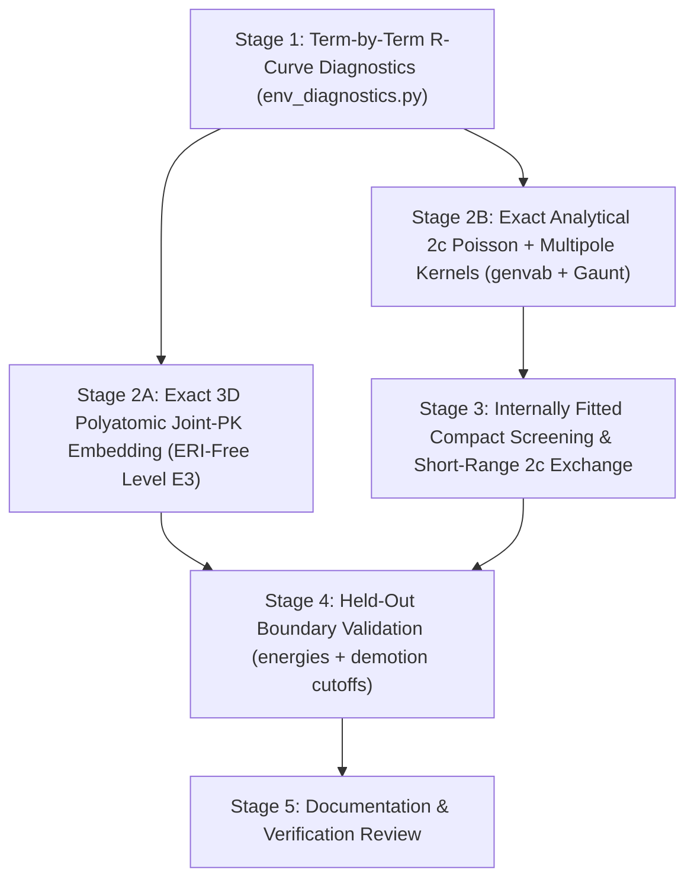

# Implementation Plan: Environment (Non-Bonded) Model Potential & PK Terms from Exact Two-Center Integrals

**Status:** Approved plan of record — execution pending (begins only after Phase 18 Stages 3–4 sign-off). Prepared Nov 18, 2026. In the repo this file lives at `docs/development/env-model-exact-integrals-plan.md`; link the executing pull requests here as they land.

**Roadmap Anchor:** `ROADMAP.md` (Part II — Open Model Items: "Environment (non-bonded) model potential and PK terms derived from the exact two-center integrals")
**Downstream Consumer:** `ROADMAP.md` (Open Model Item: "Near-linear pair handling: distance-based demotion, integral screening, and caching")

**Sequencing precondition — read first:** Do not begin this work until Phase 18 Stages 3–4 (NO on Ni(100) dissociation) have landed on `master`. Branch from the `master` tip at that time. This plan modifies `phatpsy/vb_driver.py` and `phatpsy/embedding.py`, which the Phase 18 work also touches; starting earlier guarantees a merge collision. Work on a branch, run `./make_build_test.sh` per the canonical verification loop, and open a pull request when Stage 5 is complete. Do not merge; Jack merges.

**Design decisions:** The four design questions raised in the original draft of this plan have been reviewed and resolved. They are stated as directives in §5, and the stage text below already reflects them. Do not reopen them without flagging it in your report.

---

## 1. Scientific Context & Root-Cause Codebase Audit

Under the **Option B** architecture (migration decision recorded in `ROADMAP.md`, Stage 3 diagnostic item: exact-integral localized VB for the bonded region, legacy model-potential/PK terms reserved for non-bonded interactions), covalently bonded active regions ($\mathcal{A}$) are solved variationally with exact two- and multi-center STO integrals, while frozen spectators, outer substrate rings, and long-range non-bonded pairs ($\mathcal{B}$) are delegated to the environment model-potential and Phillips-Kleinman (PK) layer.

The Stage 3 diagnostic (`phatpsy/vb_correction.py`, `tools/diagnose_diatomic_determinant.py`) showed that the current single-center functional's error $E_{\text{PHATPSY}}(R) - E_{\text{det}}(R)$ vanishes asymptotically ($0.01\text{ eV}$ on $\text{LiH}$ at $R = 8\text{ Bohr}$) but grows steeply inward ($-1.1\text{ eV}$ on $\text{LiH}$, $-14\text{ eV}$ on $\text{HF}$, $-38\text{ eV}$ on $\text{CO}$, $-44\text{ eV}$ on $\text{N}_2$ `DZ`, $-75\text{ eV}$ on $\text{N}_2$ `DZP`).

Auditing the live codebase reveals the exact mathematical mechanisms responsible across **both** non-bonded code surfaces:

### Surface A: Option B Spectator Embedding (`phatpsy/embedding.py`, `phatpsy/vb_driver.py`)

1. **Ad-hoc Heuristic in `environment_embedding="model_potential"` (`vb_driver.py`, `_apply_model_potential_spectators`):**
   - `_apply_model_potential_spectators` leaves the active overlap metric `ints.S` **unprojected** (no pseudometric $\tilde{\mathbf{S}}_{\text{eff}}$, no charge-conserving active ERI renormalization $\mathbf{W}$).
   - Spectators are accumulated **additively** ($\sum_B \mathbf{S}_{AB} \mathbf{D}_B \mathbf{S}_{BA}$) rather than through the joint environment metric inverse $(\mathbf{S}_{\mathcal{B}\mathcal{B}})^{-1}$, with eigenvalues heuristically clamped at `0.90`.
   - Pauli repulsion is multiplied by a **hardcoded constant `0.50` Ha** (`delta_h += 0.50 * P_reg`) regardless of whether the spectator shell is a $-300\text{ Ha}$ $\text{Ni}$ core, a $-20\text{ Ha}$ $\text{O } 1s$ core, or a $-0.5\text{ Ha}$ lone pair.
   - The spectator density in the PK term is built with `0.5 * spec_env.occ_weights` while the Coulomb term uses the full `spec_env.occ_weights` — an inconsistency between the two channels of the same function.
   - **Interatomic spectator–active exchange $-\mathbf{K}(\mathbf{D}_{\mathcal{B}})$ is completely omitted**.
2. **Polyatomic Cost & Multi-Spectator Coupling Gap in `environment_embedding="exact_joint_pk"` (`vb_driver.py`, `phatpsy/embedding.py`):**
   - Only collinear $z$-aligned active diatomics (`r_active_z == True`) dispatch to the ERI-free two-center engine `embed_diatomic_in_environment`. Every general 3D active geometry materializes full $(\mathcal{A} + \mathcal{B})$ multi-center two-electron integrals (`ab_ints`) and calls `embed_from_full_integrals(..., mode="huzinaga_pk")`.
   - Inside `embed_diatomic_in_environment`, off-diagonal blocks $\mathbf{S}_{E_i E_j}$ and $\mathbf{F}_{E_i E_j}$ of the joint environment matrix are populated **only** when both environment atoms are `same_center`; distinct external environment atoms $E_i \neq E_j$ default to $\mathbf{S}_{E_i E_j} = \mathbf{0}$ (unlike the specialized 8-atom slab routine `embed_collinear_in_c4v_slab`).

### Surface B: Single-Center Model Potential & PK Functional (`src/scf.f90`, `src/analys.f90`, `src/bloop.f90`)

1. **Electrostatic Channel (`cpot2` + `zpot2` vs Exact Two-Center Coulomb):**
   - For any exact electrostatic potential $V_{\text{el}}^B(\mathbf{r}) = \int \rho_B(\mathbf{r}') |\mathbf{r}-\mathbf{r}'|^{-1} d^3r'$, the one-electron integral $\int \rho_A(\mathbf{r}) V_{\text{el}}^B(\mathbf{r}) d^3r$ equals the exact two-center Coulomb integral $(\rho_A | \rho_B)$ **identically**.
   - The legacy error comes strictly from (i) **spherical $L=0$ truncation** (omitting $L \ge 1$ dipolar/quadrupolar/$d$-shell anisotropy) and (ii) **insufficiently tight radial screening exponents** in `TFEXP` ($\max \zeta_k = 3.52\,\text{rscale}$ vs $5.2\text{--}12.7\,\text{rscale}$ required for $1s$ cores, leaving potential errors up to $0.28\text{ Ha}$ at short range; see `ROADMAP.md`, TFEXP item).
   - Crucially, `src/twocenter.f90` (`genvab` and `d_genvab`) **already implements** exact closed-form elliptical STO integrals for arbitrary radial powers $r_B^{n_b - 1} e^{-\zeta r_B}$ (`lv >= 0`) and angular multipoles (`lv < 0`, `mv`).
2. **Pauli + Exchange Channel (`pkpot` + `xpot2` vs Exact $E_{\text{pauli}} = E_{\text{det}} - E_{\text{HP}}$):**
   - **Missing Cross-Fock Terms in Diagonal PK:** Replacing $(1 - P_B) F (1 - P_B) = F - P_B F - F P_B + P_B F P_B$ with $\sum_{j \in B} (\varepsilon - \varepsilon_j^B) |\phi_j^B\rangle\langle\phi_j^B|$ is exact *only* when $|\phi_j^B\rangle$ is an eigenfunction of the full molecular $F$ across $\mathcal{H}_A \oplus \mathcal{H}_B$. Because $|\phi_j^B\rangle$ is solved only in $\mathcal{H}_B$, the neglected off-diagonal residual $\Delta \mathbf{F}_{AB} = \mathbf{F}_{AB}\mathbf{C}_B - \mathbf{S}_{AB}\mathbf{C}_B \boldsymbol{\varepsilon}_B$ grows as $O(S_{AB})$, whereas exact Rayleigh-Ritz back-projection $\tilde{\mathbf{h}} = \mathbf{L}^T \mathbf{F}^{\mathcal{B}} \mathbf{L}$ with $\tilde{\mathbf{S}} = \mathbf{L}^T \mathbf{S} \mathbf{L}$ retains $\mathbf{F}_{AB}$ exactly, guarantees variationality, and locks `pk_scale = 1.0` without `H-X` or `w_HH = 0.40` patches.
   - **Mulliken-Projected One-Center Exchange (`xpot2`):** Projecting one-center exchange via overlap $\mathbf{S}_{AB} \mathbf{S}_B^{-1} \mathbf{K}_{BB} \mathbf{S}_B^{-1} \mathbf{S}_{BA}$ (`src/scf.f90`, `src/bloop.f90`) severely overestimates attractive interatomic exchange as $R$ decreases, driving the non-variational plunge below $E_{\text{det}}$.

---

## 2. Architecture & Staged Execution Workflow

Note the dependency change from the original draft: **Stage 3 depends on Stage 2B only.** Stage 2A is the largest engineering chunk in this plan; it must not gate Stage 3. Stage 2A joins at Stage 4 as one of the compared methods.

> [!IMPORTANT]
> **Anti-Circularity Invariant (`AGENTS.md` §1.5 & `docs/development/validation_standards.md`):** Every reference value used to design or fit a screening exponent or short-range exchange attenuation in Stage 3 must be computed solely from PHATPSY's own exact one- and two-center STO integrals (`phatpsy/two_center_integrals.py`, `phatpsy/multicenter_integrals.py`, `phatpsy/embedding.py`) on an explicit **Calibration Set**, never from experimental data, and must be verified on a strictly disjoint **Held-Out Validation Set** across full $R$-curves. **The Held-Out Set is locked:** do not inspect held-out results, and do not adjust any fit parameter, exponent range, or truncation ($K$, cutoffs, attenuation forms) in response to them, before the Stage 4 evaluation. Stage 4 is run once, as specified.

---

## 3. Detailed Stage-by-Stage Plan

### Stage 1: Channel-Resolved Model-vs-Exact $R$-Curve Diagnostic Suite

**Goal:** Measure the exact distance dependence ($R \in [1.8, 12.0]\text{ Bohr}$) of each individual approximation channel before changing any model code, separating operator error at fixed orbitals from self-consistent orbital-relaxation drift.

1. **New Diagnostic Module (`phatpsy/env_diagnostics.py`) & CLI Tool (`tools/diagnose_env_terms_vs_exact.py`):**
   - Extend `interatomic_decomposition` (`phatpsy/vb_correction.py`) so that for any pair $(A, B)$ at separation $R$ with frozen localized spin-orbitals $\{\phi_i^A, \phi_j^B\}$ (from isolated atomic RHF/ROHF or converged `phatpsy_scf` / `LocalizedVB` states), we compute:
     - **Exact Reference Channels (`ProlateGrid` + `one_center_coulomb_potential`):**
       - Exact classical electrostatic interaction:
         $$E_{\text{elst}}^{\text{exact}}(R) = \langle \rho_A | -Z_B r_B^{-1} \rangle + \langle \rho_B | -Z_A r_A^{-1} \rangle + (\rho_A | \rho_B) + \frac{Z_A Z_B}{R}$$
       - Exact spherical ($L=0$) vs multipolar ($L \ge 1$) Coulomb split:
         $$(\rho_A | \rho_B) = (\rho_A | V_{\text{Coul}, L=0}^B) + \sum_{L=1}^{2 l_{\max}} (\rho_A | V_{\text{Coul}, L}^B)$$
       - Exact Pauli decomposition ($E_{\text{pauli}}^{\text{exact}} = E_{\text{det}} - E_{\text{HP}}$):
         $$E_{\text{pauli}}^{\text{exact}}(R) = \Delta E_{\text{orth}, 1e}(R) + \Delta E_{\text{orth}, J}(R) + E_{K, \text{inter}}^{\text{exact}}(R) + \Delta E_{K, \text{intra}}(R)$$
         isolating pure two-center exchange $E_{K, \text{inter}}^{\text{exact}}(R) = -\sum_\sigma \sum_{i \in A, j \in B} (i_\sigma j_\sigma | j_\sigma i_\sigma)$ from Löwdin metric orthogonalization kinetic/Coulomb repulsion.
     - **Model Comparison Channels (evaluated on the identical orbitals):**
       1. Legacy `TFEXP` grid-fitted screening (`fit_screening_simplex`) vs exact $L=0$ Poisson potential $V_{\text{Coul}, L=0}^B$,
       2. Legacy overlap-projected exchange (`xpot2` = $\mathbf{S}_{AB} \mathbf{S}_B^{-1} \mathbf{K}_{BB} \mathbf{S}_B^{-1} \mathbf{S}_{BA}$) vs $E_{K, \text{inter}}^{\text{exact}}(R)$,
       3. Legacy regularized PK (`regularize_pk_projector`) vs symmetric Huzinaga ($\mathbf{F}_{AA} - \mathbf{S}_{AB}\mathbf{E}_B\mathbf{S}_{BA}$) vs exact Rayleigh-Ritz back-projection ($\mathbf{L}^T \mathbf{F}^B \mathbf{L}$ in metric $\mathbf{L}^T \mathbf{S} \mathbf{L}$),
       4. Current `_apply_model_potential_spectators` (`0.50 * P_reg`, unprojected `S`, zero exchange).
2. **Strict Dataset Partition (Calibration vs Held-Out):**
   - **Calibration Set (allowed for Stage 3 internal integral fitting):** $\text{He}_2$, $\text{Ne}_2$ (closed-shell non-bonded prototypes), $\text{LiH}$, $\text{HF}$, $\text{N}_2$, $\text{CO}$ in `DZ` and `DZP` across $R \in [1.8, 12.0]\text{ Bohr}$.
   - **Held-Out Validation Set (locked until Stage 4 evaluation):**
     - *Weakly bound complexes:* $\text{H}_2 \cdots \text{He}$, $\text{H}_2 \cdots \text{Ne}$, $\text{Ar} \cdots \text{HF}$,
     - *Hydrogen-bonded dimers:* $(\text{H}_2\text{O})_2$ and $(\text{HF})_2$ along intermolecular stretch ($R_{\text{X}\cdots\text{H}} \in [2.5, 9.0]\text{ Bohr}$),
     - *Adsorbate–surface boundary regime:* $\text{CO}/\text{Ni}(100)$ and $\text{NO}/\text{Ni}_4\text{Ni}_9(100)$ vertical approach ($z \in [3.2, 8.5]\text{ Bohr}$).
   - Note: nickel appears **only** in the Held-Out Set, deliberately — the adsorbate–surface systems are the examination, not the homework. The Ni screening exponents of Stage 3.2 therefore carry the full transfer burden, and the Stage 4 Ni curves are the make-or-break test of this item. State this in the Stage 4 report.
3. **Stage 1 Gate:** Committed JSON/Markdown diagnostic report quantifying each channel's crossover radius $R_{\text{cut}}(\epsilon)$ at $\epsilon = 1.0\text{ mHa}$ and $0.2\text{ mHa}$, plus unit tests in `tests/test_env_diagnostics.py` verifying exact identity $\sum_{\text{channels}} = E_{\text{det}}$ to $< 10^{-7}\text{ Ha}$.

---

### Stage 2: Exact Two-Center Constructions Over Fits (ERI-Free Polyatomic Embedding)

**Goal:** Replace every approximate or O($N^4$) spectator path where an **exact one-/two-center construction** already exists, extending the Stage 9 joint-$(\mathbf{S}_{\mathcal{B}\mathcal{B}})^{-1}$ precedent (`pk_scale = 1.0` identically, $\tilde{\mathbf{S}}_{\text{eff}} \succ 0$) to arbitrary 3D polyatomics and analytical STO kernels.

#### 2A. General 3D ERI-Free Joint-PK Embedding (`embed_polyatomic_in_environment` in `phatpsy/embedding.py`)
- Generalize `embed_diatomic_in_environment` to arbitrary 3D active regions $\mathcal{A}$ ($N_{\mathcal{A}} \ge 1$) and arbitrary collections of closed-shell or ROHF/spin-polarized `FrozenEnvironmentAtom` centers $\mathcal{B} = \mathcal{B}_{\text{core}(\mathcal{A})} \cup \mathcal{B}_{\text{spec}}$:
  1. **Exact Analytic All-Multipole Environment Electrostatics:** Evaluate $V_{\text{es}}^E(\mathbf{r}) = -Z_E r_E^{-1} + V_{\text{Coul}}^E(\mathbf{r})$ for every $E \in \mathcal{B}$ using exact Gaunt + Laplace incomplete-gamma `one_center_coulomb_potential` on each active one-center spherical grid and active pair `ProlateGrid` — **exact through $L = 2 l_{\max}$ with zero fitting and zero 3-/4-center ERIs**.
  2. **True Joint $(\mathbf{S}_{\mathcal{B}\mathcal{B}}^{\text{orb}})^{-1}$ Across All Environment Pairs:** Populate off-diagonal $\mathbf{S}_{E_i E_j}$ and $\mathbf{F}_{E_i E_j}$ blocks for *all* overlapping environment pairs $(E_i, E_j)$ (both active-core–spectator and spectator–spectator pairs with $R_{ij} \le R_{\text{ovlp\_cut}}$, fixing the $E_i \neq E_j$ omission in `embed_diatomic_in_environment`), guaranteeing $\tilde{\mathbf{S}}_{\text{eff}} = \mathbf{S}_{\mathcal{A}\mathcal{A}} - \mathbf{S}_{\mathcal{A}\mathcal{B}} \mathbf{D}_{\mathcal{B}} \mathbf{S}_{\mathcal{B}\mathcal{A}} \succ 0$ at unit scaling (`pk_scale = 1.0`).
  3. **Exact Rayleigh-Ritz Back-Projected One-Electron Operator:**
     $$\tilde{\mathbf{h}} = \mathbf{F}_{\mathcal{A}\mathcal{A}}^{\mathcal{B}} - \mathbf{F}_{\mathcal{A}\mathcal{B}}^{\mathcal{B}} \mathbf{P}_{\mathcal{B}\mathcal{A}} - \mathbf{P}_{\mathcal{B}\mathcal{A}}^T \mathbf{F}_{\mathcal{B}\mathcal{A}}^{\mathcal{B}} + \mathbf{P}_{\mathcal{B}\mathcal{A}}^T \mathbf{F}_{\mathcal{B}\mathcal{B}}^{\mathcal{B}} \mathbf{P}_{\mathcal{B}\mathcal{A}}, \qquad \mathbf{P}_{\mathcal{B}\mathcal{A}} = (\mathbf{S}_{\mathcal{B}\mathcal{B}}^{\text{orb}})^{-1} \mathbf{S}_{\mathcal{B}\mathcal{A}}$$
     paired with charge-conserving active ERI renormalization $\tilde{\mathbf{V}}_{\mathcal{A}} = \mathbf{W}^{\otimes 4} \mathbf{V}_{\mathcal{A}\mathcal{A}\mathcal{A}\mathcal{A}}$ (`_renormalize_active_eri`).
  4. **Spin-Weighted / Open-Shell Spectator Support:** Handle fractional/spin-polarized `occ_weights` (e.g., ferromagnetic $\text{Ni}(100)$ slab spectators from `EmbeddedAtomState`) uniformly in 3D without requiring collinear $z$-axis symmetry, and preserve neutral-slab asymptotic monopole cancellation options where appropriate. The `occ_weights` convention must be **one** convention, applied identically in every channel (Coulomb, PK, exchange) — the current full-vs-half inconsistency (§1, Surface A.1) must not survive in any form.
- **Driver Integration (`phatpsy/vb_driver.py`):** Route `environment_embedding="exact_joint_pk"` for all 3D geometries through `embed_polyatomic_in_environment`, eliminating the full $(\mathcal{A}+\mathcal{B})$ `ab_ints` ERI build.

#### 2B. Exact Closed-Form Two-Center Analytical Electrostatic & Overlap Kernels (`phatpsy/exact_2c_potentials.py`)
- Eliminate numerical 3D grid integration for one-center active blocks $\langle \chi_\mu^A | V_{\text{es}}^E | \chi_\nu^A \rangle$ and active–environment overlaps $\mathbf{S}_{AE}$ by exploiting the exact analytical STO structure coupled to Fortran `src/twocenter.f90`:
  - **Exact Analytical Overlaps $\mathbf{S}_{AE}$ & $\mathbf{S}_{E_i E_j}$:** Compute via `compute_gensab` + `compute_rotsab` (already compiled in `_phatpsy_core.twocenter`), verified to $< 10^{-12}$ against `ProlateGrid`.
  - **Exact Analytical $L=0 \dots 2 l_{\max}$ Poisson Expansion in `genvab` Basis:** For any frozen density $\mathbf{D}_E$ on center $E$, its exact Laplace potential (`_radial_multipole_potential` in `phatpsy/embedding.py`) is a **finite analytical sum** of Slater-Yukawa radial-multipole terms with pair-sum exponents $\zeta_{\mu\nu} = \zeta_\mu + \zeta_\nu$ and integer powers $r_E^{k-1} e^{-\zeta_{\mu\nu} r_E}$. Map the $L=0$ spherical terms directly to `compute_genvab` (`lv = k >= 0`, `vexp = \zeta_{\mu\nu}$) — giving **exact analytical two-center electrostatic penetration with zero quadrature and zero fitting** — and benchmark `lv < 0` / Gaunt multipole terms against `one_center_coulomb_potential`.
  - **Differentiability constraint (design, not delivery):** Every operator introduced in 2B and Stage 3 must remain a closed-form function of the nuclear coordinates through these analytical kernels (`compute_gensab` / `compute_genvab`, whose derivative kernels `compute_d_gensab` / `compute_d_genvab` already exist in `src/twocenter.f90`). Analytical spectator gradients are a separate follow-on commission (see §6); this plan must not introduce any operator whose form would block them.
- **Stage 2 Gate:** On $\text{LiH}$, $\text{N}_2$, $\text{H}_2\text{O} + \text{He}$ (3D non-collinear), and tilted $\text{CO}/\text{Ni}_2 + \text{Ni}_{\text{spec}}$, `embed_polyatomic_in_environment` (`exact_joint_pk`) reproduces Level E2 (`unprojected_eri` from full 3c/4c integrals) to $< 0.5\text{ mHa}$ across $R \ge 2.5\text{ Bohr}$ while keeping $\lambda_{\min}(\tilde{\mathbf{S}}_{\text{eff}}) > 0$ everywhere with `pk_scale = 1.0`.

---

### Stage 3: Internally Derived Parametric Screening & Fast Two-Center Exchange

**Goal:** Where a compact parametric operator is still required — specifically (a) fast quadrature-free `environment_embedding="model_potential"` for distant/demoted spectators and (b) compact `NVTERM` screening tables — derive and fit every parameter **exclusively against Stage 1–2 exact two-center integrals** on the Calibration Set.

1. **Overhaul `environment_embedding="model_potential"` (`vb_driver.py` `_apply_model_potential_spectators` $\to$ `embed_model_potential_spectators` in `phatpsy/embedding.py`):**
   - **Retire** the unprojected metric, pairwise `0.90` eigenvalue clamp, and hardcoded `0.50 Ha` PK constant.
   - **PK / Orthogonality Term (Exact Construction, Zero Fit):** Use the exact analytical two-center overlaps $\mathbf{S}_{AE}$ (`compute_gensab`), exact joint $(\mathbf{S}_{\mathcal{B}\mathcal{B}}^{\text{orb}})^{-1}$ projector, pseudometric $\tilde{\mathbf{S}}_{\text{eff}} = \mathbf{S}_{\mathcal{A}\mathcal{A}} - \mathbf{S}_{\mathcal{A}\mathcal{B}}\mathbf{D}_{\mathcal{B}}\mathbf{S}_{\mathcal{B}\mathcal{A}}$ (with $\mathbf{W}$ renormalization on $\mathbf{V}_{\mathcal{A}}$), and analytical Huzinaga/back-projected kinetic + potential coupling built from each spectator's exact 1-center Fock matrix $\mathbf{F}_{EE}$. Cost is purely matrix multiplication of tiny analytical 2-center overlap/potential blocks.
   - **Electrostatic Term:** Use Stage 2B's exact analytical `compute_genvab` Poisson sum (or compact internally fitted screening below when `EmbeddedAtomState.model_potential` coefficients are supplied), plus exact analytical point-dipole/quadrupole asymptotics for $L=1, 2$ beyond overlap range.
   - **Short-Range Two-Center Exchange Representation (Calibrated Strictly to Exact $\mathbf{K}_{AE}^{\text{exact}}(R)$):** The `model_potential` path serves **demoted, non-bonded** pairs; its exchange must be accurate in the non-bonded regime ($R \ge R_{\text{vdW}} - 0.5$ Bohr and outward). Do not spend effort matching exact exchange at bonded distances in this path — bonded pairs never reach it. Implement the candidates **in this order**:
     1. *Localized Resolution-of-Identity (2c-RI) Exchange (primary — a construction, not a fit):* Project $\chi_\mu^A \psi_b^E$ onto the two-center auxiliary STO pair space on $(A, E)$ using exact analytical 1-center Slater integrals $R^L$ and 2-center overlaps $\mathbf{S}_{AE}$. This form has **zero fitted parameters** and is preferred on Anti-Circularity grounds.
     2. *Range-Attenuated Overlap Exchange (fallback — only if 2c-RI misses the Stage 3 Gate):* $\mathbf{K}_{AA}^{(E)}(R) = \mathbf{S}_{AE} \, \mathbf{G}_E \, \mathbf{K}_{EE} \, \mathbf{G}_E^T \mathbf{S}_{EA}$, fitted **solely** to minimize $\sum_{R \in \text{Cal}} \|\mathbf{K}^{\text{model}}(R) - \mathbf{K}^{\text{exact}}(R)\|_F^2$ across the Calibration Set, with exact smooth $C^2$ cutoff when $\|\mathbf{S}_{AE}\| < 10^{-5}$. **Constraint on the fit:** the attenuation $\mathbf{G}_E$ must be a function of dimensionless overlap invariants (eigenvalues of the overlap metric), **not of $R$ directly** — an $R$-parameterized attenuation does not transfer off the calibration pairs and reproduces the Mulliken projection's medium-$R$ over-binding failure in fitted form. Whichever candidate is not adopted is documented with its measured error in the Stage 3 report, not silently dropped.
2. **Internal-Reference Element Screening Exponents (`phatpsy/screening_fit.py`):**
   - Resolve the `TFEXP` core-cusp exponent gap documented in `ROADMAP.md`: generate per-element ($Z = 1 \dots 36$, including $\text{Ni}$) compact screening exponent sets $\{\zeta_k^Z\}_{k=1}^K$ ($K = 5\text{--}6$) by minimizing the weighted two-center electrostatic integral residual
     $$\mathcal{L}(\{\zeta_k^Z\}) = \int_{R_{\min}}^{\infty} w(R) \left| (\rho_A^{\text{RHF}} | V_{\text{fit}}^Z)(R) - (\rho_A^{\text{RHF}} | V_{\text{exact}, L=0}^Z)(R) \right|^2 dR$$
     under exact simplex NNLS constraints ($w_k \ge 0, \sum_k w_k = 1$, exact nuclear cusp and Poisson charge conservation).
   - Expose as an opt-in element preset (`potential_exponents` / internal table) with full provenance script `tools/fit_internal_screening_exponents.py` so every number is reproducible from exact integrals from scratch. **Opt-in means opt-in:** the preset must not change any default behavior anywhere — in particular not the defaults of the legacy `phatpsy_scf` engine (see §5, Decision 1).
3. **Stage 3 Gate:** Zero experimental constants appear anywhere in code or fitting scripts (verified by code audit); on the Calibration Set, `environment_embedding="model_potential"` removes the `0.50 Ha` artifact and matches `exact_joint_pk` within $< 1\text{ mHa}$ across the non-bonded regime ($R \ge R_{\text{vdW}} - 0.5\text{ Bohr}$). **Additionally, a unit test must pin the removal:** a test in `tests/test_env_diagnostics.py` (or a dedicated test module) asserting that the spectator code path contains no numeric PK/screening literals and that the `0.90` clamp and `0.50 Ha` constant do not reappear — the removal is pinned by a test, not only by a one-time audit.

---

### Stage 4: Held-Out Full $R$-Curve Validation (Energies & Demotion Cutoffs)

**Goal:** Prove transferability on the locked **Held-Out Validation Set** across full $R$-curves using the Stage 3 exact-determinant / exact-embedding detector, and produce the demotion boundary contract for the downstream pair-handling item. (Analytical spectator gradients are **not** part of this stage or this commission — see §6.)

1. **Held-Out Boundary-Regime Benchmark (`tools/validate_env_boundary_curves.py` & `tests/test_env_boundary_validation.py`):**
   - Evaluate full potential energy curves $E(R)$ and interaction curves $\Delta E_{\text{int}}(R) = E(R) - E(R_{\max})$ across:
     1. **Rare-Gas / Weakly Bound Complexes:** $\text{H}_2 \cdots \text{He}$, $\text{H}_2 \cdots \text{Ne}$, $\text{Ar} \cdots \text{HF}$ ($R = 2.5 \dots 10.0\text{ Bohr}$), comparing Full Exact VB vs `exact_backprojected` (E1) vs 3D ERI-free `exact_joint_pk` (E3) vs upgraded `model_potential`.
     2. **Hydrogen Bonds:** Water dimer $(\text{H}_2\text{O})_2$ and $(\text{HF})_2$ ($R_{\text{O}\cdots\text{O}} / R_{\text{F}\cdots\text{F}} = 4.2 \dots 10.0\text{ Bohr}$), quantifying the exact distance $R_{\text{boundary}}$ at which treating the H-bond acceptor/donor as a non-bonded spectator deviates from 2-monomer active `MaskedVB` (polarization + charge-transfer onset).
     3. **Longer-Range Adsorbate–Surface Approach:** $\text{CO}/\text{Ni}(100)$ and $\text{NO}/\text{Ni}_4\text{Ni}_9(100)$ ($z = 3.2 \dots 8.5\text{ Bohr}$), measuring outer-ring spectator accuracy and verifying strictly positive pseudometric eigenvalues ($\lambda_{\min}(\tilde{\mathbf{S}}_{\text{eff}}) > 0$), smooth monotonic long-range tails, and virial ratios ($|-V/T - 2.0| \le 0.05$ at equilibrium).
   - **The accuracy gate is stated on interaction energies:** $|\Delta E_{\text{env}}(R)| \le 1.0\text{ mHa}$ on $\Delta E_{\text{int}}(R)$ in the non-bonded regime. Demotion decisions consume energy differences, not absolute energies; report both, gate on the difference.
   - **Quantitative Demotion Boundary Table:** Record the verified cutoff radii $R_{\text{demote}}(\text{element pair}, \epsilon)$ for $\epsilon \in \{0.2, 1.0\}\text{ mHa}$ as the direct input contract for the `ROADMAP.md` pair-handling item. ($1.0\text{ mHa}$ is the operative gate; $0.2\text{ mHa}$ is recorded as the conservative bound.)

---

### Stage 5: Documentation, Schema Hygiene & Canonical Verification

1. **Documentation Updates (per `AGENTS.md` §3 Rules 4–9):**
   - Update `docs/science/model_potentials.md` (§10), `docs/science/methodology_overview.md` (§16), and `docs/science/equation_mapping.md` with the exact equations, Stage 1–4 $R$-curve error tables, and demotion boundary radii (using MkDocs `!!!` admonitions, fenced language tags, GitHub permalinks/inline code spans, and explicit code/`ROADMAP.md` citations).
   - Mark the item `[x]` in `ROADMAP.md` with measured error metrics and provenance script paths.
   - Ensure all YAML/Python documentation snippets pass `tests/test_docs_examples.py` and `tools/lint_docs.py`.
2. **Canonical Build & Independent Verification Review (`AGENTS.md` §4):**
   - Execute `./make_build_test.sh` (0 failed, 0 errors, no regressions in quarantined or active suites).
   - Run the independent `verification-review` skill pass to audit anti-circularity, physical invariants (virial, translational/rotational invariance, positive pseudometric), and protected basis files (`phatpsy/data/*.json` untouched).

---

## 4. Files to Create / Modify (When Approved)

| File | Action | Purpose |
| :--- | :--- | :--- |
| `phatpsy/env_diagnostics.py` | **Create** | Channel-resolved model-vs-exact $R$-curve error decomposition ($L=0$ Coulomb, $L \ge 1$ multipoles, 2c exchange, PK/Huzinaga orthogonalization). |
| `phatpsy/exact_2c_potentials.py` | **Create** | Analytical two-center overlap & exact one-center Poisson-to-`genvab` potential builder. (Derivative wrappers belong to the §6 follow-on.) |
| `phatpsy/screening_fit.py` | **Create** | Non-circular internal-reference screening exponent & short-range 2c exchange attenuator fitter against exact two-center STO integrals. |
| `phatpsy/embedding.py` | **Modify** | Add general 3D `embed_polyatomic_in_environment` (ERI-free Level E3 with full external $(E_i, E_j)$ joint $(\mathbf{S}_{\mathcal{B}\mathcal{B}})^{-1}$) and `embed_model_potential_spectators`. |
| `phatpsy/vb_driver.py` | **Modify** | Replace `_apply_model_potential_spectators` (`0.50 Ha` heuristic) and the $O(N^4)$ `ab_ints` fallback in `exact_joint_pk`. |
| `tools/diagnose_env_terms_vs_exact.py` | **Create** | Reproducible CLI runner generating Stage 1 channel-error $R$-curves. |
| `tools/fit_internal_screening_exponents.py` | **Create** | Reproducible provenance script fitting compact element screening exponents strictly to exact 1c/2c STO integrals on the Calibration Set. |
| `tools/validate_env_boundary_curves.py` | **Create** | Held-out boundary validation runner ($\text{H}_2\cdots\text{He/Ne}$, $(\text{H}_2\text{O})_2$, $(\text{HF})_2$, $\text{CO}$ & $\text{NO}$ on $\text{Ni}(100)$) producing demotion cutoffs. |
| `tests/test_env_diagnostics.py` | **Create** | Unit & physics-invariant tests for exact channel sum rules, 3D ERI-free polyatomic embedding, held-out $R$-curve bounds, and the no-numeric-literals pin on the spectator path. |
| `tests/test_env_boundary_validation.py` | **Create** | Held-out boundary-regime tests (Stage 4). |
| `docs/science/*.md`, `ROADMAP.md` | **Modify** | Scientific documentation, equation mapping, and roadmap completion record. |

---

## 5. Design Decisions (Resolved — Do Not Reopen Without Flagging)

1. **Scope Boundary with Legacy `phatpsy_scf` (`src/scf.f90` / `src/bloop.f90`): KEEP THE LEGACY FORMULAS UNTOUCHED.** The algorithmic PK/exchange replacements in this plan apply to `phatpsy/embedding.py` and `phatpsy/vb_driver.py` (`exact_joint_pk` and `model_potential`) only. Rationale, from the repository's own record: (i) the documentation-reframe Open Model Item in `ROADMAP.md` defines `method: phatpsy_scf` as heritage, documented in its current role (environment/non-bonded treatment and the `phatpsy_scf` option), not as the product's center; (ii) the CPHF gradient machinery is validated against the current Fortran formulas (`tests/test_cphf.py`, `tests/test_grid_fit.py`) — changing them reopens validated parity baselines for no benefit to the localized VB architecture; (iii) the internally fitted screening exponents of Stage 3.2 are exposed to `phatpsy_scf` only as an **opt-in** `potential_exponents` preset, which changes no default and no formula. **Do not add an opt-in flag inside the Fortran Fock/PK formulas in this commission.**
2. **Short-Range Two-Center Spectator Exchange in `model_potential` Mode: 2c-RI FIRST, ATTENUATED OVERLAP ONLY AS A GATED FALLBACK.** Order and constraints are specified in Stage 3.1: the localized 2c-RI projection (zero fitted parameters, built from analytical 1c Slater integrals + 2c `gensab` overlaps) is the primary form; the shell-resolved overlap-attenuated operator is implemented only if 2c-RI misses the Stage 3 Gate, and any attenuation must be a function of dimensionless overlap invariants, never of $R$ directly. Accuracy is required in the non-bonded regime only (see Stage 3.1) — this path never sees bonded pairs.
3. **Calibration vs Held-Out Split & Target Demotion Tolerance: AS SPECIFIED IN STAGES 1 AND 4.** Calibration $\{\text{He}_2, \text{Ne}_2, \text{LiH}, \text{HF}, \text{N}_2, \text{CO}\}$; Held-out $\{\text{H}_2\cdots\text{He}, \text{H}_2\cdots\text{Ne}, \text{Ar}\cdots\text{HF}, (\text{H}_2\text{O})_2, (\text{HF})_2, \text{CO}/\text{Ni}(100), \text{NO}/\text{Ni}(100)\}$, locked until Stage 4 (see the Anti-Circularity box in §2). Target gate $|\Delta E_{\text{env}}(R)| \le 1.0\text{ mHa}$ ($\approx 0.63\text{ kcal/mol}$) **on interaction energies** $\Delta E_{\text{int}}(R)$, with demotion radii recorded at both $\epsilon = 1.0$ and $0.2\text{ mHa}$.
4. **Analytical Spectator Gradients: SPLIT INTO A FOLLOW-ON COMMISSION (see §6).** This commission delivers energies and demotion cutoffs (Stages 1–5). It does **not** include analytical gradients for the `model_potential` spectator path. The design constraint that makes the split safe is mandatory, however: every operator introduced here stays closed-form in the nuclear coordinates via the analytical `gensab`/`genvab` kernels, so the follow-on is differentiation, not redesign (Stage 2B). Geometry work is not blocked meanwhile: the exact-path embedding-response gradients already exist (the corresponding `ROADMAP.md` Open Model Item is marked complete — closed-form Schur-complement metric-response gradients, verified vs finite differences at $< 10^{-5}$ Ha/Bohr in `tests/test_no_ni100_dissociation.py`, Gates 1a/1b).

---

## 6. Follow-On (Not Part of This Commission)

**Analytical nuclear gradients for the upgraded `model_potential` spectator path.** Differentiate $(\tilde{\mathbf{S}}_{\text{eff}}(\mathbf{R}), \tilde{\mathbf{h}}(\mathbf{R}), \tilde{V}_{nn}(\mathbf{R}))$ with respect to active and spectator nuclear coordinates using the exact analytical Fortran derivative kernels `compute_d_gensab` and `compute_d_genvab` (`src/twocenter.f90`) plus Schur-complement metric response (matching the CPHF-free formulation of the completed embedding-response gradients item). Acceptance for that follow-on: parity against central finite differences ($h = 10^{-4}$ Bohr) to $< 10^{-5}$ Ha/Bohr across 3D off-axis active + spectator coordinates, with exact translational invariance ($\|\sum_A \mathbf{F}_A\| < 10^{-10}$ Ha/Bohr). It will be commissioned separately once Stages 1–5 above are signed off.
