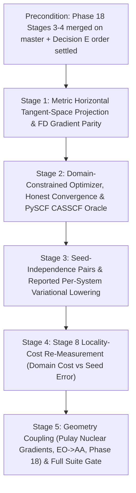

# Plan: Variational Optimization of the VB Orbitals Within Their Declared Domains (Masked Orbital Optimization)

**Status:** Draft — prepared Nov 18, 2026; executing PRs linked as they land  
**Roadmap item:** `ROADMAP.md`, Part II — *Variational optimization of the VB orbitals within their declared domains (masked orbital optimization)* (`ROADMAP.md`, line 223)  
**Audit baseline:** `master` at commit `891f64eac7a8b5b82baaf5fb54d620f303888550`  
**Target engine:** Primary exact-integral localized valence-bond architecture (`control.method: localized_vb` and `control.method: masked_vb`)  
**Executing PRs:** *(none yet — populate as stage PRs open and merge)*

---

## Scope, Guardrails, Governing Rules, and Sequencing Preconditions

### Methodological Role
PHATPSY 2.0's primary electronic-structure engine (`control.method: localized_vb` / `masked_vb`) confines each molecular or hybrid orbital $p$ to a user-declared atomic domain — materialized as an AO index mask $M_p \subseteq \{0, \dots, N_{\text{AO}} - 1\}$ from `domain_mode`, `AtomConfig.orbital_domains`, or `ControlConfig.vb_orbital_specs`. Historically, the ROADMAP characterized the general `MaskedVB` path as "CASCI over constructed orbitals" whose energies depend on seed-hybrid heuristics. As verified in §1 below, `master` already runs a first-generation Euclidean BFGS wrapper (`optimize_masked_vb`), but that wrapper leaves redundant intra-domain gauge rotations unprojected on all-electron runs, substitutes soft penalties and a biasing Gram-eigenvalue barrier on embedded runs, and marks unconverged gradients (`< 5e-4` to `2e-3` Ha) as converged.

This plan upgrades `MaskedVB` into a genuine, seed-independent, domain-constrained variational solver: each orbital's AO coefficients within $M_p$ become true stationary parameters of the active-space energy in the nonorthogonal AO metric $S$, with all redundant intra-domain rotations projected out on the horizontal tangent space and zero artificial barrier bias. Completing this work converts the shipped localized VB method to "variational throughout, within declared domains" — the exact mathematical formulation required for the PHATPSY 2.0 methods paper.

### Binding Guardrails (`ROADMAP.md`, line 223)
1. **Domains are fixed model inputs, never optimizer outputs:** For every orbital $p$, $[c_p]_\mu = 0$ identically for all $\mu \notin M_p$ at initialization, at every line-search/trust-region trial point, and at convergence. The optimizer never widens $M_p$. If a chemical process requires delocalization onto an additional center, the answer is a different domain declaration by the user; the propose/review/edit workflow of `domain_mode` and `vb_orbital_specs` is unchanged.
2. **Out of scope:**
   - **STO exponent ($\zeta$) optimization:** Tracked separately in `ROADMAP.md` (line 224) and requires integral derivatives $\partial(\mu\nu|\lambda\sigma)/\partial\zeta$ not needed for linear intra-domain AO mixing.
   - **BOVB-style per-structure orbital breathing:** Orbitals remain common to the active-space CI expansion within a single `MaskedVB` state; breathing-orbital VB with distinct orbital sets per spin-coupled structure is out of scope.

### Governing Project Invariants
All stages execute under `AGENTS.md`, `.agents/rules/scientific-integrity.md`, and [Validation Standards](validation_standards.md):

- **Atomic units:** All energies (Hartree), lengths (Bohr), orbital gradients (Hartree per dimensionless metric-normalized rotation radian), and nuclear gradients ($\text{Ha}/\text{Bohr}$) remain strictly in atomic units internally; eV and $\text{kcal/mol}$ conversions occur only at reporting boundaries.
- **Anti-Circularity Invariant (`AGENTS.md` §1.5):** Zero benchmark energies, PySCF CASSCF reference values, bond angles, or Stage 8 locality figures may appear as constants, damping floors, or stopping targets in `phatpsy/`. Independent PySCF `mcscf.CASSCF` and central finite-difference oracles are computed dynamically inside `tests/`.
- **Docs-first for physics changes:** Mathematical updates to [Methodology Overview](../science/methodology_overview.md) and [Equation Mapping](../science/equation_mapping.md) documenting the metric-weighted horizontal tangent-space projection and domain-constrained stationarity conditions land before or in the same PR as solver code. Any `ControlConfig` schema addition regenerates `docs/reference/*` via `tools/docs_gen.py` in the same commit (`AGENTS.md` §3 Rules 4–5).
- **Protected paths (`AGENTS.md` §5):** `phatpsy/data/*.json` basis tables are untouched. Existing tests in `tests/` are never weakened mid-fix to mask regressions.
- **Scope and regression discipline:** Unlike legacy-SCF maintenance, this plan modifies the core localized VB path (`phatpsy/localized_vb.py` and `phatpsy/vb_driver.py`). Every stage must keep `./make_build_test.sh`, `tools/lint_docs.py`, and `tests/test_docs_examples.py` green — explicitly including the EO$\to$AA stationary points and IRC suite (`tests/test_eo_to_aa_localized_vb.py`) and the Phase 18 chemisorption/SCLS suite (`tests/test_no_ni100_dissociation.py`). **Any numerical shift to a shipped result caused by achieving true intra-domain stationarity must be reported explicitly as a numerical deviation with its physical/algorithmic cause, never silently absorbed.**

### Sequencing Preconditions and Coordination
1. **Wait for Phase 18 Stages 3–4:** Execution of Stage 1 begins **only after Phase 18 Stages 3–4 have merged to `master`**, because Phase 18 exercises `phatpsy/vb_driver.py` and `phatpsy/chemisorption.py` (`compute_delta_casscf_core_1s_be`) heavily.
2. **Coordination with the environment-model exact-integrals plan (`docs/development/env-model-exact-integrals-plan.md`):** Both plans modify `phatpsy/vb_driver.py` inside `LocalizedVBDriver.run_deck` and `LocalizedVBDriver.energy_and_gradient`. Their relative execution order is **Jack's decision** (posed explicitly in §3 Decision E rather than assumed here).
3. **Independence from performance items:** Per `ROADMAP.md` (lines 218–223), this plan is independent of multicenter quadrature threading and distant-pair integral screening.
4. **Branch and merge discipline:** Each stage lands on its own feature branch via pull request against `master`, verified by `./make_build_test.sh` with terminal output pasted in the PR description; Jack reviews and merges.

---

## 1. Audit of Current-State Claims Against `master` (`891f64e`)

Per project rules, every current-state claim in `ROADMAP.md` (line 223) and the planning brief was audited directly against `master` (`891f64eac7a8b5b82baaf5fb54d620f303888550`). Several substantive differences between the brief's summary and the live code were found and are flagged explicitly below.

| # | Claim in `ROADMAP.md` / Brief | Verdict on `master` (`891f64e`) | Primary Evidence (`file:line`) |
| :--- | :--- | :--- | :--- |
| **1** | General `MaskedVB` is purely "CASCI over constructed orbitals" (stops at seed hybrids without orbital optimization). | **FLAGGED (Partially Divergent)** — `master` already calls `optimize_masked_vb` (analytic-gradient Euclidean BFGS) on every `MaskedVB` path, and has **no** zero-iteration CASCI switch in `vb_driver.py`. Seed dependence persists due to four concrete defects in `MaskedVB.optimize` (unprojected gauges when `use_gauge=False`, soft penalties + Gram barrier when `use_gauge=True`, `5e-4`/`2e-3` false-convergence overrides, and 60-step Blyholder caps). | `phatpsy/localized_vb.py:1016-1208`; `phatpsy/vb_driver.py:1637,1792-1800,2164,2197,2353,2647-2651` |
| **2** | Analytic orbital gradients already exist in the diatomic/pair layer (`LocalizedVBModel`, behind $\text{N}_2$ VB $R_e/\omega_e$). | **VERIFIED WITH SCOPE LIMITS** — `cas_energy_and_gradient` computes exact analytic CAS orbital gradients in metric $S$ from 1-/2-RDMs, but `LocalizedVBModel` covers only $z$-aligned, spectator-free, `strict_1c` main-group diatomics ($Z \in \{1,3,5,6,7,8,9\}$, $|m| \le 1$, equal active electrons) and raises `NotImplementedError` for `pp` and `covalent` (falling back to central FD). | `phatpsy/localized_vb.py:448-558,702-715,806,1244-1260`; `phatpsy/vb_driver.py:2137-2148,2219` |
| **3** | `tools/relax_orbitals_hl.py` is an existing precedent for analytic orbital gradients. | **FLAGGED (Does Not Hold)** — `tools/relax_orbitals_hl.py` calls `scipy.optimize.minimize(..., method="BFGS")` **without `jac=`**, relying on forward finite differences (`eps=1e-6`) of `pair_energies_from_orbitals` while rebuilding `ProlateGrid` every call for homonuclear $\text{H}_2$ $m=0$ mirror orbitals only. | `tools/relax_orbitals_hl.py:36,71-76`; `phatpsy/vb_correction.py:87-120` |
| **4** | CASCI nuclear-gradient machinery in `phatpsy/localized_vb.py` / `phatpsy/vb_driver.py` already builds the 1- and 2-RDM contractions needed for orbital gradients. | **VERIFIED (Shared Kernel Already Exists)** — Both `cas_energy_and_gradient` (`lines 448-558`) and `cas_nuclear_gradient_intermediates` (`lines 560-697`) already construct `dm1`, `dm2`, core/active Coulomb–exchange matrices `(J_c, K_c, J_a, K_a)`, and generalized Fock intermediates `(F_i, F_a)` in the nonorthogonal metric $S$. | `phatpsy/localized_vb.py:448-697`; `phatpsy/vb_driver.py:2934` |
| **5** | Wavefunction modes (`cas`, `pp`, `covalent`, `hl`) expose energies for orbital differentiation, and `vb_driver.py` dispatches them cleanly. | **FLAGGED (Silent Fallback Defect)** — `cas`, `pp`, and `covalent` have smooth energy evaluators in `phatpsy/localized_vb.py` (`hl` exists only as a 2-electron 2-orbital helper in `phatpsy/vb_correction.py`), but whenever `can_use_diatomic_1c_model` is `False`, `phatpsy/vb_driver.py` **silently ignores `vb_wavefunction` in `("pp", "covalent", "hl")`** and runs `MaskedVB` (`cas`) while still labeling the output `vb_wavefunction`. | `phatpsy/localized_vb.py:322-445,806`; `phatpsy/vb_correction.py:51-120`; `phatpsy/vb_driver.py:2219,2310-2361,2743` |
| **6** | EO$\to$AA stationary-point / IRC machinery currently consumes unoptimized CASCI nuclear gradients. | **FLAGGED (Already Uses Optimized-Orbital Pulay Gradients)** — `optimize_geometry`, `compute_vibrations`, `dimer`, `neb`, and `irc` call `LocalizedVBDriver.energy_and_gradient`, which runs `optimize_masked_vb` first and then evaluates Pulay nuclear gradients (`cas_nuclear_gradient_intermediates`) assuming $\partial E/\partial \mathbf{c}_{\text{dom}} = \mathbf{0}$. True intra-domain stationarity makes those nuclear gradients *more* exact, whereas unoptimized CASCI would require missing seed-response terms. | `phatpsy/vb_driver.py:2353,2892,2934`; `tests/test_eo_to_aa_localized_vb.py:158-220,286-378` |

### 1.1 Detailed Audit: Where `MaskedVB` Constructs Its Orbitals and Why Its Current Optimizer Remains Seed-Dependent

1. **Seed construction (`phatpsy/vb_driver.py`):**
   - General automatic declarations (`strict_1c`, `bond_local`, `bond_local_h`, `delocalized`, `custom`) build `(roles, masks, nelec_act, x0)` in `_build_general_vb_setup` (`phatpsy/vb_driver.py`, lines 1156–1607) using atomic ROHF cores/lone pairs, directed bond vectors, or subspace-projected RHF/ROHF MOs (`_pick_mask_in_subspace`, lines 900–925).
   - Explicit `ControlConfig.vb_orbital_specs` declarations build `(roles, masks, nelec_act, x0)` in `_build_setup_from_orbital_specs` (`phatpsy/vb_driver.py`, lines 928–1034), projecting either warm-started orbitals (`lines 967–987`) or energy-weighted RHF/ROHF occupied/virtual pools (`lines 989–1034`) into each declared mask.
2. **Existing `MaskedVB` optimization calls (`phatpsy/vb_driver.py` and `phatpsy/chemisorption.py`):**
   - `LocalizedVBDriver.run_deck` does **not** stop after building `x0`. On the general path (`phatpsy/vb_driver.py`, lines 2349–2358), it instantiates `MaskedVB(ints, roles, masks, nelec_act)` (`phatpsy/localized_vb.py`, lines 1016–1205) and calls `optimize_masked_vb(model, x0, maxiter=maxiter, gtol=gtol)` (`lines 1206–1208`), with `maxiter = max(200, max_cycles * 5)` (or `max(500, max_cycles * 2)` when `max_cycles >= 100`) and `gtol = min(convergence, 1e-6)` (`lines 1792–1800`).
   - `_solve_general_regimes` (`phatpsy/vb_driver.py`, line 1637) and the Ni+CO Blyholder ladder (`lines 2164, 2197`) likewise invoke `optimize_masked_vb`.
   - Phase 18's Bagus/Siegbahn core-hole solver `compute_delta_casscf_core_1s_be` (`phatpsy/chemisorption.py`, lines 1169–1173, 1408, 1527, 1594) directly imports and calls `build_subset_gauge_pairs`, `eval_orbital_gauge_and_hinge_penalty`, and `bfgs_with_reset_continuation` from `phatpsy.localized_vb`.
   - **Missing zero-iteration path:** Because `phatpsy/vb_driver.py` (`lines 1792–1797`) clamps `maxiter >= 200` even when `control.max_cycles == 0`, no YAML or `ControlConfig` setting currently executes pure 0-iteration CASCI over `x0` through `LocalizedVBDriver` (only direct Python calls to `MaskedVB.energy(x0)` at `phatpsy/localized_vb.py`, line 1043 do so).
3. **Four structural defects in `MaskedVB.optimize` (`phatpsy/localized_vb.py`, lines 836–1203) that cause seed dependence and non-stationarity:**
   - **Defect 1 — Zero redundant-rotation projection on non-embedded / all-electron runs:** `MaskedVB.optimize` (`lines 1103–1107`) sets `use_gauge = is_embedded` (`isinstance(self.ints, EmbeddedAOIntegrals)` or `hasattr(self.ints, "S_bare")`). For every `core_embedding == "all_electron"` run without spectator atoms — including `examples/EO_localized_vb.yaml`, all EO$\to$AA tests in `tests/test_eo_to_aa_localized_vb.py`, and all-electron $\text{H}_2\text{O}$/diatomic runs — `use_gauge` is `False`. Consequently, `orthogonalize_init=False` (`line 1116`) and `use_gauge_and_hinge=False` (`line 1130`), applying only a weak norm tether `c_pen * (||u_k||^2 - 1)^2` (`c_pen = 1e-4`, `lines 915–917`). Every continuous intra-inactive rotation, intra-active CAS rotation, and nested inactive$\to$active gauge direction ($M_a \subseteq M_b$) remains completely unprojected, creating flat zero-curvature gauge valleys in which Euclidean BFGS inverse-Hessian updates become ill-conditioned and stall at seed-dependent points.
   - **Defect 2 — Soft quadratic penalties and a biasing Gram barrier instead of manifold projection on embedded runs:** When `use_gauge = True`, `build_subset_gauge_pairs` (`lines 858–887`) identifies only strict subset pairs $M_a \subseteq M_b$ (missing partial-overlap subspace intersections), and `eval_orbital_gauge_and_hinge_penalty` (`lines 921–950`) adds finite quadratic penalties `2 * c_pen * (u_a^T M_ab u_b)^2` (`c_pen = 1e-2`) plus a $C^2$ log-hinge barrier on eigenvalues of the bare Gram matrix `G_all = X_all^T S_bare X_all` below `w_floor = 0.05` (`c_hinge = 1e-4`, `lines 938–950`). Whenever physical inter-atomic overlap between non-orthogonal valence hybrids produces a legitimate Gram eigenvalue $< 0.05$, the barrier adds non-physical forces $\partial E_{\text{hinge}}/\partial u \neq 0$, displacing the minimum away from true variational stationarity ($\partial E_{\text{CAS}}/\partial \mathbf{c}_{\text{dom}} \neq \mathbf{0}$) and polluting analytical Pulay nuclear gradients.
   - **Defect 3 — False-convergence overrides:** `bfgs_with_reset_continuation` (`phatpsy/localized_vb.py`, lines 994–996) overwrites `res.success = True` whenever `max|gu| < max(5e-4, gtol * 50.0)`, and `LocalizedVBDriver.run_deck` (`phatpsy/vb_driver.py`, lines 2647–2651) sets `converged = True` whenever `grad_norm_phys < max(5e-4, gtol * 50.0)` or `(n_iters < maxiter and grad_norm_phys < 2e-3)`. Runs that fail line search at gradients of $10^{-3}\text{ Ha}$ ($10^3\times$ above `gtol = 1e-6`) are reported as `converged=True`.
   - **Defect 4 — Hard-coded 60-step cap on Ni+CO Blyholder regimes:** `phatpsy/vb_driver.py` (`lines 2163, 2196`) overrides user settings with `maxiter_r = min(maxiter, 60)` and `gtol_r = max(gtol, 1e-5)` on Blyholder `r0/r1/r2` states.

### 1.2 Detailed Audit: Pair/Diatomic Layer (`LocalizedVBModel`) and `tools/relax_orbitals_hl.py`

- **`cas_energy_and_gradient` (`phatpsy/localized_vb.py`, lines 448–558):** Exact, metric-consistent, and reusable across arbitrary masks. Given raw nonorthogonal orbital matrices $X_i \in \mathbb{R}^{N_{\text{AO}} \times n_i}$ and $X_a \in \mathbb{R}^{N_{\text{AO}} \times n_a}$, it forms $C_i = \text{sym\_orth}(X_i, S)$, $X_{a,\text{proj}} = (I - C_i C_i^T S) X_a$, and $C_a = \text{sym\_orth}(X_{a,\text{proj}}, S)$; solves FCI (`fci.direct_spin1`, with exact fast paths when `nelec_act == (nact, nact)` or `(nact, 0)` at `lines 467–500`); builds generalized Fock matrices $F_i, F_a$ from the 1- and 2-RDMs; and pulls the MO orbital gradients $G_{C_i}, G_{C_a}$ back through `sym_orth_pullback` (`lines 439–445`) and the $(I - C_i C_i^T S)$ projection (`lines 549–557`) to return exact Euclidean derivatives $(\partial E/\partial X_i, \partial E/\partial X_a)$. Central FD parity (`< 1e-7 Ha`) is already verified in `tests/test_localized_vb.py` (`lines 77–99`).
- **`LocalizedVBModel` limitations (`phatpsy/localized_vb.py`, lines 732–830, 1232–1261; `phatpsy/vb_driver.py`, lines 2137–2148, 2219):**
  - Applies only to two-atom, $z$-aligned, spectator-free `strict_1c` systems with $Z \in \{1, 3, 5, 6, 7, 8, 9\}$, `nelec_a == nelec_b`, and $\sigma/\pi_x/\pi_y$ symmetry adaptation (`symmetry_mask`, `lines 702–715`, which hardcodes $m \in \{0, +1, -1\}$ and excludes $|m| = 2$ $d_\delta$ functions).
  - Removes only single-orbital scale redundancy via a fixed pivot component `p = argmax |v_0[mask]|` (`lines 761–777`), which does not generalize to multi-orbital same-domain subspaces without intra-inactive/intra-active gauge fixing.
  - Analytic gradients in `LocalizedVBModel.energy_and_grad` (`line 806`) raise `NotImplementedError` for `method != "cas"`; `optimize()` (`lines 1244–1260`) falls back to central finite differences (`_optimize_fd`, $2 N_{\text{param}}$ energy evaluations per step) for `"pp"` and `"covalent"`.
- **`tools/relax_orbitals_hl.py` (`lines 1–100`):** Standalone exploratory script for $\text{H}_2$ in `ADF-TZP`/`DZ` that wraps `pair_energies_from_orbitals` (`phatpsy/vb_correction.py`, lines 87–120) inside `scipy.optimize.minimize(..., method="BFGS", options={"gtol": 1e-7, "eps": 1e-6})` (`lines 71–76`) using **forward finite differences**, reconstructing `ProlateGrid` inside `e_of` (`line 36`) and enforcing homonuclear mirror symmetry on $m = 0$ AOs. Nothing in `tools/relax_orbitals_hl.py` provides analytic gradients or generalizes beyond 2-electron homonuclear diatomics.

### 1.3 Detailed Audit: Wavefunction Modes (`cas`, `pp`, `covalent`, `hl`) and Domain Plumbing Notes

1. **Wavefunction energy and gradient availability across `VALID_VB_WAVEFUNCTIONS` (`phatpsy/schema.py`, line 164):**
   - `cas`: Smooth energy $E_{\text{CAS}}(\mathcal{V}_i, \mathcal{V}_a)$, analytic orbital gradient `cas_energy_and_gradient`, and analytic Pulay nuclear-gradient intermediates `cas_nuclear_gradient_intermediates` all exist for arbitrary $(n_i, n_a)$ and spin `(na_act, nb_act)`.
   - `pp` (`pp_energy`, `phatpsy/localized_vb.py`, lines 387–436): Smooth variational energy for $K$ electron pairs $(a_k, b_k)$ coupled into local singlet/ionic $2\times 2$ blocks interacting via mean-field Coulomb/exchange $(2J_m - K_m)$ between pairs, after projecting active orbitals orthogonal to $\mathcal{V}_i$ (`lines 396–401`). Unlike `cas`, $E_{\text{PP}}$ is **not** invariant under rotations mixing different pairs $k \neq m$ or mixing $a_k$ with $b_k$; it requires an explicit pair-assignment topology `[(a_0, b_0), ...]` not present in `MaskedVB(ints, roles, masks, nelec_act)` and has no analytic orbital or nuclear gradient on `master`.
   - `covalent` (`covalent_vb_energy`, `phatpsy/localized_vb.py`, lines 322–384): Smooth nonorthogonal spin-coupled covalent energy (`2^K` $S_z = 0$ spin-flip determinants evaluated via Löwdin cofactors in `nonorth_2body`, `lines 259–319`). Like `pp`, it requires explicit pair topology `[(a_0, b_0), ...]`, is physically sensitive to individual active hybrid shapes (no active-active $\text{GL}(n_a)$ invariance), can encounter singular cofactor overlap matrices if two same-spin orbitals become linearly dependent, and has no analytic orbital or nuclear gradient on `master`.
   - `hl` (`two_orbital_energies`, `phatpsy/vb_correction.py`, lines 51–85): Diagnostic 2-electron, 2-orbital evaluator returning `hl_cov` (identical to 1-pair `covalent`) and `hl_ci` (identical to `CAS(2e, 2o)`). Not implemented as a many-pair wavefunction in `phatpsy/localized_vb.py`.
   - **Silent dispatch bug (`phatpsy/vb_driver.py`, lines 2219, 2310–2361, 2743):** When a deck sets `vb_wavefunction: "pp"`, `"covalent"`, or `"hl"` on any polyatomic, any `bond_local`/`delocalized`/`custom` domain, any spectator-embedded system, or `method: "masked_vb"`, `can_use_diatomic_1c_model` evaluates to `False` and `run_deck` **silently executes `MaskedVB` (`cas`)** while returning `state["vb_wavefunction"] == vb_wf`.
2. **Domain plumbing notes relevant to Stage 4 (Stage 8 locality re-measurement):**
   - In `_build_general_vb_setup` (`phatpsy/vb_driver.py`, lines 1322–1323), `domain_mode="bond_local"` keeps all `inactive` valence lone pairs strictly one-center (`idxs_i`) and widens only `active` bond orbitals to bonded neighbors. By contrast, the Stage 8 locality analysis (`tools/locality_analysis.py`, lines 63–64; `ROADMAP.md`, line 216) achieved $\text{H}_2\text{O}$'s $0.72 \to 0.23 \to 0.014\text{ eV}$ locality-cost progression by widening oxygen's two valence lone pairs to `[O, H1, H2]` ("option 1: bond-local lone pairs"). Stage 4 must measure both `bond_local` (active-only) and `bond_local` with bond-local valence lone pairs via `vb_orbital_specs` so the comparison against Stage 8 is exact.
   - `AtomConfig.orbital_domains` (`phatpsy/vb_driver.py`, lines 1295–1305, 1540–1550) currently takes the union of all domain lists declared on an atom and assigns that union mask to every active orbital on that atom; distinct per-orbital masks on the same atom require `ControlConfig.vb_orbital_specs` (`lines 594–649`).

---

## 2. Implementation Stages, Fixed Gates, and Stop Conditions



### Mathematical Foundation Shared Across Stages 1–2
Let orbital $p \in \{0, \dots, n_{\text{orb}}-1\}$ have declared mask $M_p$ spanning the AO subspace $\mathcal{S}(M_p) = \{ v \in \mathbb{R}^{N_{\text{AO}}} : v_\mu = 0 \;\forall \mu \notin M_p \}$, equipped with the restricted overlap metric $S_{M_p, M_p}$ (with numerically rank-deficient intra-domain modes below $10^{-10}$ removed once via orthonormal domain basis $F_p \in \mathbb{R}^{N_{\text{AO}} \times d_p}$, $\text{supp}(F_p) \subseteq M_p$, $F_p^T S F_p = I_{d_p}$). Let $\mathcal{V}_i = \text{span}(X_i)$ and $\mathcal{V}_a = \text{Proj}_{\mathcal{V}_i^\perp}^S \text{span}(X_a)$.

For `vb_wavefunction == "cas"`, the energy $E_{\text{CAS}}(X_i, X_a)$ depends solely on the partial flag $(\mathcal{V}_i, \mathcal{V}_i \oplus \mathcal{V}_a) \in \text{Fl}(n_i, n_i + n_a; N_{\text{AO}})$. Whenever $\dim \mathcal{V}_i = n_i$ and $\dim \mathcal{V}_a = n_a$, an infinitesimal masked perturbation $\delta v_p \in \mathcal{S}(M_p)$ leaves $(\mathcal{V}_i, \mathcal{V}_i \oplus \mathcal{V}_a)$ unchanged to first order if and only if $\delta v_p$ lies in the local redundant gauge subspace:

$$\mathcal{R}_k = \mathcal{V}_i \cap \mathcal{S}(M_k) \quad (k \in I), \qquad \mathcal{R}_a = (\mathcal{V}_i \oplus \mathcal{V}_a) \cap \mathcal{S}(M_a) \quad (a \in A, \text{ CAS}).$$

(If `pp` or `covalent` is included under Decision B, active orbitals retain individual hybrid identity, so $\mathcal{R}_a^{\text{VB}} = (\mathcal{V}_i \oplus \text{span}(v_a)) \cap \mathcal{S}(M_a)$.) Defining the metric-orthogonal horizontal tangent space $\mathcal{T}_p = \mathcal{S}(M_p) \ominus_S \mathcal{R}_p$:

1. **Zero leakage:** Every tangent step $\delta v_p \in \mathcal{T}_p \subseteq \mathcal{S}(M_p)$ satisfies $[\delta v_p]_\mu = 0$ identically for $\mu \notin M_p$.
2. **Exhaustive gauge removal:** $\mathcal{R}_p$ automatically removes per-orbital norm scaling ($\delta v_p \propto v_p$), all subset gauges ($M_q \subseteq M_p$), and any partial-overlap intersection mode, without requiring heuristic penalty weights (`c_pen`) or biasing Gram barriers (`w_floor`).
3. **Exact CASSCF dimension in the `delocalized` limit:** When $M_p = \{0, \dots, N_{\text{AO}}-1\}$ for all $p$, $\dim \mathcal{T}_k = N_{\text{AO}} - n_i = n_a + n_{\text{virt}}$ for each of the $n_i$ inactive orbitals and $\dim \mathcal{T}_a = N_{\text{AO}} - (n_i + n_a) = n_{\text{virt}}$ for each of the $n_a$ active orbitals, summing to $n_i n_a + n_i n_{\text{virt}} + n_a n_{\text{virt}}$ — the exact non-redundant dimension of unconstrained CASSCF.
4. **Intrinsic stationarity criterion:** The projected intra-domain orbital gradient is $\mathbf{g}_{\text{orb}, p}^{\text{proj}} = \text{Proj}_{\mathcal{T}_p}^S (S^{-1} \nabla_{v_p} E)$ (computed directly in the $F_p$ coordinates as $(I_{d_p} - \Pi_{\mathcal{R}_p}) F_p^T \frac{\partial E}{\partial v_p}$ for $S$-normalized $v_p$), which vanishes if and only if $E$ is stationary with respect to all domain-allowed variations.

---

### Stage 1: Metric Horizontal Tangent-Space Projection & Orbital-Gradient Parity

- **Goal:** Implement the exact metric-weighted intra-domain horizontal tangent-space projector, retraction ($S$-orthonormalized ordered domain retraction preserving $M_p$ and $(\mathcal{V}_i, \mathcal{V}_a)$), and projected orbital-gradient assembly in `phatpsy/localized_vb.py`; eliminate the silent `vb_wavefunction` fallback in `phatpsy/vb_driver.py` (`lines 2310–2361`); and land the science documentation updates first.
- **Expected files touched:**
  - `docs/science/methodology_overview.md`
  - `docs/science/equation_mapping.md`
  - `phatpsy/localized_vb.py`
  - `phatpsy/vb_driver.py` (dispatch guard for unsupported `vb_wavefunction` on `MaskedVB` only)
  - `tests/test_localized_vb.py`
- **Acceptance gate (fixed in advance):**
  1. **Gradient parity (ROADMAP Criterion 4):** Analytic projected intra-domain orbital gradient matches central finite differences ($h = 10^{-6}$ along orthonormal basis vectors of $\mathcal{T}_p$ mapped through the retraction) to $\max |\mathbf{g}_{\text{ana}} - \mathbf{g}_{\text{FD}}| < 10^{-7}\text{ Ha}$ (matching the existing `1e-7` tolerance in `tests/test_localized_vb.py`, line 98) across:
     - `strict_1c`, `bond_local`, nested `vb_orbital_specs`, partially overlapping polyatomic domains (`[C1, H1]` / `[C1, H2]`), and `delocalized`;
     - closed-shell, open-shell (`target_spin > 0`), single-determinant high-spin (`nelec_act == (nact, 0)`), and both all-electron `AOIntegrals` and embedded `EmbeddedAOIntegrals` (`exact_backprojected` and `exact_joint_pk`) on $\text{H}_2$, $\text{LiH}$, $\text{HF}$, $\text{NO}$, and bent $\text{H}_2\text{O}$.
  2. **Exact gauge annihilation & dimension count:** Perturbations along $\mathcal{R}_p$ leave $E_{\text{CAS}}$ invariant to $< 10^{-13}\text{ Ha}$ and have projected gradient norm $< 10^{-13}\text{ Ha}$; in the `delocalized` limit, $\sum_p \dim \mathcal{T}_p == n_i n_a + n_i n_{\text{virt}} + n_a n_{\text{virt}}$ identically.
  3. **Strict domain confinement:** $\max_{p,\, \mu \notin M_p} |[c_p]_\mu| == 0.0$ identically before and after projection/retraction.
  4. **Explicit wavefunction guard:** Passing an unsupported `vb_wavefunction` to `MaskedVB` / `LocalizedVBDriver` raises a clear `NotImplementedError` rather than silently running `cas`.
- **Stop condition:** Any analytic-vs-FD orbital gradient discrepancy $\ge 10^{-7}\text{ Ha}$ on fixed integral tensors, any discrepancy between embedded active orbital gradients and full-system frozen-core orbital gradients (`tests/test_embedding.py`, line 85), or any non-zero coefficient leakage outside $M_p$.

---

### Stage 2: Domain-Constrained Variational Optimizer, Honest Convergence, & Delocalized CASSCF Oracle

- **Goal:** Replace the legacy penalty/unprojected Euclidean BFGS implementation in `MaskedVB.optimize` (`phatpsy/localized_vb.py`, lines 890–1203) and the false-convergence overrides (`phatpsy/localized_vb.py`, lines 994–996; `phatpsy/vb_driver.py`, lines 2647–2651) with the chosen Riemannian / projected intra-domain optimizer (Decision A), wire the `ControlConfig` surface and zero-iteration CASCI bypass (Decisions C & D), remove the hardcoded 60-step cap on Ni+CO Blyholder regimes (`phatpsy/vb_driver.py`, lines 2163, 2196), and keep `compute_delta_casscf_core_1s_be` (`phatpsy/chemisorption.py`, lines 1408–1605) aligned on the projected solver (preserving its core-hole orthogonality projector $c_p \perp_S c_{1s}$).
- **Expected files touched:**
  - `phatpsy/localized_vb.py`
  - `phatpsy/vb_driver.py`
  - `phatpsy/schema.py` (per Decision C/D)
  - `phatpsy/chemisorption.py`
  - `tools/docs_gen.py` and generated `docs/reference/*` (if `ControlConfig` fields are added)
  - `tests/test_localized_vb.py`
  - `tests/test_vb_driver.py`
- **Acceptance gate (fixed in advance):**
  1. **Delocalized-domain external CASSCF oracle:** With `domain_mode="delocalized"` and `core_embedding="all_electron"`, `MaskedVB` reproduces independent PySCF `mcscf.CASSCF` (`conv_tol = 1e-10`) on the exact same `AOIntegrals` / `MolecularAOIntegrals` tensor to $|E_{\text{MaskedVB}} - E_{\text{PySCF}}| < 10^{-8}\text{ Ha}$ and $\|\mathbf{g}_{\text{orb}}^{\text{proj}}\|_\infty \le 10^{-6}\text{ Ha}$ on:
     - $\text{H}_2$ (`DZ`, `CAS(2,2)`), $\text{LiH}$ (`DZ`, `CAS(2,2)`), $\text{HF}$ (`DZ`, `CAS(2,2)`), $\text{N}_2$ (`SZ` and `DZ`, `CAS(6,6)`), $\text{CO}$ (`SZ` and `DZ`, `CAS(6,6)`), and bent $\text{H}_2\text{O}$ (`SZ` and `DZ`, `CAS(4,4)`).
  2. **Honest stationarity reporting:** `state["converged"]` is `True` **if and only if** $\|\mathbf{g}_{\text{orb}}^{\text{proj}}\|_\infty \le \text{gtol}$ (and `stop_reason == "converged"`); iteration-cap exits report `converged=False`, `stop_reason="max_cycles_reached"`, and `state["delta_energy"] == float(grad_norm_proj)` without `5e-4` or `2e-3` overrides.
  3. **Zero-iteration CASCI compatibility gate (Decision D):** Invoking the zero-iteration CASCI mode executes zero optimizer iterations (`cycles == 0`, `stop_reason == "casci_no_opt"`), leaves `localized_orbitals_embedded` equal to the $S$-normalized seed orbitals `x0`, and matches `MaskedVB.energy(x0)` to $|E_{\text{driver}} - E_{\text{CASCI}}(x0)| < 10^{-13}\text{ Ha}$.
- **Stop condition:** Inability to match PySCF `mcscf.CASSCF` within $10^{-8}\text{ Ha}$ in the `delocalized` limit from the same active-space symmetry basin, failure to converge $\|\mathbf{g}_{\text{orb}}^{\text{proj}}\|_\infty \le 10^{-6}\text{ Ha}$ without reintroducing artificial Gram barriers, or regression in Phase 18 `CVS-Delta-CASSCF` core-hole binding energies (`tests/test_no_ni100_dissociation.py`).

---

### Stage 3: Seed-Independence Pairs & Per-System Variational Lowering Benchmark

- **Goal:** Deliver ROADMAP Acceptance Criteria 1 (**seed independence**) and 2 (**variational lowering, reported**) across the baseline diatomic and polyatomic model systems under restricted domains (`strict_1c`, `bond_local`, and explicit `vb_orbital_specs`).
- **Distinct seed families tested inside identical masks $M_p$:**
  - **Seed Family A (MO-projected default):** Default `_build_general_vb_setup` / `_build_setup_from_orbital_specs` seeds constructed from subspace-projected RHF/ROHF MOs and default bond-vector hybrids.
  - **Seed Family B (Bare-atom directed hybrids + intra-domain rotation):** Isolated bare-atom ROHF $sp^k$ hybrids constructed purely from one-center atomic blocks (`tools/localized_vb_polyatomic.py` / `tools/localized_vb_scan.py` style, zero molecular RHF input), plus a third stress check applying a deterministic random intra-domain orthogonal transformation $\exp(\kappa_{\text{dom}})$ ($\|\kappa_{\text{dom}}\|_\infty = 0.30\text{ rad}$, preserving point-group/spin sector) to Seed Family A.
- **Baseline model systems:** $\text{H}_2$, $\text{LiH}$, $\text{HF}$, $\text{N}_2$, $\text{CO}$ (equilibrium $R_e$ and stretched $1.5\,R_e$), bent $\text{H}_2\text{O}$, and polyatomic ethylene oxide ($\text{C}_2\text{H}_4\text{O}$, `examples/EO_localized_vb.yaml` domain partition).
- **Expected files touched:**
  - `phatpsy/vb_driver.py` (expose `seed_casci_energy` and `orbital_relaxation_lowering_ha = total_energy - seed_casci_energy` in `CalculationState` / result metadata so lowering is reported on every run, never hidden)
  - `tests/test_masked_orbital_optimization.py` (new dedicated test module)
  - `docs/science/methodology_overview.md` (committed per-system table of $E_{\text{CASCI}}(\text{Seed A})$, $E_{\text{CASCI}}(\text{Seed B})$, $E_{\text{opt}}$, and $\Delta E_{\text{relax}}$)
- **Acceptance gate (fixed in advance):**
  1. **Seed independence (ROADMAP Criterion 1):** For every baseline system and domain mode (`strict_1c`, `bond_local`), Seed Family A and Seed Family B inside the exact same masks converge to the same optimized energy within $|E_{\text{opt}}(\text{A}) - E_{\text{opt}}(\text{B})| < 10^{-6}\text{ Ha}$ (exceeding the $10^{-5}\text{ Ha}$ / $5\times 10^{-4}\text{ Ha}$ suite tolerances in `tests/test_vb_driver.py` and `tests/test_no_ni100_dissociation.py`) and the same total 1-RDM within $\|\mathbf{D}_1(\text{A}) - \mathbf{D}_1(\text{B})\|_F < 10^{-4}$.
  2. **Variational lowering, reported (ROADMAP Criterion 2):** Every run satisfies $E_{\text{opt}} \le E_{\text{CASCI}}(\text{seed}) + 10^{-12}\text{ Ha}$, with `seed_casci_energy` and `orbital_relaxation_lowering_ha` ($\le 0$) populated in the returned state dictionary and tabulated per system in `docs/science/methodology_overview.md`.
- **Stop condition:** Any baseline system where Seed A and Seed B initialized in the same bonding symmetry sector converge to distinct stationary points separated by $\ge 10^{-6}\text{ Ha}$ (halts progression to diagnose saddle points via orbital-Hessian eigenvalues before Stage 4), or any run where $E_{\text{opt}} > E_{\text{CASCI}}(\text{seed}) + 10^{-12}\text{ Ha}$.

---

### Stage 4: Stage 8 Locality-Cost Re-Measurement at Variationally Optimized Orbitals

- **Goal:** Deliver ROADMAP Acceptance Criterion 3 and complete the coupled Stage 8 analysis (`ROADMAP.md`, lines 216, 223): re-measure the energetic cost of orbital locality across the nested domain hierarchy at variationally optimized orbitals, cleanly separating **pure domain-restriction cost** from **constructed-seed error**:
  $$\underbrace{E_{\text{CASCI}}(\text{seed}, M) - E_{\text{CASSCF}}}_{\text{unoptimized apparent cost}} = \underbrace{\big(E_{\text{opt}}(M) - E_{\text{CASSCF}}\big)}_{\Delta E_{\text{domain}}(M) \ge 0\text{ (pure locality cost)}} + \underbrace{\big(E_{\text{CASCI}}(\text{seed}, M) - E_{\text{opt}}(M)\big)}_{\Delta E_{\text{seed}}(M) \ge 0\text{ (seed error removed)}}.$$
- **Domain ladder evaluated per system ($\text{H}_2\text{O}$, $\text{N}_2$, $\text{CO}$, $\text{HF}$, $\text{LiH}$ in `DZ` and `ADF-TZP`):**
  1. `strict_1c` (all inactive and active orbitals strictly one-center);
  2. `bond_local` active-only (`_build_general_vb_setup` default: 1c cores and 1c valence lone pairs, 2c bond-local active orbitals);
  3. `bond_local` with bond-local valence lone pairs (`vb_orbital_specs` matching `tools/locality_analysis.py` Option 1 on $\text{H}_2\text{O}$ / heteronuclear lone pairs);
  4. `bond_local_h` (heavy-atom valence orbitals shared across bonded H neighbors);
  5. `delocalized` (full-molecule masks, verified identical to PySCF `mcscf.CASSCF`).
- **Expected files touched:**
  - `tools/locality_analysis.py` (refactor from reading `/tmp/h2o_lvb_x.npy` into a reproducible, self-contained benchmark driver outputting JSON/Markdown tables of $\Delta E_{\text{domain}}$, $\Delta E_{\text{seed}}$, and gauge-invariant `own_atom_character` across the full baseline set)
  - `tests/test_masked_orbital_optimization.py`
  - `docs/science/methodology_overview.md`
  - `ROADMAP.md` (update Stage 8 and Masked Orbital Optimization status notes with reproducible citations)
- **Acceptance gate (fixed in advance):**
  1. **Variational monotonicity across nested domains:** For every molecule on the ladder $M^{(1)} \subseteq M^{(2)} \subseteq \dots \subseteq M^{(\text{deloc})}$, optimized energies satisfy $E_{\text{CASSCF}} = E_{\text{opt}}(M^{(\text{deloc})}) \le \dots \le E_{\text{opt}}(M^{(2)}) \le E_{\text{opt}}(M^{(1)}) + 10^{-7}\text{ Ha}$. (Warm-starting $M^{(r+1)}$ from $M^{(r)}$'s converged orbitals is permitted and tested alongside cold-starting from `Seed A` to verify basin consistency.)
  2. **Gauge-invariant locality metrics:** `own_atom_character` (`phatpsy/localized_vb.py`, lines 1277–1339) is verified invariant to $< 10^{-12}$ under arbitrary nonsingular intra-inactive and intra-active basis transformations and reported alongside $\Delta E_{\text{domain}}$ and $\Delta E_{\text{seed}}$.
  3. **Reproducibility:** `tools/locality_analysis.py` runs end-to-end from the repository without `/tmp` scratch files and its committed numbers match `docs/science/methodology_overview.md`.
- **Stop condition:** Any violation of nested-domain monotonicity $E_{\text{opt}}(M_{\text{wider}}) > E_{\text{opt}}(M_{\text{narrower}}) + 10^{-7}\text{ Ha}$ (proves the wider-domain run landed on a higher local stationary point and requires basin-continuation or curvature check before reporting locality figures).

---

### Stage 5: Geometry Coupling (Pulay Nuclear Gradients, Vibrations, NEB/IRC) & Full Suite Regression Gate

- **Goal:** Establish and verify the exact contract between masked orbital optimization and nuclear-gradient consumers (`optimize_geometry`, P-RFO saddle search, `compute_vibrations`, `dimer`, `neb`, and `irc`), and verify zero unreviewed regressions across the entire PHATPSY 2.0 test suite.
- **Explicit Geometry-Coupling Architecture:**
  1. **Optimized-orbital nuclear gradients are the active default across all PES workflows:** As verified in §1.5, `LocalizedVBDriver.energy_and_gradient` (`phatpsy/vb_driver.py`, lines 2865–3142) already optimizes `(Xi, Xa)` inside $M_p$ before calling `cas_nuclear_gradient_intermediates` (`phatpsy/localized_vb.py`, lines 560–697). Because each mask $M_p$ is a discrete set of atom-tagged AO indices constant under nuclear displacements $\mathbf{R}$, the chain-rule orbital-response term is
     $$\sum_{p} \sum_{\mu \in M_p} \frac{\partial E}{\partial [c_p]_\mu} \frac{d[c_p]_\mu}{d\mathbf{R}_A} = \mathbf{0}$$
     **if and only if** the orbitals are variationally stationary inside their declared domains ($\mathbf{g}_{\text{orb}}^{\text{proj}} = \mathbf{0}$) with zero artificial penalty distortion. Replacing the legacy solver with exact horizontal tangent-space stationarity (and removing the biasing `w_floor = 0.05` Gram barrier) therefore **eliminates residual non-Hellmann–Feynman force errors** across `optimize_geometry`, `compute_vibrations`, `dimer`, `neb`, and `irc` without needing active-space CP-CASSCF equations.
  2. **Tightened stationarity floor inside `energy_and_gradient`:** Whenever `return_grad_context=True` (nuclear-gradient evaluation), `LocalizedVBDriver` enforces `gtol_grad = min(effective_gtol, 1.0e-7)` so residual orbital-gradient force contamination remains $< 10^{-7}\text{ Ha/Bohr}$.
  3. **Explicit guard on zero-iteration CASCI nuclear gradients:** When orbital optimization is disabled (`optimize_orbitals=False` or `max_cycles == 0`, Decision D), $\partial E/\partial [c_p]_{\mu \in M_p} \neq 0$ and the constructed seeds $\mathbf{c}_0(\mathbf{R})$ vary implicitly with $\mathbf{R}$ through RHF/ROHF/geometry projections. `LocalizedVBDriver.energy_and_gradient(..., method="analytical")` **must raise `ValueError`** in zero-iteration CASCI mode (directing callers either to enable `optimize_orbitals=True` or to request `method="finite_difference"`).
- **Expected files touched:**
  - `phatpsy/vb_driver.py`
  - `tests/test_masked_orbital_optimization.py`
  - `examples/EO_localized_vb.yaml` / `tests/test_eo_to_aa_localized_vb.py` *(touched **only** if Jack approves an explicit numerical-deviation report where true gauge-projected stationarity lowers a previously stalled `use_gauge=False` all-electron energy)*
- **Acceptance gate (fixed in advance):**
  1. **Nuclear-gradient FD parity:** Analytical nuclear gradients match central finite differences ($\Delta R = 10^{-4}\text{ Bohr}$) to:
     - $< 10^{-6}\text{ Ha/Bohr}$ on all-electron polyatomics (`H2O` SZ/STO-6G in `tests/test_eo_to_aa_localized_vb.py`, line 219, plus non-equilibrium distorted ethylene oxide `CAS(4,4)` SZ/STO-6G);
     - $< 10^{-5}\text{ Ha/Bohr}$ on embedded open-shell transition-metal complexes (`NiH` and `Ni2+NO` in `tests/test_no_ni100_dissociation.py`, lines 300–390).
  2. **EO$\to$AA and Phase 18 regression gate:** All stationary-point gradients ($< 5\times 10^{-4}\text{ Ha/Bohr}$), vibrational Hessian imaginary-mode counts (`EO=0`, `AA=0`, `TS1=1`, `TS2=1`, `TS3=1`), IRC endpoint connectivity (`tests/test_eo_to_aa_localized_vb.py`), and Phase 18 chemisorption, rotational-invariance, and SCLS tests (`tests/test_no_ni100_dissociation.py`) pass.
  3. **Zero-iteration guard test:** Calling `drv.energy_and_gradient(deck_casci_no_opt, method="analytical")` raises `ValueError` with a clear diagnostic message.
  4. **Canonical full build & test loop:** `./make_build_test.sh`, `tools/lint_docs.py`, and `tests/test_docs_examples.py` exit `0` with 0 failures.
- **Stop condition:** Any nuclear-gradient FD error above gate tolerance, loss of first-order saddle character on any EO$\to$AA transition state, or an unreported/unexplained numerical shift $> 10^{-6}\text{ Ha}$ in any existing localized VB test.

---

## 3. Decisions Posed for Jack

None of the five design and sequencing choices below are pre-decided by this plan; execution pauses on Jack's selection (or confirmation of the labeled recommendations) before Stage 1 / Stage 2 code lands.

### Decision A: Intra-Domain Orbital Optimizer Algorithm

| Option | Summary | Evidence Required to Adopt | Pros / Cons |
| :--- | :--- | :--- | :--- |
| **A1: Exact-Hessian Riemannian Trust-Region Newton** | Assemble the exact intra-domain projected orbital Hessian $\mathbf{H}_{\text{orb}}^{\text{proj}}$ (coupled or uncoupled-CI micro-iterations) and solve trust-region subproblems at each macro-step. | Benchmark wall-time and memory scaling from diatomics ($N_{\text{AO}} \approx 10\text{--}30$) up to Phase 18 `Ni4+NO` / `Ni9+NO` plaquettes ($N_{\text{AO}} \approx 70\text{--}150$, $\dim \mathcal{T} \approx 500\text{--}1500$); verify quadratic terminal convergence and saddle escape. | **Pros:** Quadratic convergence in 8–15 macro-steps; exact negative-curvature detection.<br>**Cons:** Explicit 2-index/4-index MO transformations for exact Hessian scale steeply on `Ni9+NO` plaquettes and require coupled CI-orbital response (`CP-CAS`) for true Newton steps. |
| **A2: Riemannian / Projected L-BFGS with Generalized-Fock Preconditioning + Curvature Escape *(Recommended)*** | Optimize on the metric-orthonormal horizontal tangent bundle $\mathcal{T}$ using L-BFGS ($m = 12\text{--}20$) preconditioned by positive-definite generalized Fock diagonal denominators, exact $S$-retraction + vector transport, and a lightweight finite-difference Hessian-vector Lanczos check triggered *only* if progress stalls or Seed A vs Seed B check flags a saddle. | Demonstrate $< 10^{-8}\text{ Ha}$ agreement with PySCF `mcscf.CASSCF` in Stage 2, $< 10^{-6}\text{ Ha}$ seed independence across all baseline systems in Stage 3, and runtime parity or speedup vs current `MaskedVB.optimize` on EO$\to$AA and Phase 18 suites. | **Pros:** Requires only first derivatives (`cas_energy_and_gradient` — already $O(N_{\text{AO}}^2)$ with PySCF JK or cached ERIs); fixes all four §1.1 defects cleanly; scales effortlessly to 150-AO surface plaquettes.<br>**Cons:** Superlinear (30–80 steps) rather than quadratic convergence. |
| **A3: Successive Pairwise ($2\times 2$ Jacobi / Givens) Intra-Domain Sweeps** | Sweep over intra-domain orbital/AO pairs $(p, \mu)$ optimizing $2\times 2$ Givens angles sequentially (Edmiston–Ruedenberg / Pipek–Mezey style). | Demonstrate convergence rate and FCI call count on `CAS(6,6)` $\text{N}_2/\text{CO}$ and `CAS(9,10)` `Ni4+NO` within practical test budgets. | **Pros:** Guaranteed monotonic step lowering and trivial domain confinement.<br>**Cons:** Each $2\times 2$ angle update touching active orbitals requires re-evaluating FCI / JK contractions, making sweep counts prohibitively expensive for general polyatomics and surface plaquettes. |

!!! tip "Recommendation (Decision A)"
    **Recommend Option A2 (Riemannian / Projected L-BFGS with generalized-Fock preconditioning and on-demand Hessian-vector saddle escape).** Once the flat gauge valleys ($\mathcal{R}_p$) and artificial Gram-hinge distortions are removed via exact horizontal projection, the domain-constrained CAS objective is smooth and well-conditioned; first-order Riemannian L-BFGS leverages the existing `cas_energy_and_gradient` kernel directly without penalizing large Phase 18 `Ni_k + NO` runs, while an on-demand 4–6-step Lanczos Hessian-vector probe (`2` gradient evaluations per probe step) handles rare symmetry saddles without building dense Hessians.

---

### Decision B: Wavefunction Mode Scope (`cas` Only vs Including `pp` and `covalent`)

| Option | Summary | Evidence Required to Adopt |
| :--- | :--- | :--- |
| **B1: Scope this plan to `vb_wavefunction: "cas"` + loud guard for `pp`/`covalent`/`hl` on `MaskedVB` *(Recommended)*** | Deliver full domain-constrained variational optimization for `cas` across all geometries/embeddings, keep existing 1c diatomic `LocalizedVBModel` support for `pp`/`covalent`, and replace the silent `cas` fallback in `phatpsy/vb_driver.py:2310-2361` with an explicit `NotImplementedError` naming the unsupported mode/domain combination. Defer general multi-domain `pp`/`covalent` analytic cofactor gradients and pair-schema design to a dedicated follow-up item. | Verify `NotImplementedError` test coverage on unsupported combinations while keeping all existing `LocalizedVBModel` diatomic `pp`/`covalent` tests (`tests/test_localized_vb.py`, `tests/test_vb_driver.py`) green. |
| **B2: Include general multi-domain `pp` and `covalent` in this plan** | Derive and implement analytic orbital gradients of `pp_energy` (coupled $2\times 2$ pair blocks) and `covalent_vb_energy` (nonorthogonal Löwdin cofactor derivatives of `nonorth_2body`), extend `vb_orbital_specs` with explicit `pair: int` indices, and decide whether analytical nuclear gradients also extend to `pp`/`covalent` or raise `NotImplementedError`. | Central-FD orbital-gradient parity ($< 10^{-7}\text{ Ha}$) for both `pp` and `covalent` across nonorthogonal multi-center masks, cofactor singularity handling when same-spin hybrids approach linear dependence, and schema review for pair-index declarations. |

!!! tip "Recommendation (Decision B)"
    **Recommend Option B1 (`cas` in this plan + explicit `NotImplementedError` guard removing the silent fallback).** Every shipped polyatomic, reaction-path (EO$\to$AA), Stage 8 locality, and Phase 18 chemisorption model uses `vb_wavefunction: "cas"`. Generalizing `pp` and `covalent` to `MaskedVB` requires not just Löwdin-cofactor derivatives (`2^K` spin determinants) and singular-overlap regularization, but also a user-facing pair-assignment schema (`pair_id` / spin-coupling topology) that deserves its own design review rather than delaying core `cas` variationality.

---

### Decision C: `ControlConfig` Deck Surface

Existing `ControlConfig` localized-VB fields (`phatpsy/schema.py`, lines 188–200) are `method`, `vb_wavefunction`, `domain_mode`, `core_embedding`, `environment_embedding`, `integral_backend`, `sto_ng_primitives`, `vb_orbital_specs`, `target_spin`, `max_cycles` (default `200`), and `convergence` (default `1.0e-6`).

| Option | Proposed `ControlConfig` Surface | Evidence / Schema Impact |
| :--- | :--- | :--- |
| **C1: Minimal (`optimize_orbitals` boolean only)** | Add `optimize_orbitals: bool = True`; map `convergence` directly to $\|\mathbf{g}_{\text{orb}}^{\text{proj}}\|_\infty \le \text{convergence}$ and `max_cycles` directly 1:1 to optimizer macro-iterations (removing hidden `* 5` / `* 2` multipliers). | Audit whether `max_cycles: 200` suffices for every existing EO$\to$AA and Phase 18 deck once hidden `* 5` multipliers are removed. |
| **C2: Boolean switch + optional orbital-gradient tolerance override *(Recommended)*** | Add `optimize_orbitals: bool = True` and `vb_orbital_grad_tol: Optional[float] = None` (when `None`, defaults to `convergence` on single-point runs and `min(convergence, 1.0e-7)` inside `energy_and_gradient`); map `max_cycles` directly 1:1 to optimizer macro-iterations. | Regenerate `docs/reference/*` via `tools/docs_gen.py`; verify default `max_cycles=200` converges all test decks cleanly under Riemannian L-BFGS without hidden multipliers. |
| **C3: Full dedicated VB optimizer block** | Add `optimize_orbitals: bool = True`, `vb_orbital_optimizer: str = "r_lbfgs"`, `vb_orbital_grad_tol: Optional[float] = None`, and `vb_orbital_max_cycles: Optional[int] = None`. | Requires maintaining multiple optimizer backends in production schema; justified only if both Option A1 and Option A2 are shipped side-by-side. |

!!! tip "Recommendation (Decision C)"
    **Recommend Option C2 (`optimize_orbitals: bool = True` and `vb_orbital_grad_tol: Optional[float] = None`, reusing `max_cycles` 1:1).** It stays concise and consistent with `ControlConfig`'s flat vocabulary, eliminates hidden iteration multipliers (`max_cycles * 5`) and hidden Blyholder caps (`60`), and lets geometry/IRC callers tighten orbital stationarity (`1e-7`) independently of energy thresholds when needed.

---

### Decision D: CASCI Zero-Iteration Limit & Backward-Compatibility Contract

Because §1.1 established that `master` already runs legacy `optimize_masked_vb` on every deck (rather than 0-iteration CASCI), backward compatibility has two distinct aspects that must not be conflated:

1. **Exact zero-iteration CASCI-over-seeds mode (`optimize_orbitals: False`, plus `max_cycles == 0` alias):** Executes zero orbital steps and returns the exact CASCI energy, RDMs, and populations of the constructed seed orbitals `x0`.
2. **Default variational mode (`optimize_orbitals: True`) on existing decks:** Existing decks continue to optimize orbitals by default; wherever the legacy solver had already reached a true intra-domain minimum, energies agree within suite tolerances, and wherever the legacy solver had stalled (`use_gauge=False` or `5e-4` override) or been shifted by `w_floor = 0.05`, the new solver achieves a lower variational energy that is documented in an explicit PR deviation table.

| Option | Compatibility Policy & Test Design | Pros / Cons |
| :--- | :--- | :--- |
| **D1: `optimize_orbitals: True` default + deterministic zero-iteration CASCI snapshot & parity suite *(Recommended)*** | Keep `optimize_orbitals: True` as the default for both `localized_vb` and `masked_vb`. When `optimize_orbitals: False` (or `max_cycles == 0`), skip optimization (`cycles == 0`), verify `< 1e-13 Ha` agreement against `MaskedVB.energy(x0)` across diatomics/$\text{H}_2\text{O}$/EO/plaquettes, freeze seed-builder CASCI regression tests so `_build_general_vb_setup` changes cannot silently drift, and raise `ValueError` if `energy_and_gradient(method="analytical")` is called with `optimize_orbitals=False`. | **Pros:** Preserves EO$\to$AA and Phase 18 decks (which use `method: masked_vb` and require optimized orbitals for Pulay nuclear gradients and ΔCASSCF relaxation) while giving a clean, tested opt-out (`optimize_orbitals: false`) for pure CASCI-over-seeds comparisons.<br>**Cons:** Any existing test deck whose legacy `use_gauge=False` run had stalled above the true minimum will show a variational lowering that must be reviewed and reported in Stage 5. |
| **D2: Split defaults by method name (`localized_vb` $\to$ `True`, `masked_vb` $\to$ `False`)** | Default `optimize_orbitals` to `True` when `control.method == "localized_vb"` and `False` when `control.method == "masked_vb"` unless explicitly set in YAML. | **Pros:** Makes `masked_vb` literally CASCI-over-seeds unless opted in.<br>**Cons:** **Breaks existing `examples/EO_localized_vb.yaml` and `tests/test_eo_to_aa_localized_vb.py`**, which declare `method: masked_vb` and rely on orbital optimization for stationary points and valid Pulay nuclear gradients. |

!!! tip "Recommendation (Decision D)"
    **Recommend Option D1.** Treating `localized_vb` and `masked_vb` uniformly with `optimize_orbitals: True` by default preserves all shipped EO$\to$AA and Phase 18 decks, while `optimize_orbitals: false` delivers a clean, bit-reproducible (`< 1e-13 Ha`) zero-iteration CASCI baseline for Stage 3's per-system variational lowering reports and future seed-construction studies.

---

### Decision E: Execution Order Relative to `docs/development/env-model-exact-integrals-plan.md`

Both this plan and `docs/development/env-model-exact-integrals-plan.md` (drafted on branch `docs/env-model-plan`, commit `7ca64a05`) require Phase 18 Stages 3–4 to merge first and both modify `phatpsy/vb_driver.py`:

- **`env-model-exact-integrals-plan.md` touchpoints in `phatpsy/vb_driver.py`:** `_apply_model_potential_spectators` dispatch (`lines 1883–1895`, plus the general `sto_ng`/multicenter active+spectator block around `lines 2001–2085`) and spectator model-potential nuclear-gradient assembly inside `energy_and_gradient` (`lines 2945–3095`).
- **This plan's touchpoints in `phatpsy/vb_driver.py`:** iteration/tolerance setup (`lines 1792–1800`), Blyholder regime caps (`lines 2163, 2196`), `MaskedVB` solver invocation and `vb_wavefunction` guard (`lines 2310–2361`), convergence/relaxation-lowering state packaging (`lines 2604–2652, 2737–2760`), and the zero-iteration guard at the top of `energy_and_gradient` (`line 2890`).

| Option | Sequencing Choice | Trade-off |
| :--- | :--- | :--- |
| **E1: Execute `env-model-exact-integrals-plan.md` first, then this plan** | Land exact-integral spectator `model_potential` embedding before refactoring `MaskedVB.optimize`. | Stage 1/Stage 5 of this plan can immediately include `environment_embedding: "model_potential"` alongside `exact_joint_pk` and `exact_backprojected` in its orbital- and nuclear-gradient FD parity gates; smaller initial diff in `vb_driver.py`. |
| **E2: Execute this plan first, then `env-model-exact-integrals-plan.md`** | Land domain-constrained variational orbital optimization and Stage 8 re-measurement first. | Prioritizes core VB variationality and methods-paper locality figures; `env-model-exact-integrals-plan.md`'s Stage 3 nuclear-gradient FD gate immediately benefits from tighter (`1e-7`), barrier-free orbital stationarity on active+spectator runs. |

!!! note "Coordination Note (Decision E)"
    Because the line ranges inside `phatpsy/vb_driver.py` are largely disjoint (spectator integral/force assembly vs `MaskedVB` optimizer invocation and state packaging), either order is clean provided the two plans are **not executed concurrently on diverging branches**. **Mild recommendation: Option E2 (this plan first)** if methods-paper Stage 8 numbers are the immediate scientific priority, or **Option E1** if spectator embedding cleanup is wanted as an extra testbed for Stage 5 gradient gates.

---

## 4. Verification Summary per Stage

Every executing PR under this plan must run and paste the output tail of:

```bash
./make_build_test.sh
```

along with the documentation integrity checks:

```bash
PYTHONPATH=. .venv/bin/python tools/lint_docs.py
PYTHONPATH=. .venv/bin/pytest tests/test_docs_examples.py -v
```

No stage is complete until all tests pass (`0 failed, 0 errors`), every new public control is reflected in `docs/reference/*` via `tools/docs_gen.py`, and any numerical deviation in an existing localized VB test is explicitly tabulated and approved by Jack.
